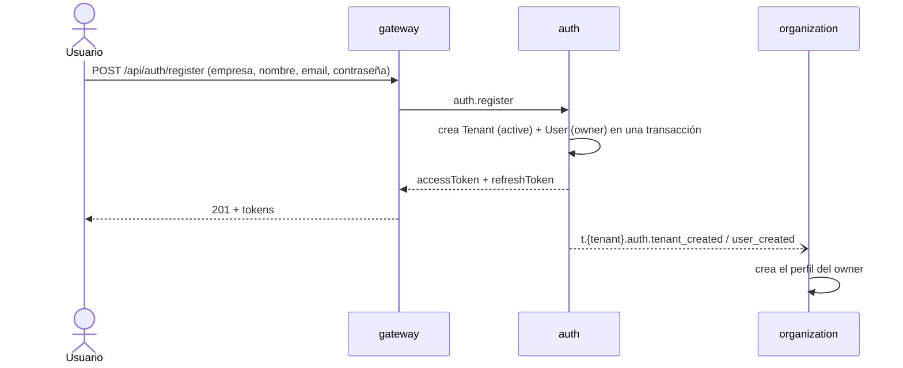
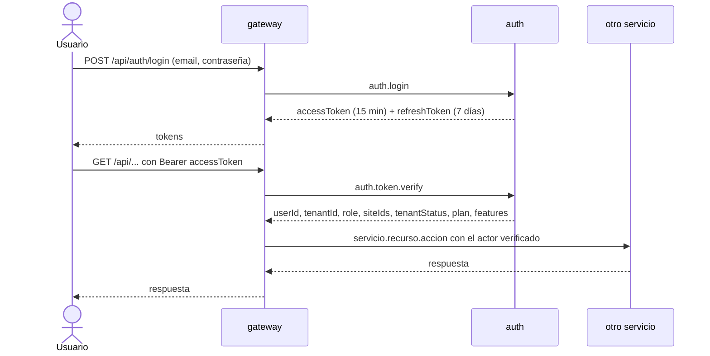
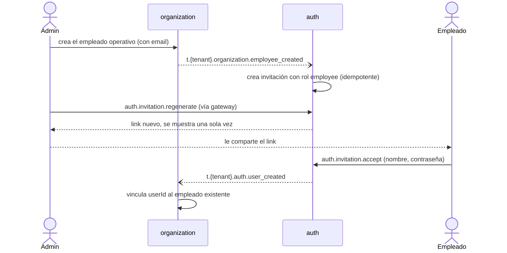
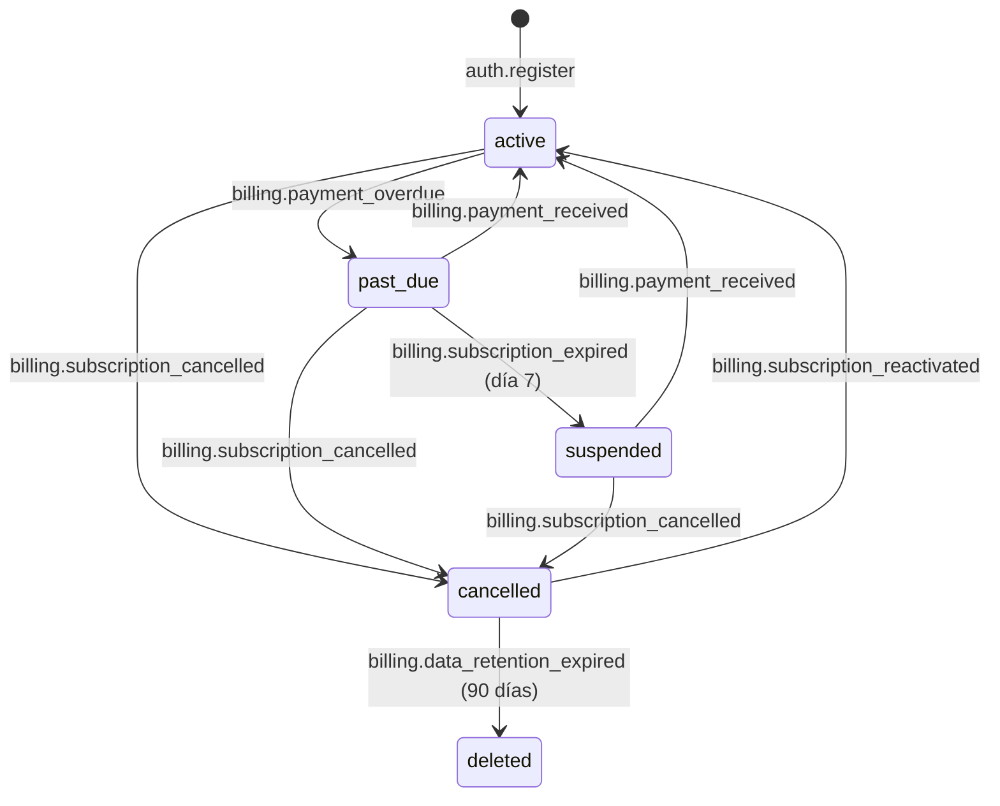

# auth — Servicio de identidad

`auth` decide **quién es quién** en TeamWorkFlow: registra organizaciones (tenants), inicia sesiones, emite y valida tokens, gestiona invitaciones y roles, y controla si un tenant puede usar la plataforma según su estado de pago. Todos los demás servicios confían en lo que `auth` responde, así que un error acá afecta a todos los tenants.

> **Estado:** el código todavía es el scaffold de Nest CLI. Este documento describe el diseño objetivo. Ver [Estado actual](#estado-actual).
>
> Documentos relacionados: [AGENTS.md](AGENTS.md) (reglas detalladas para agentes, fuente de verdad) · [README general](../../README.md) · [Modelo de datos](../../docs/database.md#auth).

## En una mirada

| Tema | Decisión |
|------|----------|
| Multitenancy | Cada tenant es una organización. Cada usuario pertenece a **un solo** tenant. |
| Login | Email + contraseña para todos los roles, empleados incluidos. |
| Roles | `owner`, `admin`, `supervisor`, `employee` (fijos, no configurables) y `platform_admin`, un rol de la plataforma que no pertenece a ningún tenant. |
| Sesión | Access token JWT de 15 min + refresh token de 7 días, rotativo y revocable. |
| Validación | El gateway le pregunta a `auth` en cada request (`auth.token.verify`). |
| Alta de usuarios | Quien se registra crea el tenant y queda como `owner`. El resto entra por invitación (link de un solo uso, 7 días). |
| Contraseña olvidada | Un admin genera un link de reseteo (1 hora). No hay emails todavía. |
| Fuerza bruta | 5 intentos fallidos bloquean la cuenta 15 min. Errores siempre genéricos. |
| Bajas | Los usuarios se desactivan, nunca se borran; la única excepción es el borrado de todos los datos de un tenant cancelado a los 90 días. |
| Suspensión | Si el tenant no paga: 7 días de gracia con avisos y después suspensión (la dispara `billing`). |
| Cancelación | Al cancelarse la suscripción a fin de mes, el tenant pasa a `cancelled` con las mismas restricciones que `suspended`. Puede volver a suscribirse; a los 90 días se borran sus datos. |
| Plan | `auth` guarda el plan y las funcionalidades del tenant (según los eventos de `billing`) y `auth.token.verify` los devuelve para que el gateway bloquee lo que el plan no incluye. |
| Comunicación | Solo por NATS. No expone HTTP: el frontend habla con el gateway. |

## Qué hace y qué no

**Hace**

- Registro de un tenant nuevo con su `owner`.
- Login, refresh y logout.
- Verificación de tokens para el gateway (HTTP y WebSocket de la Torre de Control).
- Invitaciones de admins, supervisores y empleados.
- Cambios de rol, asignación de sedes a supervisores y desactivación de usuarios.
- Links de reseteo de contraseña generados por un admin.
- Estado del tenant (`active`, `past_due`, `suspended`, `cancelled`, `deleted`) a partir de los eventos de `billing` (ver [Mora y suspensión](#mora-suspensión-y-cancelación-del-tenant)).
- Borrado de los usuarios, tokens e invitaciones de un tenant cancelado al recibir `billing.data_retention_expired`, conservando un registro mínimo del tenant.
- Plan y funcionalidades del tenant, actualizados con `billing.subscription_created` y `billing.plan_changed` (ver [Plan y funcionalidades](#plan-y-funcionalidades)).
- El usuario `platform_admin` (ver [Roles y permisos](#roles-y-permisos)).

**No hace**

| Qué | Dónde vive |
|-----|-----------|
| Perfil (nombre, teléfono, avatar) y legajo | `organization` (módulo de empleados) |
| Pagos, planes, precios y facturas | `billing` |
| Envío de emails, push o SMS | `notifications` (todavía no se usa para auth) |
| Conexiones WebSocket de la Torre de Control | `gateway` (`auth` solo verifica el token y devuelve las sedes) |
| MFA, login social / SSO, "olvidé mi contraseña" por email | Trabajo futuro |

## Roles y permisos

| Rol | Quién es | Qué puede hacer |
|-----|----------|-----------------|
| `platform_admin` | Operador de la plataforma. No pertenece a ningún tenant. | Solo las rutas de plataforma (`billing.admin.*`: planes y precios, pagos manuales, anulaciones). No administra usuarios de ningún tenant. |
| `owner` | Quien registró la organización. Uno solo por tenant. | Todo. Es el único que gestiona admins. |
| `admin` | Administración de la empresa. | Gestiona supervisores y empleados. |
| `supervisor` | Responsable de una o varias sedes. | Ve la Torre de Control de **sus** sedes, atiende alertas y corrige fichadas. |
| `employee` | Personal operativo (app móvil). | Ficha, ve sus turnos y tareas, completa formularios, acepta emergencias. |

Gestión de usuarios:

| Acción | owner | admin | supervisor | employee |
|--------|:-----:|:-----:|:----------:|:--------:|
| Invitar supervisor o empleado | ✅ | ✅ | ❌ | ❌ |
| Invitar admin | ✅ | ❌ | ❌ | ❌ |
| Ver invitaciones pendientes / regenerar su link | ✅ | ✅ ¹ | ❌ | ❌ |
| Cambiar rol entre supervisor y empleado | ✅ | ✅ | ❌ | ❌ |
| Promover o degradar un admin | ✅ | ❌ | ❌ | ❌ |
| Asignar sedes a un supervisor | ✅ | ✅ | ❌ | ❌ |
| Desactivar supervisor o empleado | ✅ | ✅ | ❌ | ❌ |
| Desactivar admin | ✅ | ❌ | ❌ | ❌ |
| Generar link de reseteo de contraseña | ✅ | ✅ ¹ | ❌ | ❌ |

¹ Solo para supervisores y empleados.

Reglas que valen siempre:

- El `platform_admin` **solo se crea por seed o CLI**: nunca por registro ni por invitación, y ningún request puede crearlo, promoverlo ni degradarlo. Inicia sesión con email y contraseña, su `tenantId` es nulo y el estado de un tenant no lo afecta.
- Nadie puede desactivar ni degradar al `owner`. Transferir la propiedad queda para más adelante.
- Nadie puede aplicarse estas acciones a sí mismo.
- Ningún usuario puede ver ni modificar usuarios de **otro tenant**, cualquiera sea su rol.

### Sedes de los supervisores

Cada supervisor tiene asignadas las sedes que puede ver (tabla `user_sites`). `owner` y `admin` ven todas las sedes del tenant. Las sedes **no** van dentro del JWT: las devuelve `auth.token.verify`, así un cambio de asignación se aplica sin volver a iniciar sesión.

## Flujos

### Registro de una organización



### Login y requests autenticados



- El gateway toma `tenantId`, `role`, `siteIds`, `plan` y `features` **solo** del resultado de `verify`, nunca del body, la query ni los headers. Si el plan no incluye la funcionalidad de una ruta, responde 403 `feature_not_in_plan`.
- Para un `platform_admin`, `tenantId`, `tenantStatus`, `plan` y `features` son nulos.
- `verify` revisa en cada llamada que el usuario siga activo y que el tenant no esté suspendido ni cancelado, así que una baja, una suspensión o una cancelación cortan el acceso en el momento.
- Cuando vence el access token, el frontend llama a `auth.token.refresh`: el refresh token usado se revoca y se emite un par nuevo.
- `auth.logout` revoca el refresh token. El access token sigue vigente hasta que vence (máximo 15 min); es un riesgo aceptado.

### Invitar a un admin o supervisor

1. El owner (o un admin, para supervisores) crea la invitación con email y rol: `auth.invitation.create`.
2. `auth` devuelve un token de un solo uso y el frontend muestra el link para copiar.
3. El invitado abre el link, carga su nombre y contraseña: `auth.invitation.accept`.
4. `auth` crea el usuario con el rol invitado y emite `t.<tenant>.auth.user_created`; `organization` crea su perfil.

### Alta de un empleado operativo



Los tokens de invitación se guardan **hasheados**, por eso la lista de invitaciones no puede mostrar el link: el admin genera uno nuevo con `auth.invitation.regenerate`, que revoca el anterior.

### Contraseña olvidada

1. Un admin (o el owner, si el afectado es admin) genera un link: `auth.password-reset.create`. Vence en 1 hora.
2. El usuario abre el link y define la nueva contraseña: `auth.password-reset.confirm`.
3. `auth` revoca todas las sesiones de ese usuario.

### Mora, suspensión y cancelación del tenant



| Estado | Qué pasa |
|--------|----------|
| `active` | Todo funciona normalmente. |
| `past_due` | Todo sigue funcionando. Owner y admins ven un banner y `billing` les manda avisos los días 1, 4 y 6. |
| `suspended` | Supervisores y empleados no pueden entrar y se revocan sus sesiones. Owner y admins entran, pero solo pueden pagar y exportar datos. Los demás servicios frenan sus procesos automáticos. Los datos se conservan. |
| `cancelled` | Mismas reglas de acceso que `suspended`: supervisores y empleados no pueden entrar (`tenant_cancelled`) y se revocan sus sesiones; owner y admins entran, pero solo pueden usar las rutas de billing (ver el plan y las facturas, y volver a suscribirse) y exportar datos. Los demás servicios frenan sus procesos automáticos. Los datos se conservan 90 días. |
| `deleted` | Pasaron 90 días sin volver a suscribirse: se borraron los usuarios, tokens e invitaciones. Solo queda un registro mínimo del tenant (id, nombre y estado) para que las facturas de `billing` sigan siendo consistentes. |

Al recibir el pago, el tenant `past_due` o `suspended` vuelve a `active`, se emite `tenant_reactivated` y los usuarios inician sesión de nuevo. Un pago recibido con el tenant `cancelled` no lo reactiva: solo lo hace `billing.subscription_reactivated`, que `billing` emite cuando el owner o un admin vuelve a suscribirse eligiendo un plan. Si el borrado de datos llega a ejecutarse, el email de los usuarios borrados queda libre para un registro nuevo.

`billing` es quien decide cuándo vence un pago y cuándo se cumplen los 7 días de gracia; `auth` solo cambia el estado al recibir sus eventos.

### Plan y funcionalidades

`auth` guarda en el tenant su `plan` (`basic` o `pro`) y sus `features` (por ejemplo `{ tasks, alerts, tower }`). Los actualiza con `billing.subscription_created` y `billing.plan_changed` (que `billing` también emite al volver a suscribirse un tenant cancelado) (de forma idempotente y sin pisar eventos más nuevos) y los devuelve en `auth.token.verify`. `auth` no decide qué incluye cada plan: lo hace `billing` y lo aplica el gateway.

## Seguridad

- **Contraseñas** con Argon2id. **Tokens** de refresh, invitación y reseteo guardados solo como hash SHA-256 y comparados en tiempo constante.
- **Errores de login genéricos** (`invalid_credentials`): no revelan si el email existe, si la cuenta está bloqueada o desactivada. La única excepción son `tenant_suspended` y `tenant_cancelled`, que se devuelven solo después de una contraseña correcta.
- **Bloqueo** de 15 minutos tras 5 intentos fallidos seguidos.
- **Nunca se loguean** contraseñas, tokens, hashes ni payloads completos de login o registro.
- **Aislamiento entre tenants**: toda consulta filtra por `tenantId` y hay tests que lo prueban.

## Contrato NATS

Los pedidos con respuesta usan `auth.<recurso>.<accion>` y no llevan tenant en el subject: el tenant sale del actor verificado. Los eventos usan `t.<tenant>.auth.<evento>` (JetStream). El detalle de payloads está en [AGENTS.md](AGENTS.md#nats-contract).

**Request-reply**

| Subject | Quién lo llama | Para qué |
|---------|----------------|----------|
| `auth.register` | público | Crear tenant + owner |
| `auth.login` | público | Iniciar sesión |
| `auth.token.refresh` | público | Rotar tokens |
| `auth.logout` | usuario | Cerrar sesión |
| `auth.token.verify` | gateway | Validar el token en cada request y conexión WebSocket; devuelve `userId`, `tenantId`, `role`, `siteIds`, `tenantStatus`, `plan` y `features` |
| `auth.invitation.create` | owner / admin | Invitar |
| `auth.invitation.list` | owner / admin | Ver invitaciones pendientes |
| `auth.invitation.regenerate` | owner / admin | Generar un link nuevo |
| `auth.invitation.accept` | público | Aceptar invitación |
| `auth.user.change-role` | owner / admin | Cambiar rol |
| `auth.user.assign-sites` | owner / admin | Asignar sedes a un supervisor |
| `auth.user.deactivate` | owner / admin | Desactivar usuario |
| `auth.user.list-recipients` | solo servicios internos (ej. `notifications`) | Obtener los usuarios activos de un tenant por rol (y sede) para enviarles avisos |
| `auth.password-reset.create` | owner / admin | Generar link de reseteo |
| `auth.password-reset.confirm` | público | Definir nueva contraseña |

**Eventos que publica:** `user_created`, `user_role_changed`, `user_deactivated`, `tenant_created`, `tenant_past_due`, `tenant_suspended`, `tenant_cancelled`, `tenant_reactivated`.

**Eventos que consume:** `organization.employee_created`, `billing.subscription_created`, `billing.plan_changed`, `billing.payment_overdue`, `billing.subscription_expired`, `billing.payment_received`, `billing.subscription_cancelled`, `billing.subscription_reactivated`, `billing.data_retention_expired`. `billing` consume a su vez `auth.tenant_created`. Todos los handlers son idempotentes: el mismo evento dos veces no genera efectos duplicados.

**Errores** (el gateway los traduce a HTTP `{ detail, code }`):

| code | HTTP | Cuándo |
|------|------|--------|
| `invalid_credentials` | 401 | Cualquier fallo de login |
| `invalid_token` | 401 | Token inválido, vencido o revocado |
| `forbidden` | 403 | El rol o el tenant no permiten la acción |
| `tenant_suspended` | 403 | Tenant suspendido |
| `tenant_cancelled` | 403 | Tenant cancelado |
| `email_taken` | 409 | El email ya tiene usuario |
| `validation_error` | 422 | Datos de entrada inválidos |

## Modelo de datos

Tablas: `tenants` (con `plan`, `features` y el estado, incluidos `cancelled` y `deleted`), `users`, `user_sites`, `refresh_tokens`, `invitations`, `password_reset_tokens`. `users.tenant_id` es nulo **solo** para el `platform_admin`; una restricción de la base lo garantiza. El diagrama y el SQL están en [docs/database.md](../../docs/database.md#auth). El servicio tiene su propio `prisma/schema.prisma` y sus tablas viven en el schema `auth` de la base compartida `teamworkflow`, con un usuario de Postgres propio (`auth_svc`) que no puede leer los schemas de otros servicios.

## Configuración

| Variable | Descripción |
|----------|-------------|
| `NATS_SERVER` | URLs de NATS separadas por coma |
| `DATABASE_URL` | Conexión a PostgreSQL |
| `JWT_SECRET` | Secreto para firmar access tokens (mínimo 32 bytes aleatorios) |
| `ACCESS_TOKEN_TTL` | Por defecto `15m` |
| `REFRESH_TOKEN_TTL` | Por defecto `7d` |

El archivo `.env` nunca se commitea; las variables se documentan en `.env.example` (todavía no existe).

## Desarrollo

```bash
# Todo el backend con Docker (NATS + auth + gateway)
cd backend
docker compose up --build

# Solo este servicio
cd backend/auth
pnpm install
pnpm start:dev

# Calidad
pnpm lint
pnpm test
pnpm build
```

## Estado actual

Hoy el código es el scaffold generado por Nest CLI. Falta, entre otras cosas:

- [ ] Convertir `src/main.ts` en microservicio NATS (`NestFactory.createMicroservice`).
- [ ] Reemplazar los patterns de ejemplo (`createAuth`, `findAllAuth`, ...) por los del contrato y alinear el gateway, que hoy envía `{ cmd: 'login' }`.
- [ ] Agregar `src/config/envs.ts` y `.env.example`.
- [ ] Instalar y configurar Prisma, Argon2, `@nestjs/jwt` y `class-validator`.
- [ ] Crear los tests unitarios y la carpeta `test/` para e2e.
