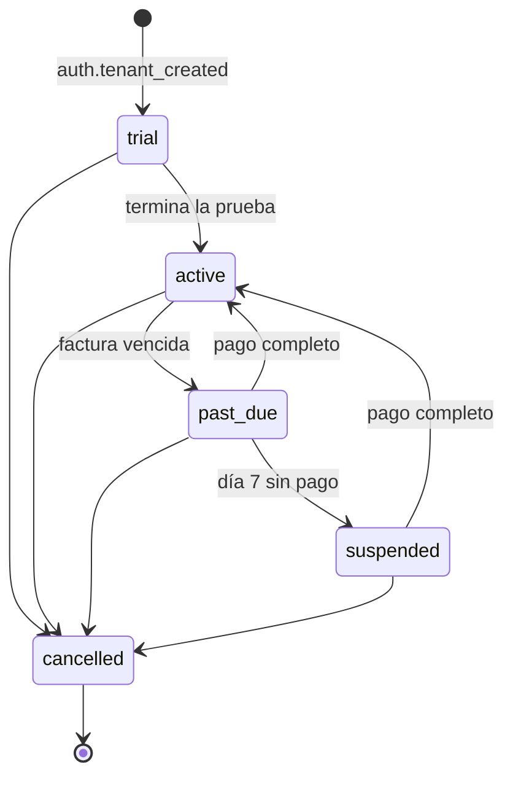
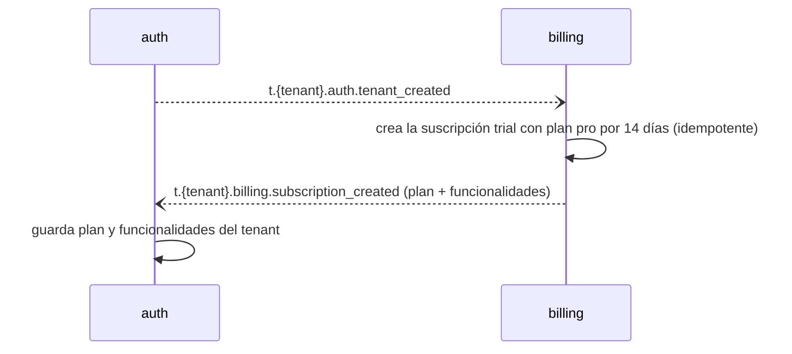
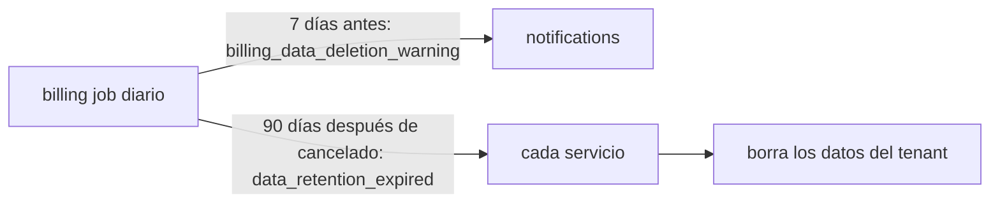
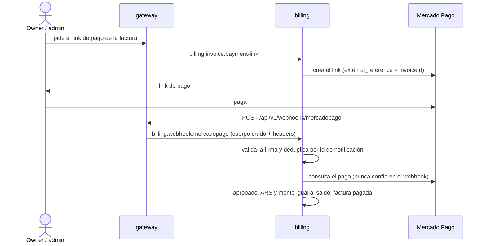
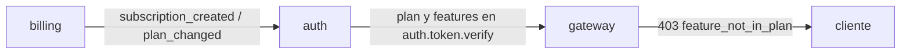

# billing — Planes, facturación y cobro

`billing` **cobra la plataforma**: sabe qué plan tiene cada organización, emite una factura mensual, registra los pagos (Mercado Pago o transferencia) y avisa cuando un tenant no paga para que `auth` restrinja el acceso, o cuando paga para que lo reactive.

> **Estado:** todavía no existe la aplicación Nest; la carpeta solo contiene documentación. Este documento describe el diseño objetivo. Ver [Estado actual](#estado-actual).
>
> Documentos relacionados: [AGENTS.md](AGENTS.md) (reglas detalladas para agentes, fuente de verdad) · [README general](../../README.md) · [auth](../auth/README.md) · [notifications](../notifications/README.md).

## En una mirada

| Tema | Decisión |
|------|----------|
| Forma | Una app NestJS 12 con módulos internos de planes, suscripciones, facturación, pagos y cobranzas. |
| Planes | `basic` y `pro`, con **precio mensual fijo en ARS** por plan. No hay precio por empleado ni medición de uso. Enterprise es trabajo futuro. |
| Funcionalidades | `basic`: sedes, empleados, turnos y asistencia. `pro`: lo anterior más tareas y formularios, alertas y Torre de Control. |
| Prueba | Cada tenant nuevo arranca con 14 días de prueba del plan `pro`. Esos días no se facturan. |
| Facturación | Mensual, **vencida**: el día 1 se factura el mes anterior con el plan más alto que estuvo activo. IVA 21 % en una línea aparte. Vence a los 10 días. |
| Prorrateo | Solo el primer mes facturado (después de la prueba) y el mes en que un tenant cancelado vuelve a suscribirse (desde el día de la re-suscripción). La cancelación siempre rige a fin de mes: no hay prorrateo a mitad de mes. |
| Dinero | Nunca con `float`: `Decimal` / `numeric(12,2)`, redondeo half-up por línea. |
| Facturas | Inmutables. Se corrigen anulando (con motivo) y emitiendo otra. |
| Cobro | Mercado Pago (link de pago por factura) y pago manual por transferencia. Detrás de una interfaz `PaymentProvider` con un proveedor `fake` para local y tests. |
| Mora | El vencimiento es el último día para pagar. Pasa a `past_due` el día siguiente (día 1 de mora); avisos los días 1, 4 y 6; el día 7 se suspende. Un pago completo reactiva. |
| Cancelación | Rige siempre a fin de mes y puede deshacerse antes. El tenant cancelado puede volver a suscribirse eligiendo un plan (sin nueva prueba). A los 90 días de cancelado se borran sus datos en todos los servicios, salvo facturas y pagos. |
| Control de funcionalidades | `auth` guarda el plan y las funcionalidades del tenant y el gateway bloquea lo que el plan no incluye. `billing` no expone nada para consultar. |
| Factura fiscal | Fuera del MVP (ARCA). Un admin de la plataforma puede guardar el número del comprobante externo. |
| Datos | PostgreSQL con Prisma 7 y su propio `schema.prisma`. |

## Qué hace y qué no

**Hace**

- Catálogo de planes con precio y funcionalidades.
- Una suscripción por tenant y su máquina de estados.
- Cierre mensual y emisión de facturas.
- Links de pago de Mercado Pago, webhook, conciliación diaria y pagos manuales.
- Cobranzas: avisos, mora, suspensión y reactivación.
- Retención de datos: avisa 7 días antes y a los 90 días de la cancelación emite el evento que dispara el borrado de los datos del tenant.

**No hace**

| Qué | Dónde vive |
|-----|-----------|
| Tenants, usuarios y el estado de acceso del tenant | `auth` |
| Borrado de los datos de un tenant cancelado | Cada servicio borra los suyos al recibir `data_retention_expired` (`billing` solo decide cuándo) |
| Entrega de notificaciones (push y en la app) | `notifications` |
| Envío de emails o SMS | No existen en la plataforma por ahora |
| Factura electrónica fiscal (ARCA) | Fuera del MVP |
| Débito automático, plan anual, cupones, otras monedas, Enterprise | Trabajo futuro |
| Datos de tarjetas | Nunca: el pago ocurre en Mercado Pago |

## Roles y permisos

| Acción | platform_admin | owner / admin | supervisor / employee |
|--------|:--------------:|:-------------:|:---------------------:|
| Gestionar planes, precios y funcionalidades | ✅ | ❌ | ❌ |
| Registrar pagos manuales, anular facturas, cargar comprobante fiscal, extender la prueba | ✅ cualquier tenant | ❌ | ❌ |
| Ver plan, estado y facturas | ✅ cualquier tenant | ✅ su tenant | ❌ |
| Obtener el link de pago | ❌ | ✅ | ❌ |
| Cambiar de plan, cancelar, deshacer una cancelación pendiente o volver a suscribirse | ❌ | ✅ | ❌ |

`platform_admin` es un rol de la plataforma que **no pertenece a ningún tenant**: lo crea `auth` por seed o CLI y solo puede usar las rutas `billing.admin.*`. El gateway toma el actor siempre de `auth.token.verify`, nunca de headers ni del body.

## Flujos

### Estados de la suscripción



Las transiciones se validan en un módulo de dominio puro; una transición no permitida es un error, nunca se fuerza. `cancelled` es final para esa suscripción: volver a suscribirse crea una suscripción nueva.

### Alta de un tenant



### Cambio de plan y cancelación

- **Subir a `pro`:** aplica de inmediato y ese mes se factura `pro`.
- **Bajar a `basic`:** aplica desde el próximo período.
- **Cancelar:** la cancelación **siempre rige a fin de mes** (sin prorrateo ni fin anticipado a mitad de mes, tampoco por un admin de la plataforma). El tenant sigue como estaba hasta entonces, se emite la última factura (mes completo) y recién entonces la suscripción pasa a `cancelled` y se emite `subscription_cancelled`. Los datos se conservan 90 días.
- **Deshacer la cancelación:** antes de que el cierre mensual la haga efectiva, el `owner` o un `admin` puede deshacerla (`billing.subscription.cancel-undo`).
- **Volver a suscribirse:** un tenant `cancelled` puede reactivarse eligiendo un plan (`billing.subscription.resubscribe`), sin nueva prueba y **sin esperar un pago**. `billing` crea una suscripción nueva en `active`, emite `plan_changed` y `subscription_reactivated`, y `auth` deja el tenant en `active`. La primera factura se prorratea desde el día de la re-suscripción.
- Cada cambio de plan emite `plan_changed` con el plan y sus funcionalidades.

### Cierre mensual

El día 1 (03:00, zona `America/Argentina/Buenos_Aires`) el job cierra el mes anterior:

1. **Días facturables:** los días del mes posteriores a la prueba y anteriores a la cancelación (en una re-suscripción, desde el día en que se volvió a suscribir). Si son cero, no hay factura.
2. **Plan:** el más alto que estuvo activo en el mes. El precio es el vigente al emitir y se copia a la factura.
3. **Línea del plan:** `precio × días facturables ÷ días del mes`, redondeada half-up.
4. **Línea de IVA:** 21 % sobre la línea del plan, redondeada half-up.
5. **Total:** la suma de las líneas. Vence a los 10 días.

Ejemplo con números ficticios: plan de ARS 100000,00 y 18 días facturables de 30: línea del plan 60000,00 + IVA 12600,00 = **72600,00**. Un mes completo: 100000,00 + 21000,00 = 121000,00.

El cierre es idempotente: no puede haber dos facturas no anuladas del mismo tenant y período. Después de anular una factura, un admin de la plataforma puede emitir otra para ese período. Recién después del cierre se aplican las bajas de plan y las cancelaciones programadas.

### Mora y suspensión

El vencimiento es el último día para pagar. Un job diario (09:00) aplica:

| Momento | Qué pasa |
|---------|----------|
| Factura emitida | Aviso al `owner` y a los `admin` |
| 3 días antes del vencimiento | Aviso de recordatorio |
| Día 1 de mora | Suscripción `past_due`, evento `payment_overdue` y aviso |
| Días 4 y 6 | Avisos |
| Día 7 | Suscripción `suspended`, evento `subscription_expired` y aviso |
| Pago completo | Vuelve a `active` y se emite `payment_received` |

`payment_received` se emite **solo** cuando la factura queda totalmente paga y no queda ninguna otra factura vencida. No reactiva a un tenant `cancelled`: eso solo ocurre al volver a suscribirse. Las suscripciones `cancelled` no pasan por mora ni suspensión.

`auth` reacciona a esos eventos y cambia el estado del tenant (ver [auth](../auth/README.md#mora-y-suspensión-del-tenant)). `billing` no envía emails: pide los avisos a `notifications` con `t.{tenant}.notifications.send`, y los destinatarios se obtienen de `auth` (`auth.user.list-recipients`).

### Retención y borrado de datos



Un job diario (09:00) revisa los tenants `cancelled`: 7 días antes del borrado avisa al `owner` y a los `admin` con la plantilla `billing_data_deletion_warning`, y a los 90 días emite `t.{tenant}.billing.data_retention_expired` una sola vez (solo si el tenant sigue cancelado; si volvió a suscribirse, no se emite). `auth`, `organization`, `attendance`, `tasks` (incluidas las fotos), `notifications` y la propia `billing` borran de forma permanente y idempotente los datos del tenant. `billing` **conserva las facturas y los pagos** por motivos legales y contables. `auth` deja solo un registro mínimo del tenant (id, nombre y estado `deleted`).

### Pago con Mercado Pago



- La ruta pública del webhook no exige JWT y tiene límite de peticiones.
- Si el pago no coincide (monto distinto, otra moneda, no aprobado), queda registrado para **revisión manual** y la factura no se marca como pagada.
- Un job diario de conciliación busca los pagos de las facturas impagas por si se perdió algún webhook.
- Si el link venció, `billing.invoice.payment-link` genera uno nuevo.

### Pago manual (transferencia)

Un `platform_admin` registra el pago con `billing.admin.payment.register` (factura, monto, fecha y referencia bancaria), con las mismas reglas que un pago de Mercado Pago.

### Control de funcionalidades por plan



Los demás servicios nunca le preguntan a `billing` si una funcionalidad está habilitada: el gateway aplica la restricción con lo que devuelve `auth.token.verify`. Además, `attendance`, `tasks` y `notifications` guardan una copia local de las funcionalidades del tenant (alimentada con `subscription_created` y `plan_changed`) para no hacer trabajo `pro` automático en tenants `basic`.

## Seguridad

- **Nunca** se manejan datos de tarjetas.
- No se confía en el monto ni en el estado del webhook: siempre se consulta el pago a la API de Mercado Pago, y la firma se valida antes de procesar.
- **Nunca se loguean** tokens, firmas ni cuerpos completos de webhooks.
- Toda consulta filtra por `tenantId` y hay tests que prueban el aislamiento. Solo `platform_admin` puede indicar un tenant objetivo en el payload.
- Ningún cálculo de dinero usa `float`.

## Contrato NATS

Los pedidos con respuesta usan `billing.<recurso>.<accion>` y no llevan tenant en el subject: el tenant sale del actor verificado. Los eventos usan `t.<tenant>.billing.<evento>` (JetStream). El detalle de payloads está en [AGENTS.md](AGENTS.md#nats-contract).

**Request-reply**

| Subject | Quién lo llama | Para qué |
|---------|----------------|----------|
| `billing.plan.list` | owner / admin | Ver los planes y sus precios |
| `billing.subscription.get` | owner / admin | Plan, estado, fin de la prueba y cambios programados |
| `billing.subscription.change-plan` | owner / admin | Subir o bajar de plan |
| `billing.subscription.cancel` | owner / admin | Cancelar al fin del mes |
| `billing.subscription.cancel-undo` | owner / admin | Deshacer una cancelación pendiente |
| `billing.subscription.resubscribe` | owner / admin | Volver a suscribirse eligiendo un plan (también con el tenant cancelado) |
| `billing.invoice.list` / `get` | owner / admin | Facturas con sus líneas y pagos |
| `billing.invoice.payment-link` | owner / admin | Link de pago (se regenera si venció) |
| `billing.webhook.mercadopago` | solo el gateway | Procesar el webhook |
| `billing.admin.plan.update` | platform_admin | Precio y funcionalidades de un plan (desde la próxima factura) |
| `billing.admin.subscription.list` / `extend-trial` | platform_admin | Ver suscripciones y extender la prueba |
| `billing.admin.invoice.list` / `void` / `issue` / `set-fiscal-receipt` | platform_admin | Consultar, anular, reemitir y cargar el comprobante fiscal |
| `billing.admin.payment.register` | platform_admin | Registrar un pago manual |

**Eventos que publica:** `subscription_created`, `plan_changed`, `invoice_issued`, `payment_overdue`, `subscription_expired`, `payment_received`, `subscription_cancelled`, `subscription_reactivated`, `data_retention_expired`. También publica `t.{tenant}.notifications.send` para los avisos (`billing_invoice_issued`, `billing_due_soon`, `billing_overdue_notice`, `billing_suspended` y `billing_data_deletion_warning`).

**Eventos que consume:** `auth.tenant_created` y su propio `data_retention_expired` (para borrar sus datos, salvo facturas y pagos). Los handlers son idempotentes.

**Errores** (el gateway los traduce a HTTP `{ detail, code }`)

| code | HTTP | Cuándo |
|------|------|--------|
| `forbidden` | 403 | El rol no permite la acción |
| `subscription_not_found` / `invoice_not_found` / `plan_not_found` | 404 | No existe o es de otro tenant |
| `invalid_subscription_transition` | 409 | La máquina de estados no lo permite |
| `invalid_plan_change` | 409 | Mismo plan o cambio ya pendiente |
| `no_pending_cancellation` | 409 | Se intentó deshacer una cancelación que no está pendiente |
| `invoice_not_payable` | 409 | La factura ya está paga o anulada |
| `invoice_exists` | 409 | Ya hay una factura no anulada para ese período |
| `invalid_webhook_signature` | 401 | Firma de webhook inválida |
| `payment_provider_error` | 502 | Mercado Pago no respondió o rechazó el pedido |
| `validation_error` | 422 | Datos de entrada inválidos |

## Modelo de datos

Modelos de Prisma: `Plan`, `Subscription`, `SubscriptionPlanChange`, `Invoice`, `InvoiceLine`, `Payment`, `WebhookNotification` y `ProcessedEvent`. Todos (salvo `Plan`) llevan `tenantId` y toda consulta lo filtra. El servicio tiene su propio `prisma/schema.prisma`; si comparte base con otros servicios se decide más adelante.

## Configuración

| Variable | Descripción |
|----------|-------------|
| `NATS_SERVER` | URLs de NATS separadas por coma |
| `DATABASE_URL` | Conexión a PostgreSQL |
| `PAYMENT_PROVIDER` | `mercadopago` o `fake` |
| `MP_ACCESS_TOKEN` | Access token de Mercado Pago |
| `MP_WEBHOOK_SECRET` | Clave para validar la firma de los webhooks |
| `BILLING_TZ` | Zona horaria de facturación (por defecto `America/Argentina/Buenos_Aires`) |
| `VAT_PERCENT` | IVA. Por defecto `21` |
| `TRIAL_DAYS` | Días de prueba. Por defecto `14` |
| `DUE_DAYS` | Días entre la emisión y el vencimiento. Por defecto `10` |
| `GRACE_DAYS` | Días de mora antes de suspender. Por defecto `7` |
| `DATA_RETENTION_DAYS` | Días entre la cancelación y el borrado de los datos del tenant. Por defecto `90` |
| `APP_URL` | URL base de la aplicación web, para los retornos de pago |

El archivo `.env` nunca se commitea; las variables se documentan en `.env.example` (todavía no existe).

## Desarrollo

Todavía no hay aplicación que ejecutar. Cuando exista:

```bash
cd backend/billing
pnpm install
pnpm start:dev

# Calidad
pnpm lint
pnpm test
pnpm build
```

En local, `PAYMENT_PROVIDER=fake` permite generar links y simular pagos y webhooks sin llamar a Mercado Pago.

## Estado actual

La carpeta contiene solo documentación (`AGENTS.md` y este `README.md`). Falta, entre otras cosas:

- [ ] Crear la app Nest como microservicio NATS (`NestFactory.createMicroservice`).
- [ ] Agregar `src/config/envs.ts` y `.env.example`.
- [ ] Instalar y configurar Prisma, `class-validator` y el scheduler de los jobs.
- [ ] Implementar el módulo de dominio puro (cálculo de dinero y máquina de estados) con sus tests.
- [ ] Implementar planes, suscripciones, facturación, pagos (proveedor `fake` y Mercado Pago) y cobranzas.
- [ ] Sumar el servicio a `backend/docker-compose.yml`, las rutas del gateway (incluido el webhook público) y el control de funcionalidades por plan.
- [ ] Crear los tests unitarios y la carpeta `test/` para e2e.
