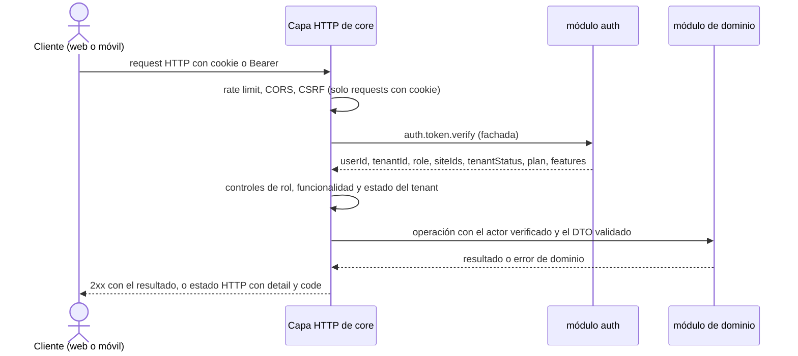

# core — Monolito modular y API HTTP pública

`core` es el servicio principal del backend de TeamWorkFlow. Es un **monolito modular** de NestJS con los módulos `auth`, `organization`, `tasks`, `notifications` y `billing`, y es también la API HTTP pública (el rol que antes tenía el `gateway`). La aplicación web y la aplicación móvil le hablan por HTTP; NATS nunca se expone a internet.

> **Estado:** `backend/core` contiene el módulo `auth` y la capa HTTP básica (tareas T6 y T7 de [`odd/tasks/two-service-architecture.md`](../../odd/tasks/two-service-architecture.md); las apps `backend/gateway` y `backend/auth` se fusionaron en él y se eliminaron). El resto de este documento describe el diseño objetivo.
>
> Documentos relacionados: [AGENTS.md](AGENTS.md) (reglas detalladas para agentes, fuente de verdad) · [Decisión de arquitectura](../../docs/architecture.md) · [README general](../../README.md) · [telemetry](../telemetry/README.md) · [Modelo de datos](../../docs/database.md).

## En una mirada

| Tema | Decisión |
|------|----------|
| Forma | Un servicio NestJS 12 con un `Module` por dominio en `src/<módulo>/`. |
| Servicios del backend | Dos: `core` y [`telemetry`](../telemetry/README.md) (todo el dominio `attendance`). Ambos se publican bajo el mismo origen con un proxy inverso por path: `/api/...` a `core`, `/api/v1/telemetry/...` y `/ws` a `telemetry`. |
| Fronteras entre módulos | Cada módulo exporta solo un servicio público (fachada). Nunca se importa el cliente de Prisma ni las clases internas de otro módulo. |
| Reacciones entre dominios | Por eventos, no por llamadas directas. Las llamadas a una fachada se reservan para lecturas que un request necesita. |
| Bus de eventos | NATS JetStream es el único bus de eventos de dominio, dentro de `core` y entre `core` y `telemetry`. |
| Datos | Una base PostgreSQL `teamworkflow`; cada módulo tiene su propio schema, rol, cliente de Prisma y migraciones. Sin claves foráneas entre schemas. |
| API | Una sola API REST bajo `/api/v1/...` para web y móvil, sin BFF en el MVP. |
| Autenticación | `auth.token.verify` en cada request autenticado. Responde además por NATS a `telemetry`. |
| Actor | `userId`, `tenantId`, `role`, `siteIds`, `tenantStatus`, `plan`, `features`, tomados solo del resultado de verify. |
| Tokens web / móvil | Web: cookies `httpOnly`, `Secure`, `SameSite` con protección CSRF. Móvil: `Authorization: Bearer`, y el refresh token va en el body. |
| Errores | Los errores de dominio se traducen a HTTP `{ detail, code }`. |
| Peticiones NATS que responde | Solo las que necesita `telemetry`: `auth.token.verify`, `organization.employee.get`, `organization.site.get`, `organization.shift.get`. |

## Módulos

| Módulo | Qué resuelve | Guía |
|--------|--------------|------|
| `auth` | Identidad: registro de organizaciones (tenants), login, tokens, invitaciones, roles (`owner`, `admin`, `supervisor`, `employee` y `platform_admin`), estado del tenant (`active`, `past_due`, `suspended`, `cancelled`, `deleted`), plan y funcionalidades. Sesión: access token JWT de 15 min y refresh token de 7 días, rotativo y revocable. Cuentas bloqueadas 15 min tras 5 intentos fallidos. | [AGENTS.md](src/auth/AGENTS.md) · [STEPS.md](src/auth/STEPS.md) |
| `organization` | Dónde y cuándo trabaja cada persona: sedes (geocerca, QR rotable, puestos), perfil de empleados y turnos (plantillas semanales, generador de 14 días, advertencias de validación, bloqueo optimista). | [AGENTS.md](src/organization/AGENTS.md) |
| `tasks` | Qué debe hacer y comprobar cada empleado: formularios versionados (publicar congela una versión), tareas únicas o por turno, revisión del supervisor y fotos en almacenamiento compatible con S3 mediante URL prefirmada. Es una funcionalidad del plan `pro`. | [AGENTS.md](src/tasks/AGENTS.md) |
| `notifications` | Notificaciones push (FCM) y dentro de la aplicación. Solo decide a quién le llega qué, lo guarda, lo envía y registra el resultado (hasta 3 intentos). Sin email, SMS ni WhatsApp. | [AGENTS.md](src/notifications/AGENTS.md) |
| `billing` | Planes `basic` y `pro` con precio mensual fijo en ARS, suscripciones con 14 días de prueba, facturación mensual vencida, cobro por Mercado Pago o transferencia (detrás de `PaymentProvider`), mora, suspensión, cancelación y retención de datos de 90 días. | [AGENTS.md](src/billing/AGENTS.md) |

Los documentos de cada módulo llaman `attendance` al dominio de asistencia, que vive en [`telemetry`](../telemetry/README.md).

## Qué hace y qué no

**Hace**

- Expone la API HTTP pública de todos sus módulos.
- Verifica el access token y arma el actor; aplica controles gruesos de rol, funcionalidad del plan, estado del tenant, rate limit, CSRF y CORS.
- Emite y borra las cookies de sesión de la web.
- Recibe el webhook de Mercado Pago y se lo entrega sin tocar a `billing`.
- Publica y consume eventos de dominio en JetStream y responde las peticiones NATS de `telemetry`.

**No hace**

| Qué | Dónde vive |
|-----|-----------|
| Fichadas, jornadas, alertas y Torre de Control (HTTP y WebSocket) | [`telemetry`](../telemetry/README.md) |
| APIs separadas para web y móvil | No en el MVP; solo si una API compartida deja de alcanzar |
| Leer las tablas de otro módulo | Se usa la fachada del módulo dueño o sus eventos |

## Ciclo de un request



`core` nunca toma `tenantId`, `role`, `siteIds`, `plan` ni `features` del body, la query ni los headers. Las rutas públicas no pasan por verify: registro, login, refresh, aceptar invitación, confirmar reseteo de contraseña y el webhook de Mercado Pago.

## Eventos

NATS JetStream: subjects `t.<tenant>.<módulo>.<evento>`, un stream `<MÓDULO>_EVENTS` por módulo, consumidores durables con ack explícito y deduplicación con `ProcessedEvent` en la misma transacción que el handler.

- Entre módulos de `core`: por ejemplo `billing.plan_changed` hace que `auth` actualice el plan del tenant; `auth.tenant_*` pausa los jobs de `organization`, `tasks` y `notifications`; `billing.data_retention_expired` hace que cada módulo borre sus datos del tenant.
- De `core` hacia `telemetry`: eventos de `organization`, `auth` y `billing`.
- De `telemetry` hacia `core`: `alert_opened` (lo consume `notifications`) y `clock_event_recorded`, `clock_event_corrected` y `workday_closed` (reportes futuros).

## Rutas

Las rutas propuestas bajo `/api/v1` y sus roles están en [AGENTS.md](AGENTS.md#route-map). Resumen:

| Módulo | Qué expone | Acceso |
|--------|------------|--------|
| `auth` | Registro, login, refresh, logout, invitaciones, cambio de rol, asignación de sedes, desactivación y reseteo de contraseña | Público para registro, login, refresh, aceptar invitación y confirmar reseteo; owner y admin para la gestión |
| `organization` | Sedes, puestos, empleados, plantillas de turnos y turnos | Owner y admin gestionan; los supervisores gestionan turnos |
| `tasks` | Formularios, plantillas de tareas, tareas y fotos | Todas las rutas requieren la funcionalidad `tasks` |
| `notifications` | Tokens push y notificaciones en la app | Cualquier usuario autenticado |
| `billing` | Planes, suscripción, facturas y links de pago | Owner y admin |
| `billing` (plataforma) | Planes y precios, pruebas, facturas y pagos manuales | Solo `platform_admin` |
| `billing` (webhook) | `POST /webhooks/mercadopago` | Público, con rate limit, body crudo |

## Estado del tenant y plan

| Estado del tenant | Comportamiento |
|-------------------|----------------|
| `active` | Acceso normal |
| `past_due` | Acceso normal; el frontend muestra un banner |
| `suspended` | `auth` rechaza a supervisores y empleados. Owner y admin solo llegan a las rutas de suscripción y facturas; el resto responde 403 `tenant_suspended` |
| `cancelled` | Igual que `suspended`, más la lista de planes y volver a suscribirse; el resto responde 403 `tenant_cancelled` |

Si el plan no incluye la funcionalidad de una ruta (`tasks`), la respuesta es 403 `feature_not_in_plan`.

## Errores

`core` responde `{ detail, code }`. Los códigos de los módulos se transmiten tal cual y la capa HTTP agrega los suyos.

| code | HTTP | Origen |
|------|------|--------|
| `invalid_credentials`, `invalid_token` | 401 | `auth` |
| `forbidden` | 403 | Módulos y controles de rol |
| `tenant_suspended`, `tenant_cancelled` | 403 | `auth` y capa HTTP |
| `feature_not_in_plan`, `csrf_invalid` | 403 | Capa HTTP |
| `email_taken` | 409 | `auth` |
| `validation_error` | 422 | Validación de DTOs |
| `rate_limited` | 429 | Capa HTTP |

## Configuración

| Variable | Descripción |
|----------|-------------|
| `PORT` | Puerto HTTP |
| `NATS_SERVER` | URLs de NATS separadas por coma |
| `WEB_ORIGIN` | Origen web permitido (CORS, credenciales habilitadas) |
| `COOKIE_SECURE` | Flag `Secure` de las cookies; si falta, se deriva de `NODE_ENV` |
| `RATE_LIMIT_PUBLIC_TTL_MS`, `RATE_LIMIT_PUBLIC_LIMIT` | Rutas públicas por IP. Valores iniciales: `60000`, `30` |
| `RATE_LIMIT_AUTH_TTL_MS`, `RATE_LIMIT_AUTH_LIMIT` | Rutas autenticadas por usuario. Valores iniciales: `60000`, `300` |

Cada módulo suma sus propias variables (conexión a su schema, claves de FCM, Mercado Pago, almacenamiento S3, etc.), listadas en su `AGENTS.md`. Los nombres finales se definen con `backend/.env.example`. El archivo `.env` nunca se commitea.

## Desarrollo

Requisitos: `backend/.env` con `JWT_SECRET` (mínimo 32 caracteres) y las contraseñas `*_DB_PASSWORD` (ver `backend/.env.example`); compose falla si falta alguna.

```bash
# Todo el backend con Docker (NATS + PostgreSQL + core)
cd backend
docker compose up --build
# Las migraciones no se ejecutan al arrancar: la primera vez y tras cambiar el schema
docker compose exec core pnpm prisma:auth:migrate:deploy

# Solo este servicio
cd backend/core
pnpm install
pnpm start:dev

# Calidad
pnpm lint
pnpm test
pnpm test:e2e
pnpm build
```

## Estado actual

- [x] Módulo `auth` implementado en `backend/core/src/auth` (ver [STEPS.md](src/auth/STEPS.md)).
- [x] Esqueleto de la capa HTTP (prefijo `api`, validación de variables, guard, filtros de errores).
- [x] `backend/core` creado a partir de `backend/gateway` y `backend/auth` (T6): los controladores de `auth` pasaron de `@MessagePattern` a HTTP; las apps legacy se eliminaron en T7.
- [ ] Capa HTTP: versionado `/api/v1`, CORS, `ValidationPipe`, guard, actor, roles, plan, estado del tenant, cookies, CSRF, filtro de errores y rate limit.
- [ ] Módulos `organization`, `tasks`, `notifications` y `billing`.
- [ ] Responder por NATS las peticiones de `telemetry`.
