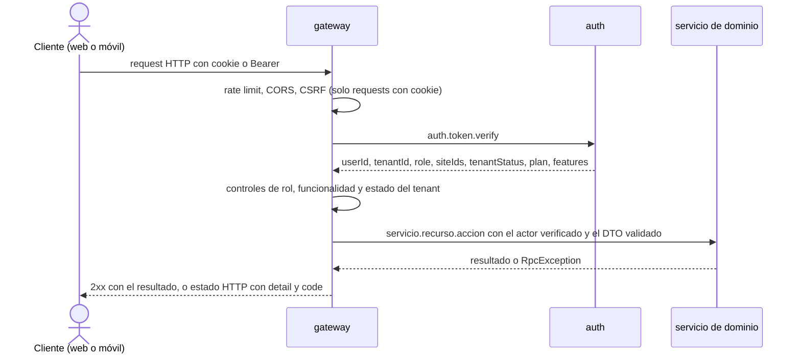
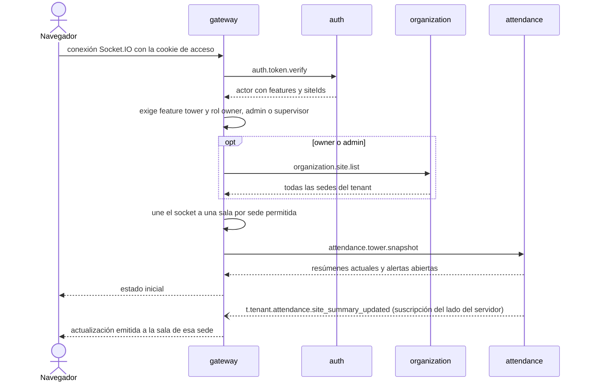

# gateway — Punto de entrada HTTP y WebSocket

`gateway` es la única puerta de entrada a TeamWorkFlow. La aplicación web y la aplicación móvil le hablan por HTTP (y por Socket.IO para la Torre de Control); el gateway verifica quién llama, aplica controles gruesos y traduce cada request a un mensaje NATS para el servicio que corresponda. NATS nunca se expone a internet.

> **Estado:** hoy existen solo el esqueleto de NestJS, el cliente NATS y la validación de variables de entorno. Este documento describe el diseño objetivo. Ver [Estado actual](#estado-actual).
>
> Documentos relacionados: [AGENTS.md](AGENTS.md) (reglas detalladas para agentes, fuente de verdad) · [README general](../../README.md#1-gateway) · [auth](../auth/README.md).

## En una mirada

| Tema | Decisión |
|------|----------|
| Rol | Único punto de entrada HTTP y WebSocket. Sin base de datos, sin NATS KV y sin lógica de negocio. |
| API | Una sola API REST bajo `/api/v1/...` para web y móvil (versionado por URI de Nest). Sin BFF en el MVP. |
| Transporte hacia los servicios | NATS request-reply (`servicio.recurso.accion`) con `ClientProxy`, siempre con timeout. |
| Autenticación | `auth.token.verify` en cada request autenticado y en cada conexión WebSocket. |
| Actor | `userId`, `tenantId`, `role`, `siteIds`, `tenantStatus`, `plan`, `features`, tomados solo del resultado de verify. |
| Tokens web | Cookies `httpOnly`, `Secure`, `SameSite` que emite el gateway, con protección CSRF. |
| Tokens móvil | Header `Authorization: Bearer`; el refresh token va en el body de `/auth/refresh` y la app lo guarda en almacenamiento seguro. |
| Plan | Cada ruta declara su funcionalidad (`tasks`, `alerts`, `tower`); si el plan no la incluye, responde 403 `feature_not_in_plan`. |
| Estado del tenant | `suspended` o `cancelled`: solo owner y admin, solo rutas de billing y exportación de datos. |
| Rate limiting | `@nestjs/throttler` en memoria: rutas públicas por IP, rutas autenticadas por usuario. |
| Errores | Las `RpcException` se traducen a HTTP `{ detail, code }`. |

## Qué hace y qué no

**Hace**

- Verifica el access token y arma el actor.
- Aplica controles gruesos: rol, funcionalidad del plan, estado del tenant, rate limit, CSRF y CORS.
- Traduce requests HTTP a pedidos NATS con timeout y devuelve los errores traducidos.
- Emite y borra las cookies de sesión de la web.
- Atiende el WebSocket de la Torre de Control y reenvía los resúmenes de sede a las salas correctas.
- Recibe el webhook de Mercado Pago y lo reenvía sin tocar a `billing`.

**No hace**

| Qué | Dónde vive |
|-----|-----------|
| Reglas de negocio y controles finos de rol o sede | Cada servicio de dominio, que recibe el actor |
| Usuarios, tokens, invitaciones y estado del tenant | `auth` |
| Planes, facturas, pagos y validación del webhook | `billing` |
| Almacenamiento de datos de cualquier tipo | No existe en el gateway (sin base de datos, sin NATS KV) |
| APIs separadas para web y móvil | No en el MVP; solo si una API compartida deja de alcanzar |

## Ciclo de un request



El gateway nunca toma `tenantId`, `role`, `siteIds`, `plan` ni `features` del body, la query ni los headers. Las rutas públicas no pasan por verify: registro, login, refresh, aceptar invitación, confirmar reseteo de contraseña y el webhook de Mercado Pago.

## Tokens: web y móvil

| | Web | Móvil |
|---|---|---|
| Access token | Cookie `httpOnly`, `Secure`, `SameSite` | Header `Authorization: Bearer` |
| Refresh token | Cookie `httpOnly`, `Secure`, `SameSite` | En el body de `/auth/refresh`; la app lo guarda en almacenamiento seguro |
| Par de tokens en el body de la respuesta | No | Sí |
| CSRF | Obligatorio en `POST`, `PUT`, `PATCH` y `DELETE` (token double-submit en `X-CSRF-Token`) | No hace falta |
| CORS | Solo `WEB_ORIGIN`, con credenciales | No aplica |
| Logout | El gateway borra las cookies y llama a `auth.logout` | La app descarta sus tokens y llama a `auth.logout` |

Cómo distingue el gateway entre ambos (regla inicial): un request con la cookie de acceso es web; un request con header `Authorization` y sin cookie es móvil; si llegan los dos, gana el header. En las rutas públicas de auth, donde todavía no hay cookie, el cliente indica su tipo con un header como `X-Client`, y por defecto se aplica el comportamiento web para que los tokens no terminen en un body por error.

## Torre de Control



- Las salas se llaman `{tenantId}:{siteId}`. Un supervisor entra a las sedes de `siteIds`; owner y admin entran a todas las sedes del tenant. El cliente nunca elige salas.
- El navegador nunca habla con NATS.
- Regla de reverificación: el gateway desconecta el socket cuando vence el access token; el cliente se reconecta con el token renovado.
- Limitación conocida: si cambian las sedes de un supervisor, el cambio se aplica al reconectarse.
- Si las conexiones abiertas se vuelven un problema de carga, esto puede pasar a un servicio `tower` propio sin cambiar el frontend.

## Rutas por servicio

Las rutas son la forma propuesta bajo `/api/v1`. La tabla completa (método, ruta, pattern NATS, rol, funcionalidad) está en [AGENTS.md](AGENTS.md#route-map).

| Servicio | Qué expone | Acceso |
|----------|------------|--------|
| `auth` | Registro, login, refresh, logout, invitaciones, cambio de rol, asignación de sedes, desactivación y reseteo de contraseña | Público para registro, login, refresh, aceptar invitación y confirmar reseteo; owner y admin para la gestión |
| `organization` | Sedes, puestos, empleados, plantillas de turnos y turnos | Owner y admin gestionan; los supervisores gestionan turnos; el servicio afina el resto |
| `attendance` | Fichadas, jornadas, alertas y snapshot de la Torre de Control | Los empleados fichan; supervisores y admins corrigen y atienden alertas. Las alertas requieren `alerts`; la torre requiere `tower` |
| `tasks` | Formularios, plantillas de tareas, tareas y fotos | Todas las rutas requieren `tasks` |
| `notifications` | Tokens push y notificaciones in-app | Cualquier usuario autenticado |
| `billing` | Planes, suscripción, facturas y links de pago | Owner y admin |
| `billing` (plataforma) | Planes y precios, pruebas, facturas y pagos manuales | Solo `platform_admin` |
| `billing` (webhook) | `POST /webhooks/mercadopago` | Público, con rate limit, body crudo reenviado |

`auth.token.verify` se usa internamente y `auth.user.list-recipients` es solo para servicios internos; ninguno es una ruta pública.

## Estado del tenant y plan

| Estado del tenant | Comportamiento |
|-------------------|----------------|
| `active` | Acceso normal |
| `past_due` | Acceso normal; el frontend muestra un banner |
| `suspended` | `auth` rechaza a supervisores y empleados. Owner y admin solo llegan a las rutas de suscripción y facturas (y a la exportación de datos); el resto responde 403 `tenant_suspended` |
| `cancelled` | Igual que `suspended`, más la lista de planes y volver a suscribirse; el resto responde 403 `tenant_cancelled` |

Rutas de exportación de datos: ningún servicio define todavía un pattern de exportación. Cuando alguno lo haga, se permitirá durante la suspensión y la cancelación y se agregará al mapa de rutas.

## Errores

El gateway responde `{ detail, code }`. Los códigos que vienen de los servicios se transmiten tal cual; el gateway agrega los suyos.

| code | HTTP | Origen |
|------|------|--------|
| `invalid_credentials` | 401 | `auth` |
| `invalid_token` | 401 | `auth` |
| `forbidden` | 403 | Servicios y controles de rol del gateway |
| `tenant_suspended` | 403 | `auth` y gateway |
| `tenant_cancelled` | 403 | `auth` y gateway |
| `feature_not_in_plan` | 403 | Gateway |
| `csrf_invalid` | 403 | Gateway |
| `email_taken` | 409 | `auth` |
| `validation_error` | 422 | Validación de DTOs |
| `rate_limited` | 429 | Gateway |
| `upstream_unavailable` | 503 | Gateway (NATS caído o sin servicio que responda) |
| `upstream_timeout` | 504 | Gateway (sin respuesta dentro de `NATS_TIMEOUT_MS`) |

## Configuración

| Variable | Estado | Descripción |
|----------|--------|-------------|
| `PORT` | existe | Puerto HTTP |
| `NATS_SERVER` | existe | URLs de NATS separadas por coma |
| `WEB_ORIGIN` | a agregar | Origen web permitido (CORS y Socket.IO) |
| `COOKIE_SECURE` | a agregar | Flag `Secure` de las cookies; si falta, se deriva de `NODE_ENV` |
| `NATS_TIMEOUT_MS` | a agregar | Timeout de los pedidos. Valor inicial: `5000` |
| `RATE_LIMIT_PUBLIC_TTL_MS`, `RATE_LIMIT_PUBLIC_LIMIT` | a agregar | Rutas públicas por IP. Valores iniciales: `60000`, `30` |
| `RATE_LIMIT_AUTH_TTL_MS`, `RATE_LIMIT_AUTH_LIMIT` | a agregar | Rutas autenticadas por usuario. Valores iniciales: `60000`, `300` |

Los valores de rate limit son estimaciones iniciales a ajustar con tráfico real. El archivo `.env` nunca se commitea.

## Desarrollo

```bash
# Todo el backend con Docker (NATS + auth + gateway)
cd backend
docker compose up --build

# Solo este servicio
cd backend/gateway
pnpm install
pnpm start:dev

# Calidad
pnpm lint
pnpm test
pnpm build
```

## Estado actual

Lo que existe hoy:

- [x] Prefijo global `api`, escuchando en `PORT`.
- [x] Módulo cliente NATS (`NATS_SERVICE`).
- [x] Validación con joi de `PORT` y `NATS_SERVER`.
- [x] `auth.controller.ts` con placeholders (`login` envía `{ cmd: 'login' }` con payload vacío).

Lo que falta:

- [ ] Versionado por URI (`/api/v1`), CORS y `ValidationPipe` global.
- [ ] Guard de autenticación, armado del actor, decoradores de rol y funcionalidad, controles de estado del tenant.
- [ ] Manejo de cookies, detección cookie o bearer y CSRF.
- [ ] Filtro de `RpcException`, timeouts y helper con `catchError`.
- [ ] Rate limiting con `@nestjs/throttler`.
- [ ] Ruta del webhook de Mercado Pago con body crudo.
- [ ] Gateway Socket.IO de la Torre de Control.
- [ ] Rutas de cada servicio y las nuevas variables de entorno.
- [ ] Tests unitarios y e2e.
