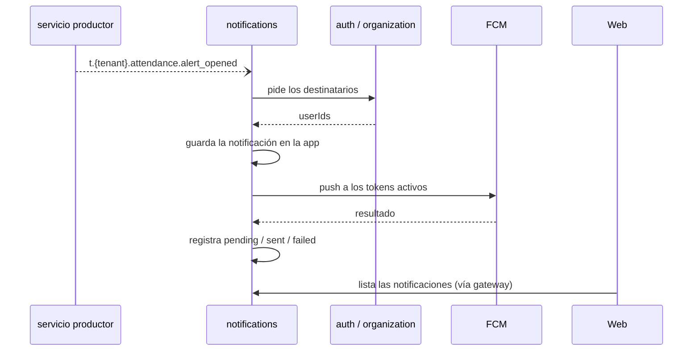
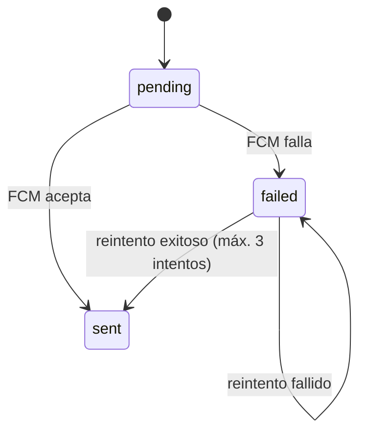

# notifications — Notificaciones push y en la app

`notifications` entrega mensajes a las personas: una notificación **push** a la app móvil (FCM) y una notificación **dentro de la aplicación** que se guarda y se lista en la web. No contiene lógica de negocio: solo decide a quién le llega qué, la guarda, la envía y registra el resultado.

> **Estado:** todavía no existe la aplicación Nest; la carpeta solo contiene documentación. Este documento describe el diseño objetivo. Ver [Estado actual](#estado-actual).
>
> Documentos relacionados: [AGENTS.md](AGENTS.md) (reglas detalladas para agentes, fuente de verdad) · [README general](../../README.md) · [auth](../auth/README.md).

## En una mirada

| Tema | Decisión |
|------|----------|
| Forma | Una app NestJS 12 con módulos internos de tokens, enrutamiento y envío. |
| Canales | Push a la app móvil (FCM) y notificaciones en la app para la web. **Sin email, SMS ni WhatsApp** (trabajo futuro). |
| Coherencia con `auth` | Los links de invitación y de reseteo los copia el admin; nunca se envían. |
| Origen | Evento genérico `t.{tenant}.notifications.send` y ruteo de eventos de dominio. |
| Idioma | Las plantillas están en español por ahora y se guardan con un campo `locale` (`es`), de modo que se pueden sumar idiomas sin cambiar el modelo. |
| Destinatarios | Se piden al servicio dueño en el momento (`auth` para roles y sedes, `organization` para empleados). No se copian. |
| Registro | Cada envío queda registrado como `pending`, `sent` o `failed`. |
| Reintentos | Hasta 3 intentos simples. Sin retroceso exponencial. |
| Datos | PostgreSQL con Prisma 7 y su propio `schema.prisma`. |

## Qué hace y qué no

**Hace**

- Registra y elimina los tokens push de los dispositivos.
- Recibe pedidos de envío de cualquier servicio y rutea eventos de dominio.
- Guarda las notificaciones en la app y permite listarlas, contar las no leídas y marcarlas como leídas.
- Envía el push por FCM, registra el resultado y reintenta.

**No hace**

| Qué | Dónde vive |
|-----|-----------|
| Reglas de negocio (qué es una tardanza, un pago vencido) | Servicio que produce el evento |
| Datos de usuarios, roles y sedes | `auth` y `organization` |
| Email, SMS, WhatsApp | Trabajo futuro |
| Preferencias de usuario, horarios silenciosos, resúmenes | Trabajo futuro |

## Qué se notifica hoy

| Evento | Quién lo recibe | Plantilla |
|--------|-----------------|-----------|
| `attendance.alert_opened` | Supervisores de la sede de la alerta | `attendance_alert_opened` |
| `tasks.task_assigned` | El empleado asignado | `task_assigned` |
| `notifications.send` (genérico) | Los `recipientUserIds` indicados | La indicada en `templateCode` |

### Avisos de cobro de `billing`

`billing` calcula los destinatarios (`owner` y `admin`, que obtiene de `auth`) y los pide con el envío genérico, usando estas plantillas:

| Plantilla | Cuándo |
|-----------|--------|
| `billing_invoice_issued` | Se emitió una factura |
| `billing_due_soon` | Faltan 3 días para el vencimiento |
| `billing_overdue_notice` | Días 1, 4 y 6 de mora |
| `billing_suspended` | Día 7 de mora: la cuenta se suspende |
| `billing_data_deletion_warning` | Faltan 7 días para borrar los datos de un tenant cancelado |

Decisión: mientras un tenant está suspendido o cancelado, estos avisos `billing_*` se siguen entregando, porque el `owner` y los `admin` pueden entrar para pagar o volver a suscribirse. El resto de los envíos automáticos se descartan.

El aviso de alertas (`attendance.alert_opened`) es una funcionalidad `pro`: el servicio guarda una copia local de las funcionalidades del tenant (con `billing.subscription_created` y `billing.plan_changed`) y descarta ese ruteo para los tenants sin la funcionalidad `alerts`. El gateway sigue bloqueando las rutas.

Agregar una ruta es un cambio de código con su test; las rutas no son configurables por tenant.

### Idioma de las plantillas

Las plantillas viven en el código, en español, y se identifican por `(templateCode, locale)` con `locale = es`. La notificación guardada también lleva su `locale`. Para sumar otro idioma bastará con agregar plantillas y una forma de elegir el idioma por usuario o tenant, sin tocar el modelo de datos.

## Flujos

### Evento de dominio a notificación



### Resolución de destinatarios

`notifications` no es dueño de usuarios, roles ni sedes, así que los pide en el momento y no los guarda:

- **Supervisores de una sede, `owner` y `admin`:** `auth.user.list-recipients` (ya forma parte del contrato de [auth](../auth/README.md); solo lo llaman servicios internos).
- **Un empleado:** el evento trae `employeeId` y se pide `organization.employee.get` para obtener su `userId`.

Si el servicio dueño no responde, el evento no se confirma y JetStream lo vuelve a entregar. El procesamiento es idempotente, por lo que reintentarlo es seguro.

### Entrega y reintentos



Un job por minuto reintenta las entregas fallidas con menos de 3 intentos. Si FCM indica que el token es inválido, se desactiva y no se reintenta. La notificación en la app se crea siempre, incluso si el usuario no tiene tokens.

### Suspensión y cancelación del tenant

Con `t.{tenant}.auth.tenant_suspended` o `tenant_cancelled` no se generan envíos automáticos para ese tenant (salvo los `billing_*`) y los reintentos se pausan; con `tenant_reactivated` se reanudan. Los datos se conservan.

### Borrado de datos del tenant

Con `t.{tenant}.billing.data_retention_expired` (90 días después de la cancelación) se borran de forma permanente y idempotente todos los datos del tenant en este servicio: tokens de dispositivos, notificaciones, entregas, estado y copia de funcionalidades.

## Contrato NATS

Los pedidos con respuesta usan `notifications.<recurso>.<accion>` y no llevan tenant en el subject: el tenant sale del actor verificado. El detalle de payloads está en [AGENTS.md](AGENTS.md#nats-contract).

**Request-reply**

| Subject | Quién lo llama | Para qué |
|---------|----------------|----------|
| `notifications.push-token.register` | app móvil | Registrar el token del dispositivo |
| `notifications.push-token.unregister` | app móvil | Eliminar el token |
| `notifications.notification.list` | web | Listar las notificaciones propias |
| `notifications.notification.unread-count` | web | Contar no leídas |
| `notifications.notification.mark-read` | web | Marcar una o todas como leídas |

**Pedidos que hace a otros servicios:** `auth.user.list-recipients` y `organization.employee.get`.

**Eventos que publica:** ninguno por ahora.

**Eventos que consume:** `notifications.send` (por ejemplo, de `billing`), `attendance.alert_opened`, `tasks.task_assigned`, `auth.tenant_suspended`, `auth.tenant_cancelled`, `auth.tenant_reactivated`, `billing.subscription_created`, `billing.plan_changed` y `billing.data_retention_expired`. Todos los handlers son idempotentes: el mismo evento dos veces no genera dos notificaciones.

**Errores** (el gateway los traduce a HTTP `{ detail, code }`)

| code | HTTP | Cuándo |
|------|------|--------|
| `notification_not_found` | 404 | No existe o no es del usuario |
| `invalid_push_token` | 422 | Token vacío o malformado |
| `validation_error` | 422 | Datos de entrada inválidos |

## Modelo de datos

Modelos de Prisma: `DeviceToken`, `Notification`, `NotificationDelivery`, `TenantState`, `TenantFeatures` y `ProcessedEvent`. Todos llevan `tenantId` y toda consulta lo filtra; hay tests que prueban el aislamiento entre tenants. `Notification` guarda el `locale` (`es`). Las plantillas viven en el código. El servicio tiene su propio `prisma/schema.prisma`; si comparte base con otros servicios se decide más adelante.

## Configuración

| Variable | Descripción |
|----------|-------------|
| `NATS_SERVER` | URLs de NATS separadas por coma |
| `DATABASE_URL` | Conexión a PostgreSQL |
| `FCM_PROJECT_ID` | Proyecto de Firebase |
| `FCM_CREDENTIALS` | Credenciales de la cuenta de servicio (nunca se commitean) |

El archivo `.env` nunca se commitea; las variables se documentan en `.env.example` (todavía no existe).

## Desarrollo

Todavía no hay aplicación que ejecutar. Cuando exista:

```bash
cd backend/notifications
pnpm install
pnpm start:dev

# Calidad
pnpm lint
pnpm test
pnpm build
```

## Estado actual

La carpeta contiene solo documentación (`AGENTS.md` y este `README.md`). Falta, entre otras cosas:

- [ ] Crear la app Nest como microservicio NATS (`NestFactory.createMicroservice`).
- [ ] Agregar `src/config/envs.ts` y `.env.example`.
- [ ] Instalar y configurar Prisma, `class-validator`, `firebase-admin` y el scheduler de reintentos.
- [ ] Implementar tokens, notificaciones en la app, envío genérico y ruteo.
- [ ] Verificar que `auth.user.list-recipients` esté implementado en `auth` (ya figura en su contrato).
- [ ] Sumar el servicio a `backend/docker-compose.yml` y las rutas del gateway.
- [ ] Crear los tests unitarios y la carpeta `test/` para e2e.
