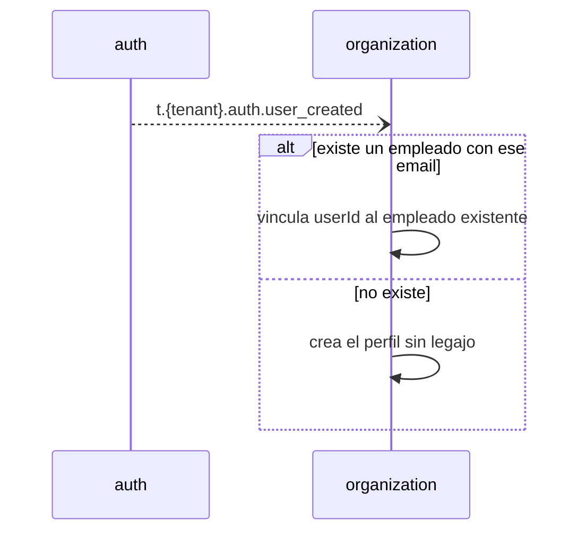
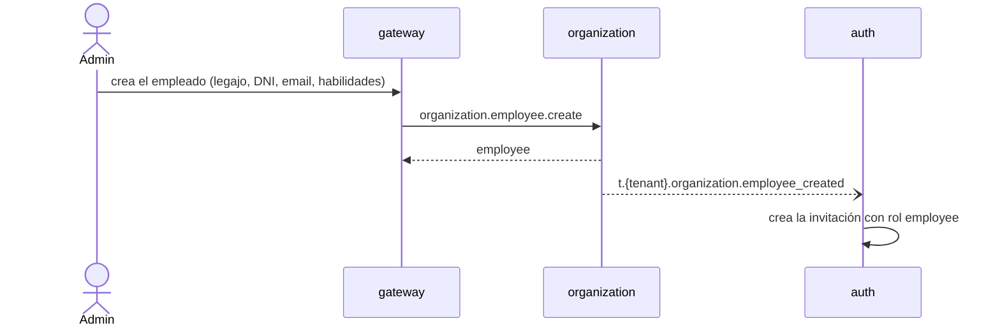
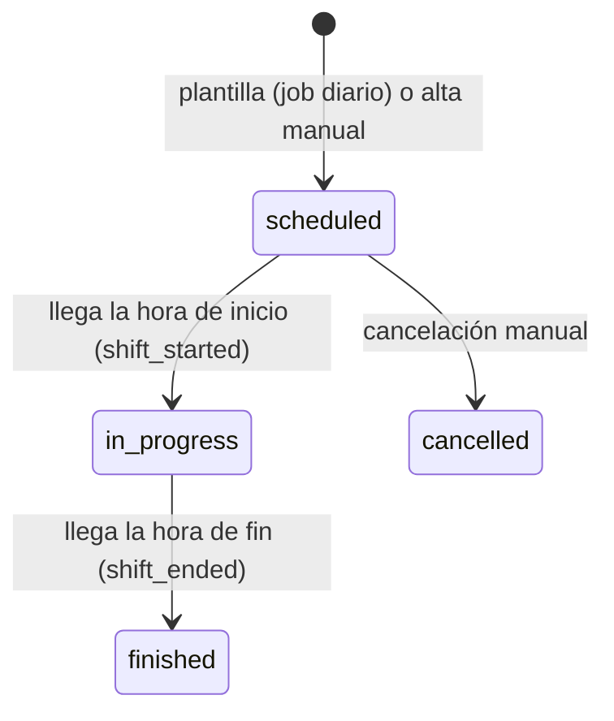

# organization — Sedes, empleados y turnos

`organization` define **dónde y cuándo trabaja cada persona** en TeamWorkFlow: las sedes de una organización (con su geocerca y su código QR), el perfil de cada empleado y los turnos que los conectan. Es la fuente de verdad que consultan `attendance`, `tasks` y `notifications`.

> **Estado:** todavía no existe la aplicación Nest; la carpeta solo contiene documentación. Este documento describe el diseño objetivo. Ver [Estado actual](#estado-actual).
>
> Documentos relacionados: [AGENTS.md](AGENTS.md) (reglas detalladas para agentes, fuente de verdad) · [README general](../../README.md) · [auth](../auth/README.md).

## En una mirada

| Tema | Decisión |
|------|----------|
| Forma | Una app NestJS 12 con tres módulos internos: `sites`, `employees`, `shifts`. Puede dividirse más adelante. |
| Sedes | Punto (lat/lng) + radio de geocerca en metros, zona horaria y un QR fijo que un admin puede rotar. Sin polígonos ni PostGIS. |
| Empleados | Cada usuario del tenant tiene un perfil. Los empleados operativos suman legajo, DNI, habilidades, sedes habilitadas y límite semanal de horas. |
| Turnos | Plantillas semanales + un job diario que genera los próximos 14 días. También se crean, editan, cancelan y reasignan turnos sueltos. |
| Validación | Solo el **solapamiento** bloquea. Descanso menor a 12 h, horas semanales excedidas, falta de habilidad y sede no habilitada son **advertencias**. |
| Concurrencia | Bloqueo optimista con un campo `version`. |
| Estados de turno | `scheduled`, `in_progress`, `finished`, `cancelled`. |
| Comunicación | Solo por NATS. El frontend habla con el gateway. |
| Datos | PostgreSQL con Prisma 7 y su propio `schema.prisma`. |

## Qué hace y qué no

**Hace**

- Alta, edición y baja lógica de sedes y puestos; rotación del QR de una sede.
- Perfil de todos los usuarios, creado o vinculado a partir de los eventos de `auth`.
- Alta de empleados operativos (con email, para que `auth` genere la invitación).
- Plantillas de turnos, generación diaria y gestión manual de turnos.
- Eventos de ciclo de vida del turno: `shift_starting`, `shift_started`, `shift_ended`.
- Lista de empleados disponibles para un reemplazo, ordenada por menos horas semanales.

**No hace**

| Qué | Dónde vive |
|-----|-----------|
| Login, roles, invitaciones y sedes de supervisores (`User.siteIds`) | `auth` |
| Fichadas, jornadas, alertas y Torre de Control | `attendance` |
| Tareas, formularios y fotos | `tasks` |
| Envío de notificaciones | `notifications` |
| Nómina, feriados, horas nocturnas, reemplazo automático de emergencia | Trabajo futuro |

## Permisos

| Acción | owner / admin | supervisor | employee |
|--------|:-------------:|:----------:|:--------:|
| Sedes, puestos, QR, empleados, plantillas | ✅ | ❌ | ❌ |
| Crear, editar, cancelar y reasignar turnos sueltos | ✅ todas las sedes | ✅ solo sus sedes | ❌ |
| Consultar | ✅ todo | ✅ solo sus sedes | su perfil y sus turnos |

El actor (usuario, tenant, rol y sedes) lo toma el gateway del resultado de `auth.token.verify`; nunca se lee de headers ni del body. Lo que queda fuera del alcance de un supervisor responde 404.

## Flujos

### Alta de un usuario y su perfil



Al desactivar un usuario (`user_deactivated`) el empleado queda inactivo y sus turnos futuros pasan a **sin asignar**. El historial se conserva.

### Alta de un empleado operativo



### Turnos: generación y ciclo de vida



- El job diario completa los próximos **14 días** desde las plantillas activas. Es idempotente: no duplica turnos si se ejecuta dos veces.
- Un job por minuto emite `shift_starting` 15 minutos antes del inicio, y cambia el estado emitiendo `shift_started` y `shift_ended`. Si estuvo caído, se pone al día en la siguiente ejecución.
- Los eventos se emiten después de confirmar la transacción y los consumidores son idempotentes.

### Validación al asignar un empleado

| Situación | Resultado |
|-----------|-----------|
| El empleado ya tiene un turno que se solapa | **Bloquea** (`shift_overlap`, 409) |
| Descanso menor a 12 h | Advertencia `rest_under_12h` |
| Supera el límite semanal de horas | Advertencia `weekly_hours_exceeded` |
| Le falta una habilidad requerida del puesto | Advertencia `missing_skill` |
| La sede no está entre sus sedes habilitadas | Advertencia `site_not_enabled` |

La respuesta de una escritura incluye `{ shift, warnings }`; quien llama decide cómo proceder. Si dos personas editan el mismo turno, la segunda recibe `version_conflict` (409).

### Suspensión y cancelación del tenant

Al recibir `t.{tenant}.auth.tenant_suspended` o `tenant_cancelled`, el generador y el job de ciclo de vida se pausan para ese tenant; con `tenant_reactivated` se reanudan. Los datos se conservan.

### Borrado de datos del tenant

Con `t.{tenant}.billing.data_retention_expired` (90 días después de la cancelación) se borran de forma permanente e idempotente todos los datos del tenant en este servicio: sedes, puestos, empleados, plantillas, turnos y estado. No se emiten eventos de turnos ni de sedes: cada servicio borra su propia copia con el mismo evento.

## Contrato NATS

Los pedidos con respuesta usan `organization.<recurso>.<accion>` y no llevan tenant en el subject: el tenant sale del actor verificado. Los eventos usan `t.<tenant>.organization.<evento>` (JetStream). El detalle de payloads está en [AGENTS.md](AGENTS.md#nats-contract).

**Request-reply**

| Subject | Quién lo llama | Para qué |
|---------|----------------|----------|
| `organization.site.create` / `update` / `list` | owner / admin (lectura: todos) | Gestionar y listar sedes |
| `organization.site.get` | gateway, `attendance` | Sede con geocerca y QR |
| `organization.site.rotate-qr` | owner / admin | Generar un QR nuevo |
| `organization.post.create` / `update` / `list` | owner / admin | Puestos de una sede |
| `organization.employee.create` / `update` | owner / admin | Gestionar empleados |
| `organization.employee.get` / `list` | gateway, otros servicios | Consultar empleados (por `employeeId` o `userId`) |
| `organization.employee.list-available` | owner / admin / supervisor | Candidatos a reemplazo |
| `organization.shift-template.*` | owner / admin | Plantillas semanales |
| `organization.shift.create` / `update` / `reassign` / `cancel` | owner / admin / supervisor | Gestión manual de turnos |
| `organization.shift.get` / `list` | gateway, `attendance`, `tasks` | Consultar turnos por sede, empleado o día |

**Eventos que publica:** `employee_created`, `site_updated`, `shift_created`, `shift_updated`, `shift_cancelled`, `shift_starting`, `shift_started`, `shift_ended`.

**Eventos que consume:** `auth.user_created`, `auth.user_deactivated`, `auth.tenant_suspended`, `auth.tenant_cancelled`, `auth.tenant_reactivated` y `billing.data_retention_expired`. Todos los handlers son idempotentes.

**Errores** (el gateway los traduce a HTTP `{ detail, code }`)

| code | HTTP | Cuándo |
|------|------|--------|
| `forbidden` | 403 | El rol no permite la acción |
| `*_not_found` | 404 | No existe o está fuera del tenant o de las sedes del actor |
| `shift_overlap` | 409 | Turno solapado |
| `version_conflict` | 409 | Edición concurrente |
| `shift_not_editable` | 409 | Turno cancelado o finalizado |
| `email_taken` | 409 | Email o legajo repetido en el tenant |
| `validation_error` | 422 | Datos de entrada inválidos |

## Modelo de datos

Modelos de Prisma: `Site`, `Post`, `Employee`, `EmployeeSite`, `ShiftTemplate`, `Shift`, `TenantState` y `ProcessedEvent`. Todos llevan `tenantId` y toda consulta lo filtra; hay tests que prueban el aislamiento entre tenants. Las tablas son plurales en `snake_case` mediante `@@map`. El servicio tiene su propio `prisma/schema.prisma` y sus tablas viven en el schema `organization` de la base compartida `teamworkflow`, con un usuario de Postgres propio (`organization_svc`) que no puede leer los schemas de otros servicios.

## Configuración

| Variable | Descripción |
|----------|-------------|
| `NATS_SERVER` | URLs de NATS separadas por coma |
| `DATABASE_URL` | Conexión a PostgreSQL |
| `SHIFT_HORIZON_DAYS` | Días a generar por adelantado. Por defecto `14` |

El archivo `.env` nunca se commitea; las variables se documentan en `.env.example` (todavía no existe).

## Desarrollo

Todavía no hay aplicación que ejecutar. Cuando exista:

```bash
cd backend/organization
pnpm install
pnpm start:dev

# Calidad
pnpm lint
pnpm test
pnpm build
```

## Estado actual

La carpeta contiene solo documentación (`AGENTS.md` y este `README.md`). Falta, entre otras cosas:

- [ ] Crear la app Nest como microservicio NATS (`NestFactory.createMicroservice`).
- [ ] Agregar `src/config/envs.ts` y `.env.example`.
- [ ] Instalar y configurar Prisma, `class-validator` y el scheduler de jobs.
- [ ] Implementar los módulos `sites`, `employees` y `shifts`.
- [ ] Implementar los consumidores de eventos de `auth` y los jobs.
- [ ] Sumar el servicio a `backend/docker-compose.yml` y las rutas del gateway.
- [ ] Crear los tests unitarios y la carpeta `test/` para e2e.
