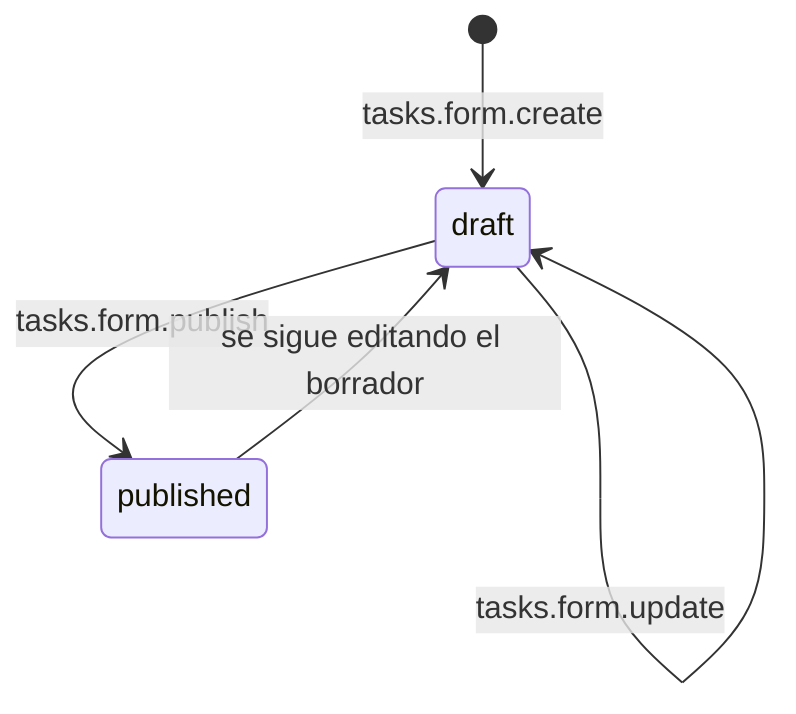
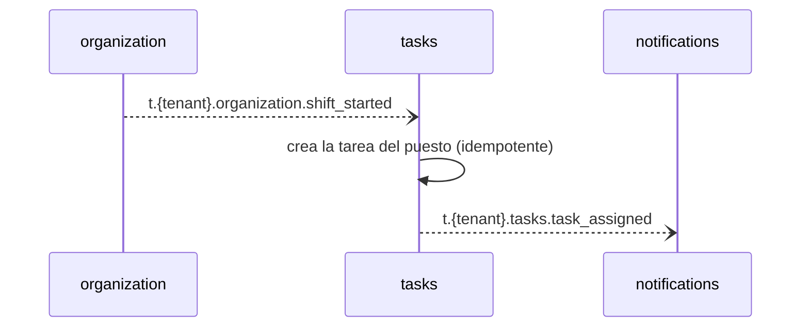
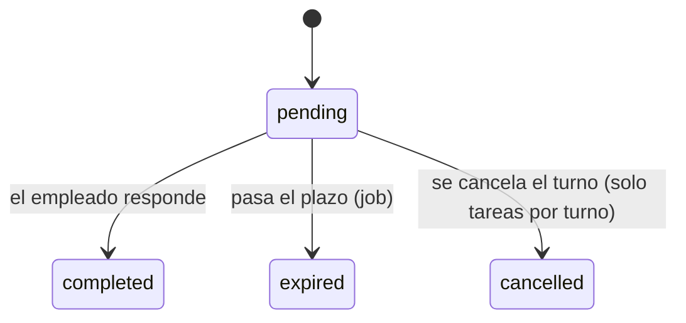
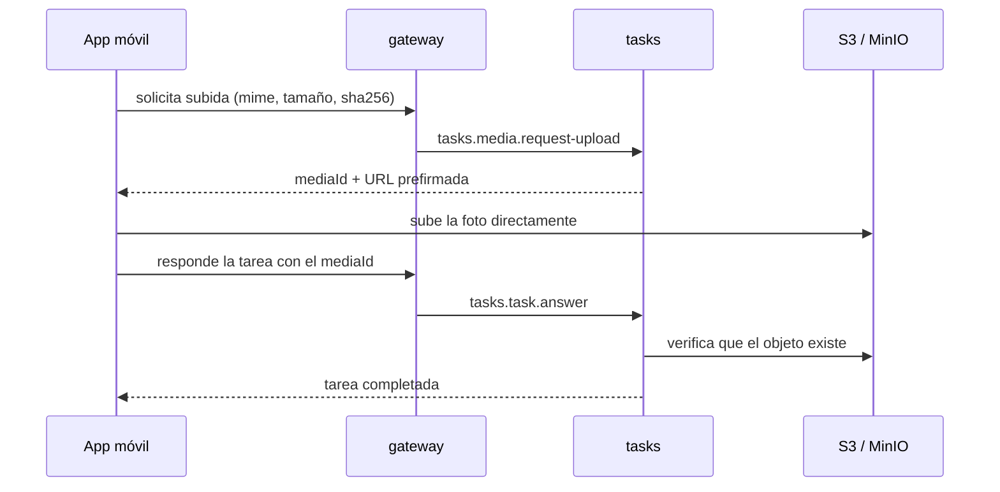

# tasks — Formularios, tareas y fotos

`tasks` define **qué debe hacer y comprobar cada empleado**: formularios configurables, tareas únicas o generadas por turno, revisión del supervisor y fotos de respaldo guardadas en almacenamiento compatible con S3.

> **Estado:** todavía no existe la aplicación Nest; la carpeta solo contiene documentación. Este documento describe el diseño objetivo. Ver [Estado actual](#estado-actual).
>
> Documentos relacionados: [AGENTS.md](AGENTS.md) (reglas detalladas para agentes, fuente de verdad) · [README general](../../README.md) · [organization](../organization/README.md).

## En una mirada

| Tema | Decisión |
|------|----------|
| Forma | Una app NestJS 12 con tres módulos internos: `forms`, `tasks`, `media`. |
| Formularios | Campos `text`, `number`, `yes_no`, `select`, `checklist`, `photo`, `qr`. Un borrador es editable; publicar congela una versión inmutable. |
| Respuestas | Siempre referencian la versión del formulario con la que se respondieron. |
| Tareas | Únicas (con plazo, asignadas a un empleado o a una sede/puesto) o por turno (se generan solas al iniciar el turno). |
| Tareas de sede/puesto | Las puede completar cualquier empleado con un turno en curso en esa sede/puesto. El primero que la toma queda como responsable y los demás ya no pueden completarla. |
| Estados | `pending`, `completed`, `expired`, `cancelled`. Un job marca las vencidas; al cancelarse un turno se cancelan sus tareas por turno pendientes. |
| Plan | Tareas y formularios son del plan `pro`: el gateway bloquea estas rutas (403 `feature_not_in_plan`) con los datos de `auth.token.verify`, y este servicio guarda además una copia local de las funcionalidades del tenant (con `billing.subscription_created` y `billing.plan_changed`): sin `tasks` rechaza la creación con `feature_not_in_plan` y no genera tareas por turno. |
| Revisión | El supervisor marca la respuesta como `approved` u `observed`. |
| QR | Si la tarea define un QR esperado, la respuesta se valida contra él. |
| Offline | Id único del cliente y hora del dispositivo; duplicados ignorados; se acepta hasta 24 h. |
| Fotos | Subida directa a S3/MinIO con URL prefirmada. Máximo 10 MB, jpeg/png/webp. Sin miniaturas ni retención automática por ahora. |
| Datos | PostgreSQL con Prisma 7 y su propio `schema.prisma`. |

## Qué hace y qué no

**Hace**

- Define formularios, los versiona y los publica.
- Crea tareas únicas y genera tareas por turno a partir de plantillas.
- Recibe respuestas (también offline), valida cada tipo de campo y marca las tareas vencidas.
- Deja que un empleado con turno en curso tome una tarea de sede/puesto y cancela las tareas por turno pendientes cuando se cancela el turno.
- Permite la revisión del supervisor.
- Entrega URLs prefirmadas para subir y ver fotos, y guarda sus metadatos.
- Publica `task_assigned`, `task_completed` y `task_expired`.

**No hace**

| Qué | Dónde vive |
|-----|-----------|
| Sedes, empleados y turnos | `organization` |
| Envío de notificaciones | `notifications` |
| Fichadas y alertas | `attendance` |
| Miniaturas, retención automática, video y documentos | Trabajo futuro |

## Permisos

| Acción | owner / admin | supervisor | employee |
|--------|:-------------:|:----------:|:--------:|
| Formularios y plantillas de tareas | ✅ | ❌ | ❌ |
| Crear tareas únicas | ✅ | ✅ solo sus sedes | ❌ |
| Revisar respuestas | ✅ | ✅ solo sus sedes | ❌ |
| Ver tareas | ✅ todas | ✅ solo sus sedes | las propias |
| Responder y subir fotos | ❌ | ❌ | ✅ las propias, o una de sede/puesto después de tomarla |
| Tomar una tarea de sede/puesto | ❌ | ❌ | ✅ solo con un turno en curso en esa sede/puesto |

El actor lo toma el gateway del resultado de `auth.token.verify`; nunca de headers ni del body.

## Flujos

### Formularios



Cada publicación crea una versión nueva e inmutable (1, 2, 3, ...). Las tareas y las respuestas apuntan a una versión, por lo que cambiar un formulario nunca altera lo ya respondido.

### Tarea por turno



### Estados de una tarea



Las tareas completadas no cambian si el turno se cancela después.

### Tarea de sede o puesto

Una tarea sin empleado asignado (de una sede/puesto, o por turno en un turno sin empleado) la puede completar cualquier empleado que tenga un turno **en curso** en esa sede y puesto:

1. El empleado la toma con `tasks.task.claim`, o directamente la responde: `tasks.task.answer` la toma y la completa en una sola operación.
2. `tasks` verifica con `organization` que el empleado tenga un turno en curso en esa sede/puesto; si no, responde `no_shift_in_progress`.
3. **El primero que la toma queda como responsable.** Si otro intenta tomarla o completarla responde `task_already_claimed`.

Después de completada, el supervisor revisa la respuesta (`approved` u `observed` con nota). La revisión no cambia el estado de la tarea.

### Foto en una respuesta



Se guardan `mime`, tamaño, `sha256`, fecha de captura y quién la subió. Las fotos se leen con URLs prefirmadas de corta duración, nunca con URLs públicas.

### Funcionalidades del plan dentro del servicio

Un tenant `basic` no tiene tareas: con la copia local de funcionalidades, sin `tasks` se rechaza `tasks.task.create` (y la creación de formularios y plantillas) con `feature_not_in_plan` y `shift_started` no genera tareas por turno. Si el tenant baja de plan, lo ya creado se conserva y no se crea nada nuevo. Sin copia todavía se asume que no hay funcionalidades `pro`.

### Suspensión y cancelación del tenant

Con `t.{tenant}.auth.tenant_suspended` o `tenant_cancelled` se pausan la generación por turno y el job de vencimientos para ese tenant; con `tenant_reactivated` se reanudan. Los datos se conservan.

### Borrado de datos del tenant

Con `t.{tenant}.billing.data_retention_expired` (90 días después de la cancelación) se borran de forma permanente e idempotente todos los datos del tenant: primero las fotos guardadas en S3 (todos los objetos del prefijo del tenant) y luego las filas de formularios, tareas, respuestas y archivos. Si falla el almacenamiento, el evento no se confirma y se reentrega.

## Contrato NATS

Los pedidos con respuesta usan `tasks.<recurso>.<accion>` y no llevan tenant en el subject. Los eventos usan `t.<tenant>.tasks.<evento>` (JetStream). El detalle de payloads está en [AGENTS.md](AGENTS.md#nats-contract).

**Request-reply**

| Subject | Quién lo llama | Para qué |
|---------|----------------|----------|
| `tasks.form.create` / `update` / `publish` | owner / admin | Gestionar formularios |
| `tasks.form.get` / `list` | gateway | Consultar formularios |
| `tasks.task-template.*` | owner / admin | Plantillas de tareas por turno |
| `tasks.task.create` | owner / admin / supervisor | Crear una tarea única |
| `tasks.task.get` / `list` | gateway | Consultar tareas |
| `tasks.task.claim` | empleado | Tomar una tarea de sede/puesto |
| `tasks.task.answer` | empleado | Responder una tarea (toma las de sede/puesto) |
| `tasks.task.review` | owner / admin / supervisor | Aprobar u observar |
| `tasks.media.request-upload` | empleado | URL prefirmada de subida |
| `tasks.media.get-url` | gateway | URL prefirmada de lectura |

**Eventos que publica:** `task_assigned`, `task_completed`, `task_expired`.

**Eventos que consume:** `organization.shift_started`, `organization.shift_cancelled`, `auth.tenant_suspended`, `auth.tenant_cancelled`, `auth.tenant_reactivated`, `billing.subscription_created`, `billing.plan_changed` y `billing.data_retention_expired`. Todos los handlers son idempotentes.

**Errores** (el gateway los traduce a HTTP `{ detail, code }`)

| code | HTTP | Cuándo |
|------|------|--------|
| `forbidden` | 403 | El rol no permite la acción |
| `feature_not_in_plan` | 403 | El plan del tenant no incluye tareas (al crear tareas, formularios o plantillas) |
| `*_not_found` | 404 | No existe o está fuera del tenant o de las sedes del actor |
| `form_not_published` / `task_not_open` | 409 | Formulario sin publicar; tarea vencida, cancelada o ya completada |
| `task_already_claimed` | 409 | Otro empleado tomó antes la tarea de sede/puesto |
| `no_shift_in_progress` | 403 | El empleado no tiene un turno en curso en la sede/puesto de la tarea |
| `qr_mismatch` | 422 | El QR respondido no es el esperado |
| `answer_too_old` | 422 | Respuesta offline de más de 24 h |
| `media_too_large` / `media_type_not_allowed` / `media_not_uploaded` | 422 | Límites de foto o archivo ausente |
| `validation_error` | 422 | Datos de entrada inválidos |

## Modelo de datos

Modelos de Prisma: `Form`, `FormVersion`, `TaskTemplate`, `Task`, `TaskAnswer`, `Media`, `TenantState`, `TenantFeatures` y `ProcessedEvent`. Todos llevan `tenantId` y toda consulta lo filtra; hay tests que prueban el aislamiento entre tenants. El servicio tiene su propio `prisma/schema.prisma`; si comparte base con otros servicios se decide más adelante.

## Configuración

| Variable | Descripción |
|----------|-------------|
| `NATS_SERVER` | URLs de NATS separadas por coma |
| `DATABASE_URL` | Conexión a PostgreSQL |
| `S3_ENDPOINT` | Endpoint del almacenamiento (MinIO en local) |
| `S3_REGION` | Región |
| `S3_BUCKET` | Bucket de fotos |
| `S3_ACCESS_KEY` / `S3_SECRET_KEY` | Credenciales |
| `S3_FORCE_PATH_STYLE` | `true` para MinIO |
| `MEDIA_URL_TTL_SECONDS` | Vigencia de las URLs prefirmadas. Por defecto `300` |

El archivo `.env` nunca se commitea; las variables se documentan en `.env.example` (todavía no existe).

## Desarrollo

Todavía no hay aplicación que ejecutar. Cuando exista:

```bash
cd backend/tasks
pnpm install
pnpm start:dev

# Calidad
pnpm lint
pnpm test
pnpm build
```

## Estado actual

La carpeta contiene solo documentación (`AGENTS.md` y este `README.md`). Falta, entre otras cosas:

- [ ] Crear la app Nest como microservicio NATS (`NestFactory.createMicroservice`).
- [ ] Agregar `src/config/envs.ts` y `.env.example`.
- [ ] Instalar y configurar Prisma, `class-validator`, el cliente S3 y el scheduler de vencimientos.
- [ ] Implementar los módulos `forms`, `tasks` y `media`.
- [ ] Implementar los consumidores de eventos de `organization` y `auth`.
- [ ] Agregar MinIO a `backend/docker-compose.yml` y las rutas del gateway.
- [ ] Crear los tests unitarios y la carpeta `test/` para e2e.
