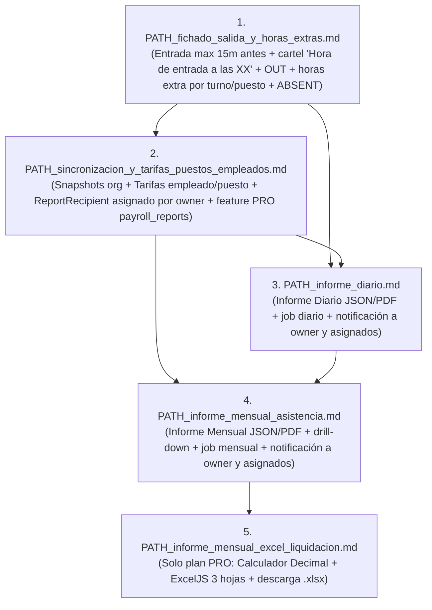

# PATH_00 — Arquitectura y Orden de Implementación de Informes (`telemetry`)

> Plan maestro para la implementación de los módulos de reportes, liquidación, destinatarios y ajustes de fichado en `backend/telemetry` (dominio `attendance`), más sus extensiones coordinadas en `backend/core` (`organization`, `billing`, `notifications`) y `frontend/`.
> Sigue `/STEPS.rules.md`, `/AGENTS.md`, `docs/architecture.md`, `docs/database.md`, `backend/telemetry/AGENTS.md` y `backend/core/AGENTS.md`.

---

## 1. Resumen Ejecutivo

El sistema incorpora 3 informes para el **`owner`** (principal destinatario) y los **trabajadores que el `owner` asigne explícitamente** como receptores autorizados (RRHH, administradores, supervisores o personal designado), además de los ajustes operativos previos en fichado y asignación de horas extras:

1. **Fichado de salida (`OUT`), ventana de entrada máxima de 15 min y horas extras asignadas por puesto/turno** (`PATH_fichado_salida_y_horas_extras.md`)
2. **Sincronización de metadatos desde `core`, configuración de tarifas y destinatarios de informes** (`PATH_sincronizacion_y_tarifas_puestos_empleados.md`)
3. **Informe 1 — Informe Diario (JSON + PDF)** (trabajadores ausentes de la jornada + fichajes fuera de geocerca / fraudulentos) (`PATH_informe_diario.md`)
4. **Informe 2 — Informe Mensual de Asistencia (JSON + PDF)** (asistencias, ausencias, horas trabajadas, horas extras y fichajes fraudulentos por trabajador) (`PATH_informe_mensual_asistencia.md`)
5. **Informe 3 — Informe Mensual en Excel (`.xlsx`) con Liquidación Final de Paga [Plan `PRO`]** (`PATH_informe_mensual_excel_liquidacion.md`)

---

## 2. Orden Estricto de Implementación

Cada bloque depende del anterior. No iniciar un módulo sin completar las dependencias previas:

| Orden | Archivo | Scope / Módulo | Dependencias |
|---|---|---|---|
| 1 | [`PATH_fichado_salida_y_horas_extras.md`](./PATH_fichado_salida_y_horas_extras.md) | `telemetry` (`clock-ins`, `shifts`, `workdays`, `alerts`), `core/organization` (`Shift.authorizedOvertimeMinutes`), `frontend` (`MyShiftView`, `ShiftsView`, `SiteDetailView`) | Existente en `telemetry` y `core` |
| 2 | [`PATH_sincronizacion_y_tarifas_puestos_empleados.md`](./PATH_sincronizacion_y_tarifas_puestos_empleados.md) | `core/organization` (NATS + eventos), `core/billing` (`payroll_reports` en plan `PRO`), `telemetry` (`snapshots`, `compensation`, `reports/recipients`, `AuthGuard`) | Paso 1 |
| 3 | [`PATH_informe_diario.md`](./PATH_informe_diario.md) | `telemetry` (`reports`), `core/notifications` (plantilla + routing a `owner` y asignados) | Pasos 1 y 2 |
| 4 | [`PATH_informe_mensual_asistencia.md`](./PATH_informe_mensual_asistencia.md) | `telemetry` (`reports`), `core/notifications` (plantilla + routing a `owner` y asignados) | Pasos 1, 2 y 3 |
| 5 | [`PATH_informe_mensual_excel_liquidacion.md`](./PATH_informe_mensual_excel_liquidacion.md) | `telemetry` (`reports/domain`, `reports/export`, `exceljs`, `@RequireFeature('payroll_reports')`) | Pasos 2 y 4 |

---

## 3. Reglas de Negocio y Seguridad Transversales

1. **Destinatarios de los informes (`owner` + trabajadores asignados):**
   - El **`owner`** recibe y accede a todos los informes por defecto y es el único que puede gestionar la lista de destinatarios (`ReportRecipient`), asignando a qué trabajadores/usuarios (`userId`) del tenant se les envían y habilitan los informes diarios (PDF), mensuales (PDF) y la liquidación en Excel (cuando el tenant tiene plan `PRO`).
   - Los usuarios asignados por el `owner` (tengan rol `admin`, `supervisor` o `employee` designado como RRHH/encargado) pueden consultar, descargar y recibir notificaciones únicamente de los tipos de informe que el `owner` les habilitó (`receiveDaily`, `receiveMonthly`, `receivePayrollExcel`).
   - Quien no sea `owner` ni esté asignado en `ReportRecipient` recibe `403 forbidden`. `platform_admin` siempre recibe `403 forbidden` en `telemetry`.
2. **Plan Gating (`PRO` obligatorio para Informes de Pagos en Excel):**
   - Los informes operativos de asistencia diaria (Informe 1) y mensual (Informe 2) están disponibles para `basic` y `pro`.
   - El **Informe 3 (liquidación de pagos y exportación Excel `.xlsx`)** es exclusivo de clientes con **plan `PRO`** (`@RequireFeature('payroll_reports')`).
   - Para ello se agrega el flag `payroll_reports` en `billing` (`BASIC`: `false`, `PRO`: `true` en `seed-plans.ts` + migración/actualización de planes existentes) y se habilita su validación en `AuthGuard` y `TenantStateService` de `telemetry`.
3. **Regla de Entrada Máxima 15 min Antes (`CLOCK_IN_EARLY_MINUTES = 15`):**
   - Un trabajador solo puede fichar `IN` como máximo **15 minutos antes** del inicio de su turno (`startsAt - 15 min`).
   - Si intenta fichar antes de esa hora, el backend lo rechaza con `422 clock_in_too_early` indicando la hora exacta de entrada en la zona horaria de la sede, y la app/web muestra el cartel: **`"Hora de entrada a las XX:XX"`**.
4. **Horas Extras Asignadas por Puesto y Turno Específico:**
   - En las tablas de **puestos / turnos laborales** (`organization`), se puede asignar horas extra a los trabajadores de un puesto en un turno específico (`Shift.authorizedOvertimeMinutes`).
   - El fichado de salida (`OUT`) mide las horas reales trabajadas; solo las horas extras trabajadas que correspondan a turnos con horas extras asignadas (o dentro del límite asignado) se liquidan automáticamente como horas extras pagas en el Excel, usando la tarifa de hora extra configurada para ese **puesto (`postId`)**.
5. **Aislamiento de Base de Datos y Multi-Tenant:**
   - `telemetry` (`attendance_svc`) nunca lee tablas del schema `organization`, `auth` o `billing`. Todo dato maestro llega por JetStream + NATS responders.
   - Toda tabla nueva lleva `tenantId @db.Uuid`, toda query filtra por `tenantId` y `BillingConsumer.handleDataRetentionExpired` purga todas las tablas nuevas.
6. **Precisión Monetaria (`Decimal`, cero `float`):**
   - Misma regla que `billing`: prohibido usar `number` de JavaScript en cálculos de dinero. Usar `Prisma.Decimal` (`numeric(12,2)`) y redondeo `ROUND_HALF_UP` a 2 decimales por línea. Moneda base `ARS`.
7. **Dependencias:**
   - **`exceljs`:** **AUTORIZADO por el usuario (2026-11-22)** para instalar en `backend/telemetry/` cuando inicie la fase de implementación del Informe 3.
   - **`pdfkit` (para exportación PDF de Informes 1 y 2):** marcado como `TODO(pdf-dep)` para pedir autorización antes de instalarlo en `backend/telemetry/` si se implementa generación PDF binaria server-side.
8. **Git y Commits:**
   - Trabajar en rama feature desde `develop` (nunca desde `main`/`master`), commits con Conventional Commits, sin `Co-Authored-By` ni atribución de IA.

---

## 4. Decisiones Confirmadas y Pendientes (`TODO` vs `DEFAULT`)

| Tema | Estado | Definición |
|---|---|---|
| **Ventana de entrada anticipada** | **CONFIRMADO** | Máximo **15 minutos** antes (`CLOCK_IN_EARLY_MINUTES = 15`). Antes de eso: cartel `"Hora de entrada a las XX:XX"` (`422 clock_in_too_early`). |
| **Horas extras por puesto en turno específico** | **CONFIRMADO** | Se asignan horas extras por turno específico del puesto en las tablas de puestos/turnos (`Shift.authorizedOvertimeMinutes`), y el precio de la hora extra se configura por puesto (`PostOvertimeRate`). |
| **Plan gating de Excel de pagos** | **CONFIRMADO** | El cálculo/exportación de pagos en Excel (Informe 3) requiere plan **`PRO`** (`features.payroll_reports === true`). |
| **Destinatarios de informes** | **CONFIRMADO** | Llegan principalmente al **`owner`**, quien asigna a qué trabajadores/usuarios (`ReportRecipient`) les llegan los informes (PDFs y Excel). |
| **Dependencia `exceljs`** | **AUTORIZADO** | Autorización otorgada para instalar `exceljs` en `backend/telemetry/`. |
| **Cómputo dentro de los 15 min previos** | `DEFAULT` | `effectiveStart = max(firstIn, shift.startsAt)` para que entrar 10 min antes dentro de la tolerancia no cuente como tiempo extra ni altere horas regulares; `deviceTime` real se guarda en auditoría. |
| **Generación PDF de Informes 1 y 2** | `TODO(pdf-dep)` | Confirmar autorización para instalar `pdfkit` (`+ @types/pdfkit`) en `backend/telemetry/` para los endpoints `/daily/pdf` y `/monthly/pdf` (alternativamente HTML imprimible/Puppeteer, aunque `pdfkit` es liviano y sin Chromium). |
| **Horas extras trabajadas sin asignación previa** | `DEFAULT` | Si un trabajador ficha salida tarde sin tener `authorizedOvertimeMinutes > 0` en ese turno, se registra `rawOvertimeMinutes` como observación informativa, pero `payableOvertimeMinutes = 0` hasta que un administrador/supervisor autorice horas extras en ese turno. Confirmar si se desea un modo estricto o permisivo. |
