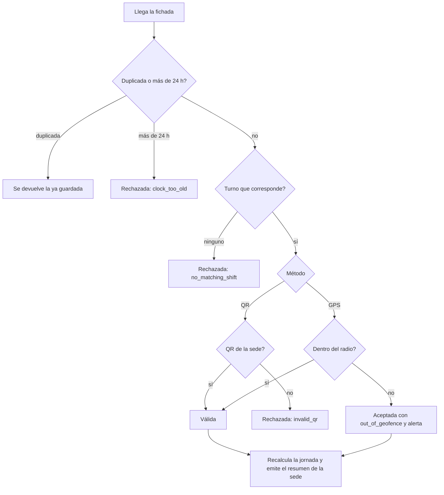
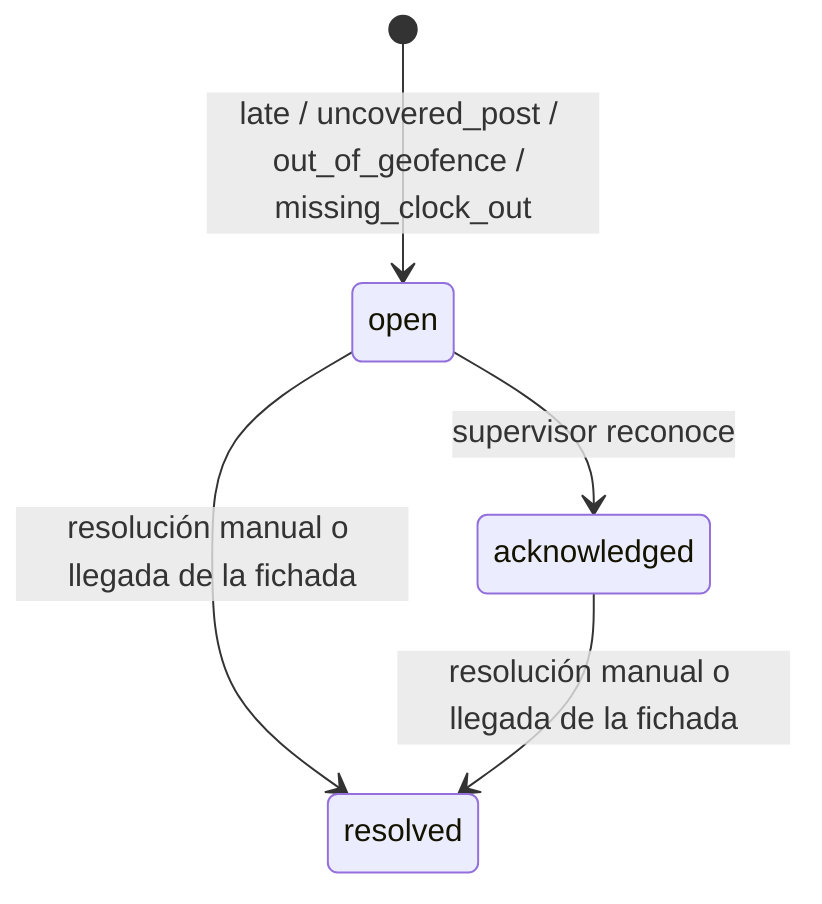
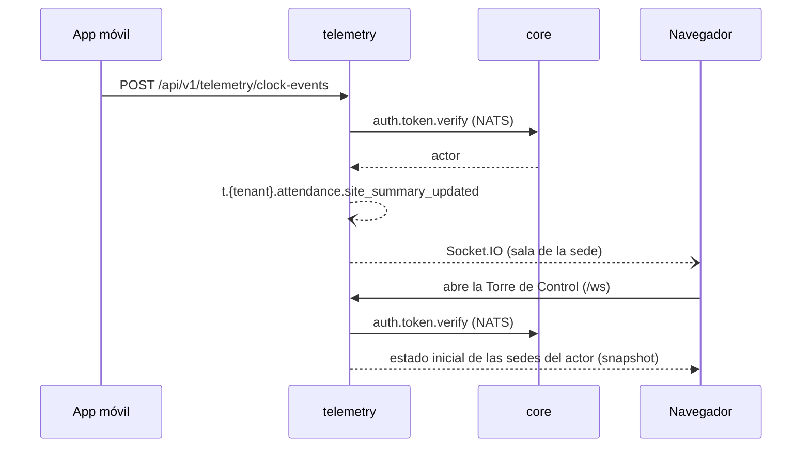

# telemetry — Fichadas, jornadas y alertas (dominio `attendance`)

`telemetry` es el servicio independiente que contiene todo el dominio `attendance`: sabe **quién está presente en cada sede** y avisa cuando algo falla. Registra las fichadas (ingesta de alta frecuencia), calcula las horas trabajadas, detecta tardanzas y puestos sin cubrir, y atiende en tiempo real la Torre de Control. Está separado de [`core`](../core/README.md) porque su carga (muchas fichadas y conexiones WebSocket abiertas) escala distinto del resto de la API.

> **Nombre:** el servicio se llama `telemetry`, pero el dominio, el schema de PostgreSQL (`attendance`), el rol (`attendance_svc`), los subjects de eventos (`t.<tenant>.attendance.<evento>`), el stream (`ATTENDANCE_EVENTS`) y los nombres de operación (`attendance.<recurso>.<accion>`) conservan el nombre `attendance`.

> **Estado:** todavía no existe la aplicación Nest; la carpeta solo contiene documentación. Puerto: 3003. Este documento describe el diseño objetivo. Ver [Estado actual](#estado-actual).
>
> Documentos relacionados: [AGENTS.md](AGENTS.md) (reglas detalladas para agentes, fuente de verdad) · [README general](../../README.md) · [Decisión de arquitectura](../../docs/architecture.md) · [core](../core/README.md).

## En una mirada

| Tema | Decisión |
|------|----------|
| Forma | Un servicio NestJS 12 independiente con cuatro módulos internos: `clock-ins`, `workdays`, `alerts`, `tower`. |
| Entradas públicas | HTTP en `/api/v1/telemetry` y WebSocket Socket.IO en `/ws`, bajo el mismo origen que `core` mediante un proxy inverso. |
| Autenticación | Verifica cada request y cada conexión WebSocket con la petición NATS `auth.token.verify`, que responde el módulo `auth` de `core`. |
| Fichadas | `in`, `out`, `break_start`, `break_end`, por `gps`, `qr` o `manual` (manual lo crea un supervisor con motivo). |
| Ventana de entrada | Una entrada se acepta desde 60 min antes del inicio del turno hasta el fin del turno. Fuera de esa ventana: `no_matching_shift`, y un supervisor puede cargar una fichada manual. |
| Salida faltante | Si pasan 2 h desde el fin del turno sin salida, la jornada queda como `missing_clock_out` con 0 minutos computados y se alerta al supervisor, que carga una salida manual con motivo. Una salida del empleado que llega después (dentro de las 24 h offline) también se acepta: cierra la jornada y resuelve la alerta. |
| Ubicación | Dentro de la geocerca es válido; el QR de la sede es válido aunque falle el GPS; fuera de la geocerca sin QR **se acepta**, se marca `out_of_geofence` y se abre una alerta. Nunca se rechaza por ubicación. |
| Offline | La app envía un id único y la hora del dispositivo. Los duplicados se ignoran. Se acepta hasta 24 h de antigüedad (`clock_too_old` después). |
| Correcciones | Siempre con motivo, conservando el antes y el después. |
| Jornada | Por turno: minutos trabajados, horas extra y minutos de tardanza. Sin horas nocturnas ni feriados todavía. |
| Alertas | Tardanza (10 min), puesto sin cubrir (15 min), fuera de geocerca y salida faltante. Estados: abierta, reconocida, resuelta. |
| Torre de Control | Un evento de resumen por sede en cada cambio; este mismo servicio lo reenvía por Socket.IO a la sala de la sede. |
| Plan | Fichadas y jornadas son del plan `basic`. **Alertas y Torre de Control son del plan `pro`**: la capa HTTP de este servicio bloquea esas rutas (403 `feature_not_in_plan`) con los datos de `auth.token.verify`, y el dominio guarda además una copia local de las funcionalidades del tenant (con `billing.subscription_created` y `billing.plan_changed`) para no detectar alertas ni emitir resúmenes en tenants `basic`. |
| Datos de turnos | Copia local alimentada por los eventos de `organization` (en `core`), con consulta de respaldo por NATS. |
| Datos | PostgreSQL con Prisma 7 y su propio `schema.prisma` (schema `attendance`). |

## Qué hace y qué no

**Hace**

- Registra fichadas con control de geocerca y QR, incluidas las offline.
- Permite a supervisores corregir o crear fichadas manuales con auditoría.
- Calcula la jornada de cada turno.
- Detecta tardanzas, puestos sin cubrir, fichadas fuera de geocerca y salidas faltantes, y administra el ciclo de vida de las alertas.
- Publica los resúmenes por sede, responde la foto inicial y atiende la conexión Socket.IO de la Torre de Control.
- Aplica en sus propias rutas el guard de autenticación, los controles de rol, plan y estado del tenant, el rate limit y la traducción de errores a `{ detail, code }`.

**No hace**

| Qué | Dónde vive |
|-----|-----------|
| Sedes, empleados y turnos | Módulo `organization` de `core` |
| Usuarios, tokens y estado del tenant | Módulo `auth` de `core` |
| Envío de notificaciones (push, notificaciones en la app) | Módulo `notifications` de `core` |
| Rutas de los demás dominios | `core`, bajo `/api` |
| Selfie al fichar, GPS continuo, umbrales configurables, horas nocturnas, feriados, cierre de períodos | Trabajo futuro |

## Permisos

| Acción | owner / admin | supervisor | employee |
|--------|:-------------:|:----------:|:--------:|
| Fichar | ❌ | ❌ | ✅ (solo a sí mismo) |
| Crear o corregir fichadas (con motivo) | ✅ | ✅ solo sus sedes | ❌ |
| Reconocer y resolver alertas (plan `pro`) | ✅ | ✅ solo sus sedes | ❌ |
| Ver la Torre de Control (plan `pro`) | ✅ todas las sedes | ✅ solo sus sedes | ❌ |
| Ver fichadas y jornadas | ✅ todas | ✅ solo sus sedes | las propias |

El actor se toma del resultado de `auth.token.verify`; nunca de headers ni del body.

## Flujos

### Fichada con control de ubicación



### Alertas



| Tipo | Se abre cuando | Se resuelve sola |
|------|----------------|------------------|
| `late` | El empleado asignado no fichó entrada 10 min después del inicio | Cuando llega su entrada |
| `uncovered_post` | Nadie fichó entrada 15 min después del inicio | Cuando llega cualquier entrada |
| `out_of_geofence` | Una fichada se aceptó fuera de la geocerca | No (la resuelve un supervisor) |
| `missing_clock_out` | Pasaron 2 h desde el fin del turno y hay entrada sin salida | Cuando llega una salida (manual de un supervisor, o la del empleado que llega tarde) |

Se evalúan con los eventos de turnos de `organization` y con una revisión periódica de los turnos en curso (y de los terminados cuya jornada sigue abierta). Los umbrales son fijos por ahora.

### Salida faltante

Si el empleado fichó la entrada y no la salida, hasta 2 h después del fin del turno la jornada sigue abierta. Pasado ese plazo queda marcada como `missing_clock_out`, con **0 minutos computados**, y se abre una alerta para los supervisores de la sede. El supervisor carga una salida manual con motivo (`attendance.clock-event.create-manual`): se recalculan los minutos reales, la jornada se cierra y la alerta se resuelve sola. Lo mismo ocurre si la salida del propio empleado llega después de marcada la jornada (por ejemplo, una fichada offline sincronizada tarde), siempre que respete la regla de 24 h y la ventana de turno.

### Torre de Control



El resumen contiene `expected` (esperados), `present` (presentes) y `openAlerts` (alertas abiertas). NATS nunca se expone al navegador.

### Datos de turnos

`telemetry` mantiene una copia local de los turnos, actualizada con los eventos de `organization` (cada evento trae el turno completo). Si falta un turno, lo pide a `core` con la petición NATS `organization.shift.get`. La geocerca y el QR se consultan con `organization.site.get` y se guardan un tiempo corto en memoria.

### Funcionalidades del plan dentro del dominio

Los tenants `basic` no tienen alertas ni Torre de Control. La capa HTTP bloquea las rutas y, además, con la copia local de funcionalidades, sin `alerts` no se detectan alertas (ni la revisión periódica ni la de eventos) y sin `tower` no se emite `site_summary_updated`. Las fichadas y las jornadas siguen funcionando. Si el tenant baja de plan, las alertas existentes se conservan y no se abren nuevas. Sin copia todavía se asume que no hay funcionalidades `pro`.

### Suspensión y cancelación del tenant

Con `t.{tenant}.auth.tenant_suspended` o `tenant_cancelled` se pausa la revisión periódica de alertas para ese tenant; con `tenant_reactivated` se reanuda. Los datos se conservan.

### Borrado de datos del tenant

Con `t.{tenant}.billing.data_retention_expired` (90 días después de la cancelación) se borran de forma permanente e idempotente todos los datos del tenant en este servicio: turnos copiados, fichadas y correcciones, jornadas, alertas, estado y copia de funcionalidades.

## Contrato NATS

Las operaciones se llaman `attendance.<recurso>.<accion>` y no llevan tenant. Los eventos usan `t.<tenant>.attendance.<evento>` (JetStream, stream `ATTENDANCE_EVENTS`). El detalle de payloads está en [AGENTS.md](AGENTS.md#nats-contract).

**Operaciones (expuestas por HTTP bajo `/api/v1/telemetry`; las rutas son una propuesta, ver [AGENTS.md](AGENTS.md#route-map-proposed-shape-under-apiv1telemetry))**

| Operación | Quién la usa | Para qué |
|---------|----------------|----------|
| `attendance.clock-event.create` | empleado | Fichar |
| `attendance.clock-event.create-manual` | supervisor / admin | Fichada manual con motivo |
| `attendance.clock-event.correct` | supervisor / admin | Corregir con motivo |
| `attendance.clock-event.list` | cualquier rol autenticado | Listar fichadas |
| `attendance.workday.get` / `list` | cualquier rol autenticado | Consultar jornadas |
| `attendance.alert.list` | cualquier rol autenticado | Listar alertas |
| `attendance.alert.acknowledge` / `resolve` | supervisor / admin | Reconocer o resolver |
| `attendance.tower.snapshot` | supervisor / admin | Foto inicial de la Torre de Control |

**Peticiones NATS que `telemetry` hace a `core`** (las responde `core`): `auth.token.verify`, `organization.employee.get`, `organization.site.get`, `organization.shift.get`. `telemetry` no responde peticiones NATS.

**Eventos que publica:** `clock_event_recorded`, `clock_event_corrected`, `workday_closed`, `alert_opened`, `alert_acknowledged`, `alert_resolved`, `site_summary_updated` (este último lo consume solo `telemetry`, para la Torre de Control).

**Eventos que consume** (los publica `core`): `organization.shift_created`, `shift_updated`, `shift_cancelled`, `shift_starting`, `shift_started`, `shift_ended`, `site_updated`, `auth.tenant_suspended` / `tenant_cancelled` / `tenant_reactivated`, `billing.subscription_created` / `plan_changed` y `billing.data_retention_expired`. Todos los handlers son idempotentes.

**Errores** (la capa HTTP de este servicio los traduce a `{ detail, code }`; además usa `feature_not_in_plan`, `rate_limited`, `csrf_invalid`, `invalid_token`, `tenant_suspended`, `tenant_cancelled`, `upstream_timeout` y `upstream_unavailable`)

| code | HTTP | Cuándo |
|------|------|--------|
| `forbidden` | 403 | El rol no permite la acción |
| `no_matching_shift` | 404 | No hay un turno que corresponda: una entrada fuera de la ventana (desde 60 min antes del inicio hasta el fin del turno), o una salida sin entrada abierta |
| `clock_too_old` | 422 | Fichada offline de más de 24 h |
| `invalid_qr` | 422 | El QR no corresponde a la sede |
| `alert_invalid_transition` | 409 | Transición de alerta inválida |
| `validation_error` | 422 | Datos de entrada inválidos |

## Modelo de datos

Modelos de Prisma: `ShiftSnapshot`, `ClockEvent`, `ClockEventCorrection`, `Workday`, `Alert`, `TenantState`, `TenantFeatures` y `ProcessedEvent`. Todos llevan `tenantId` y toda consulta lo filtra; hay tests que prueban el aislamiento entre tenants. El servicio tiene su propio `prisma/schema.prisma` y sus tablas viven en el schema `attendance` de la base compartida `teamworkflow`, con un usuario de Postgres propio (`attendance_svc`) que no puede leer los schemas de `core`.

## Configuración

| Variable | Descripción |
|----------|-------------|
| `NATS_SERVER` | URLs de NATS separadas por coma |
| `ATTENDANCE_DATABASE_URL` | Conexión a PostgreSQL (schema `attendance`, rol `attendance_svc`) |
| `PORT` | Puerto HTTP y WebSocket. Por defecto 3003 |
| `WEB_ORIGIN` | Origen web permitido (CORS y Socket.IO) |
| `NATS_TIMEOUT_MS` | Timeout de las peticiones a `core`. Valor inicial: `5000` |
| `RATE_LIMIT_AUTH_TTL_MS`, `RATE_LIMIT_AUTH_LIMIT` | Rate limit por usuario. Valores por definir según el tráfico de fichadas |

Los umbrales (10 min, 15 min, 24 h, 60 min antes del turno para fichar la entrada y 2 h después del fin del turno para la salida faltante) son constantes en el código por ahora. El archivo `.env` nunca se commitea; las variables se documentan en `.env.example` (todavía no existe).

## Desarrollo

Todavía no hay aplicación que ejecutar. Cuando exista:

```bash
cd backend/telemetry
pnpm install
pnpm start:dev

# Calidad
pnpm lint
pnpm test
pnpm build
```

## Estado actual

La carpeta contiene solo documentación (`AGENTS.md` y este `README.md`). Falta, entre otras cosas:

- [ ] Crear la app Nest (HTTP + WebSocket + cliente NATS) y definir el puerto.
- [ ] Agregar `src/config/envs.ts` y `.env.example`.
- [ ] Instalar y configurar Prisma, `class-validator` y el scheduler de la revisión periódica.
- [ ] Implementar los módulos `clock-ins`, `workdays`, `alerts` y `tower`.
- [ ] Implementar la capa HTTP (guard con `auth.token.verify`, roles, plan, estado del tenant) y la Torre de Control por Socket.IO.
- [ ] Implementar los consumidores de eventos de `organization`, `auth` y `billing`.
- [ ] Sumar el servicio a `backend/docker-compose.yml` y las rutas del proxy inverso (`/api/v1/telemetry`, `/ws`).
- [ ] Crear los tests unitarios y la carpeta `test/` para e2e.
