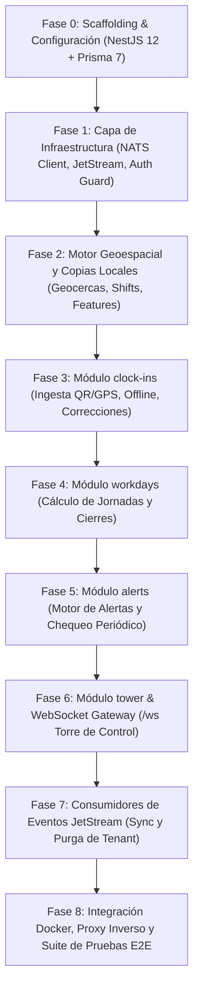

# STEPS.md — Guía de Implementación del Servicio `telemetry` (Dominio `attendance`)

Este documento define el plan de trabajo paso a paso para construir e integrar el servicio independiente de **Telemetría y Control de Asistencia** (`backend/telemetry`).

El plan está estrictamente basado en:
- [`backend/telemetry/AGENTS.md`](AGENTS.md) (fuente de verdad y reglas de agente).
- [`backend/telemetry/README.md`](README.md) (visión general del dominio `attendance`).
- [`docs/architecture.md`](../../docs/architecture.md) (decisión arquitectónica de 2 servicios: `core` y `telemetry`).
- [`docs/database.md`](../../docs/database.md) y [`backend/STEPS.md`](../STEPS.md) (convenciones de base de datos, schema `attendance` y roles PostgreSQL).

---

## 🏛️ Resumen de Arquitectura y Decisiones Clave

1. **Servicio y Dominio:** El servicio se llama `telemetry`, pero el dominio funcional, el schema de PostgreSQL (`attendance`), el rol de base de datos (`attendance_svc`), los subjects de eventos (`t.<tenant>.attendance.<evento>`), el stream JetStream (`ATTENDANCE_EVENTS`) y los nombres de operación (`attendance.<recurso>.<accion>`) conservan el nombre **`attendance`**.
2. **Puerto y Rutas Públicas:**
   - Puerto HTTP: **`3003`** (prefijo `/api/v1/telemetry`).
   - WebSocket: Socket.IO en el path **`/ws`** (Torre de Control).
   - Ambos publicados bajo el mismo origen que `core` mediante el proxy inverso (Caddy / Nginx).
3. **Módulos Internos (NestJS 12):**
   - `clock-ins`: Ingesta de fichadas (`in`, `out`, `break_start`, `break_end`), métodos (`gps`, `qr`, `manual`), control de geocerca, offline y correcciones con auditoría.
   - `workdays`: Una jornada por turno con cálculo de minutos trabajados, horas extra y minutos de tardanza. Manejo de salidas faltantes.
   - `alerts`: Detección de tardanzas (10 min), puestos sin cubrir (15 min), fuera de geocerca y salida faltante (fin + 2h).
   - `tower`: Resúmenes en vivo por sede, snapshot inicial y gateway Socket.IO `/ws` para la Torre de Control.
4. **Reglas de Negocio No Negociables:**
   - **Ubicación:** Dentro de la geocerca es válido; el QR de la sede es válido aunque falle el GPS; fuera de la geocerca sin QR **se acepta**, se marca `outOfGeofence = true` y se abre alerta. **Nunca se rechaza una fichada por ubicación**.
   - **Ventana de fichada:** Entrada válida desde 60 min antes del turno hasta el fin del turno (`CLOCK_IN_EARLY_MINUTES = 60`). Fuera de ventana: `no_matching_shift` (404).
   - **Salida faltante:** Si pasan 2 horas tras el fin del turno sin salida (`MISSING_CLOCK_OUT_HOURS = 2`), la jornada se marca `MISSING_CLOCK_OUT` (0 minutos trabajados) y se abre alerta `missing_clock_out`.
   - **Actor y Seguridad:** El actor `{ userId, tenantId, role, siteIds, tenantStatus, plan, features }` proviene **exclusivamente** de la petición NATS `auth.token.verify` hacia `core`. Jamás del body, headers o query.
   - **Plan Gating:** Fichadas y jornadas pertenecen al plan `basic`. Alertas y Torre de Control son del plan `pro` (bloqueadas vía HTTP con 403 `feature_not_in_plan` y en el dominio mediante copia local de `features`).

---

## 🌿 Estrategia de Ramas y Flujo de Integración (Git Workflow)

Para mantener la rama `develop` estable en todo momento, el desarrollo de `telemetry` se organiza bajo el patrón de **Rama de Integración / Epic Branch** con **Ramas Hijas por Fase (Slice Branches)**:

### 1. Rama Base / Integradora (Epic)
- **Nombre:** `feat/telemetry-service`
- **Origen:** Creada a partir de `develop`.
- **Propósito:** Concentra todo el avance del microservicio hasta que esté listo para el PR final hacia `develop`.

### 2. Ramas Hijas por Fase (Slice Branches)
Cada fase se desarrolla en una rama individual creada a partir de `feat/telemetry-service`:

| Fase | Rama de Trabajo (creada desde `feat/telemetry-service`) | Scope / Contenido Principal |
|---|---|---|
| **Fase 0** | `feat/telemetry-phase-0-scaffolding` | Setup NestJS 12, envs Joi y Prisma schema `attendance` |
| **Fase 1** | `feat/telemetry-phase-1-nats-auth` | Cliente NATS RPC, `AuthGuard`, filtros de error y JetStream |
| **Fase 2** | `feat/telemetry-phase-2-geofence` | Algoritmos Haversine, caché de sedes y control de tolerancias |
| **Fase 3** | `feat/telemetry-phase-3-clock-ins` | Fichadas QR/GPS, ventana de turnos y correcciones auditadas |
| **Fase 4** | `feat/telemetry-phase-4-workdays` | Cálculo de horas trabajadas, horas extra y salidas faltantes |
| **Fase 5** | `feat/telemetry-phase-5-alerts` | Tarea periódica cron, detección de tardanzas y ausencias |
| **Fase 6** | `feat/telemetry-phase-6-control-tower` | Gateway Socket.IO `/ws`, salas multitenant y streaming en vivo |
| **Fase 7** | `feat/telemetry-phase-7-event-listeners` | Suscripción durable a eventos `organization`, `auth` y `billing` |
| **Fase 8** | `feat/telemetry-phase-8-docker-proxy` | Docker Compose, reverse proxy unificado y tests E2E |

### 3. Ciclo de Pull Requests
1. Cada rama de fase apunta su **PR a `feat/telemetry-service`** como rama base (nunca a `develop` directamente).
2. Se revisa y mergea cada fase asegurando que `pnpm lint`, `pnpm test` y `pnpm build` pasen.
3. Al finalizar la **Fase 8**, se abre el **PR definitivo** desde `feat/telemetry-service` hacia `develop`.

---

## 📋 Fases de Ejecución

---

### Fase 0: Scaffolding y Base de Datos (attendance schema)

- [x] **TEL-0.1: Inicialización del Proyecto NestJS 12**
  - Crear `backend/telemetry/package.json` con dependencias: `@nestjs/common`, `@nestjs/core`, `@nestjs/platform-express`, `@nestjs/websockets`, `@nestjs/platform-socket.io`, `socket.io`, `@prisma/client`, `prisma`, `nats`, `joi`, `class-validator`, `class-transformer`, `@nestjs/throttler`, `@nestjs/schedule`.
  - Crear `tsconfig.json` con modo estricto alineado al resto del monorepo.
  - Crear `nest-cli.json` configurado para compilar en `dist/`.
- [x] **TEL-0.2: Variables de Entorno y Configuración (`src/config/envs.ts`)**
  - Validar con Joi al inicio:
    - `PORT`: default `3003`.
    - `ATTENDANCE_DATABASE_URL`: URL PostgreSQL conectando al schema `attendance` (rol `attendance_svc`).
    - `NATS_SERVER`: lista de servidores NATS separados por coma (e.g. `nats://localhost:4222`).
    - `NATS_TIMEOUT_MS`: timeout para peticiones a `core` (default `5000`).
    - `WEB_ORIGIN`: origen permitido para CORS y Socket.IO (con credentials).
    - `RATE_LIMIT_AUTH_TTL_MS` y `RATE_LIMIT_AUTH_LIMIT`.
  - Crear archivo `.env.example`.
- [x] **TEL-0.3: Modelado Prisma (`src/prisma/schema.prisma`)**
  - Configurar datasource PostgreSQL con schema `attendance` y cliente generado.
  - Definir los 8 modelos especificados en `AGENTS.md`:
    - `ShiftSnapshot`: `shiftId`, `tenantId`, `siteId`, `postId`, `employeeId`, `startsAt`, `endsAt`, `status`, `version`.
    - `ClockEvent`: `id`, `tenantId`, `shiftId`, `employeeId`, `siteId`, `type` (`IN`, `OUT`, `BREAK_START`, `BREAK_END`), `method` (`GPS`, `QR`, `MANUAL`), `latitude`, `longitude`, `distanceMeters`, `outOfGeofence`, `clientEventId`, `deviceTime`, `receivedAt`, `createdByUserId`, `reason`.
    - `ClockEventCorrection`: `id`, `tenantId`, `clockEventId`, `before`, `after`, `reason`, `correctedByUserId`, `createdAt`.
    - `Workday`: `id`, `tenantId`, `shiftId`, `employeeId`, `siteId`, `workedMinutes`, `overtimeMinutes`, `lateMinutes`, `status` (`OPEN`, `CLOSED`, `MISSING_CLOCK_OUT`), `updatedAt`.
    - `Alert`: `id`, `tenantId`, `type` (`LATE`, `UNCOVERED_POST`, `OUT_OF_GEOFENCE`, `MISSING_CLOCK_OUT`), `status` (`OPEN`, `ACKNOWLEDGED`, `RESOLVED`), `siteId`, `shiftId`, `employeeId`, `clockEventId`, `acknowledgedBy`, `acknowledgedAt`, `resolvedBy`, `resolvedAt`, `createdAt`.
    - `TenantState`: `tenantId`, `isSuspended`, `updatedAt`.
    - `TenantFeatures`: `tenantId`, `features` (json), `effectiveAt`.
    - `ProcessedEvent`: `eventId` (unique), `processedAt`.
  - Índices: `(tenantId, shiftId, deviceTime)`, `(status, startsAt)`, `(tenantId, siteId, status)`, y unicidad parcial para alertas.
- [x] **TEL-0.4: Servicio Prisma (`src/prisma/attendance-prisma.service.ts`)**
  - Implementar extensión `PrismaClient` con lifecycle hooks (`onModuleInit`, `onModuleDestroy`).

---

### Fase 1: Capa de Infraestructura, NATS RPC y Seguridad

- [x] **TEL-1.1: Cliente NATS RPC hacia `core` (`src/nats/nats-client.service.ts`)**
  - Implementar llamadas con timeout configurable a los endpoints de `core`:
    - `auth.token.verify`: verificación de token (cookie o Bearer) -> `{ userId, tenantId, role, siteIds, tenantStatus, plan, features }`.
    - `organization.employee.get`: resolución de `employeeId` a partir del `userId`.
    - `organization.site.get`: geocerca (`latitude`, `longitude`, `radiusMeters`) y `qrCode` oficial del sitio.
    - `organization.shift.get`: consulta de respaldo para turnos cuando no están en el snapshot local.
  - Manejo de fallos: responder 504 `upstream_timeout` o 503 `upstream_unavailable` si `core` no responde.
- [x] **TEL-1.2: Capa HTTP: Guards y Decoradores de Seguridad**
  - `AuthGuard`:
    - Extrae access token de cookies o `Authorization: Bearer`.
    - Valida contra `auth.token.verify`.
    - Rechaza `platform_admin` con 403 `forbidden`.
    - Rechaza tenants suspendidos/cancelados con 403 `tenant_suspended` / `tenant_cancelled`.
    - Inyecta `req.actor` en el contexto.
  - Decoradores de Rol y Plan:
    - `@Roles('employee')`, `@Roles('supervisor', 'admin', 'owner')`.
    - `@RequireFeature('alerts')`, `@RequireFeature('tower')` -> retorna 403 `feature_not_in_plan` si el tenant no lo tiene.
  - Protección CSRF: doble submit token `X-CSRF-Token` para métodos mutantes autenticados por cookie.
- [x] **TEL-1.3: Filtro Global de Excepciones y Pipe de Validación**
  - `HttpExceptionFilter`: mapea errores `{ status, code, message }` al formato público `{ detail, code }`.
  - Configurar `ValidationPipe` con whitelist, forbidNonWhitelisted y respuesta 422 `validation_error`.
- [x] **TEL-1.4: Servicio de Publicación JetStream (`src/nats/jetstream.service.ts`)**
  - Wrapper para publicar en el stream `ATTENDANCE_EVENTS`.
  - Formato de subject: `t.<tenant>.attendance.<evento>`.
  - Helpers para publicar eventos de auditoría y negocio tras commits exitosos de base de datos.

---

### Fase 2: Motor Geoespacial y Gestión de Estado Local

- [x] **TEL-2.1: Algoritmos Geoespaciales (`src/common/geo.utils.ts`)**
  - Implementar cálculo de distancia con fórmula de **Haversine** (en metros) entre la coordenada del empleado y la sede.
  - Comparar contra `radiusMeters` de la sede.
- [x] **TEL-2.2: Caché en Memoria de Sedes y Empleados**
  - Cachear resultado de `organization.site.get` con TTL corto (invalorable ante evento `organization.site_updated`).
  - Cachear relación `(tenantId, userId) -> employeeId` de `organization.employee.get`.
- [x] **TEL-2.3: Gestión de `ShiftSnapshot` y `TenantFeatures`**
  - Métodos para consultar turnos locales y recuperar de `core` (`organization.shift.get`) en caso de cache miss.
  - Mecanismo "Fail-Closed" para features: si no existe registro en `TenantFeatures`, se asume plan `basic` (sin alertas ni Torre de Control).

---

### Fase 3: Módulo `clock-ins` (Ingesta de Fichadas y Correcciones)

- [x] **TEL-3.1: DTOs de Fichada (`src/clock-ins/dto/`)**
  - `CreateClockEventDto`: `clientEventId`, `type` (`in`, `out`, `break_start`, `break_end`), `method` (`gps`, `qr`), `deviceTime`, `latitude`, `longitude`, `qrCode`.
  - `CreateManualClockEventDto`: `employeeId`, `shiftId`, `type`, `time`, `reason` (obligatorio).
  - `CorrectClockEventDto`: `clockEventId`, `type`, `time`, `reason` (obligatorio).
  - `ListClockEventsDto`: filtros por `shiftId`, `employeeId`, `siteId`, paginación.
- [x] **TEL-3.2: Lógica de Validación de Fichadas (`ClockInsService`)**
  - **Idempotencia y Antigüedad:** Si `clientEventId` ya existe para el tenant, devolver el registro existente. Si `deviceTime` tiene más de 24 horas, rechazar con 422 `clock_too_old`.
  - **Matching de Turno:**
    - Fichada `in`: emparejar con turno no cancelado entre 60 min antes del inicio (`CLOCK_IN_EARLY_MINUTES = 60`) y el fin del turno. Si no hay turno, rechazar con 404 `no_matching_shift`.
    - Fichadas `out` / breaks: buscar turno con fichada `in` abierta. Si no hay, rechazar con 404 `no_matching_shift`.
  - **Control de Ubicación (No Rechazo):**
    - Método `qr`: si coincide con el `qrCode` de la sede, válido (incluso sin GPS). Si no coincide, rechazar con 422 `invalid_qr`.
    - Método `gps`: calcular distancia con Haversine. Si está dentro del radio, válido. Si está fuera y no hay QR, **aceptar la fichada**, marcar `outOfGeofence = true`, registrar `distanceMeters` y gatillar apertura de alerta `out_of_geofence`.
    - Si no envía ni GPS ni QR válido: rechazar con 422 `validation_error`.
- [x] **TEL-3.3: Correcciones y Fichadas Manuales con Auditoría**
  - Supervisores (limitados a `siteIds`) o admin/owner pueden crear fichadas manuales o corregir existentes.
  - Requisito estricto: campo `reason` no vacío.
  - Guardar historial en `ClockEventCorrection` con snapshots JSON `before` y `after`.
  - Recomputar automáticamente la jornada (`Workday`) y el resumen de la sede.
- [x] **TEL-3.4: Emisión de Eventos JetStream**
  - Emitir `t.<tenant>.attendance.clock_event_recorded`.
  - Emitir `t.<tenant>.attendance.clock_event_corrected`.
- [x] **TEL-3.5: Controlador HTTP (`ClockInsController`)**
  - `POST /api/v1/telemetry/clock-events` (`attendance.clock-event.create` - solo empleado).
  - `POST /api/v1/telemetry/clock-events/manual` (`attendance.clock-event.create-manual` - supervisor/admin).
  - `PATCH /api/v1/telemetry/clock-events/:clockEventId` (`attendance.clock-event.correct` - supervisor/admin).
  - `GET /api/v1/telemetry/clock-events` (`attendance.clock-event.list`).

---

### Fase 4: Módulo `workdays` (Jornadas Laborales)

- [x] **TEL-4.1: Motor de Cálculo de Jornada (`WorkdaysService`)**
  - Mantener exactamente un `Workday` por turno.
  - Reglas de cómputo:
    - `workedMinutes`: tiempo entre cada `in` y su respectivo `out`, restando el tiempo transcurrido en breaks (`break_start` a `break_end`).
    - `overtimeMinutes`: `max(0, workedMinutes - shiftDurationMinutes)`.
    - `lateMinutes`: `max(0, firstIn - shiftStart)`.
- [x] **TEL-4.2: Gestión de Salidas Faltantes (Missing Clock-Out)**
  - Si el turno finalizó hace más de 2 horas (`MISSING_CLOCK_OUT_HOURS = 2`) y tiene `in` sin `out`:
    - Marcar estado del `Workday` como `MISSING_CLOCK_OUT`.
    - Asignar `workedMinutes = 0` y `overtimeMinutes = 0`.
    - Abrir alerta `missing_clock_out` para supervisores de la sede.
  - Si llega una fichada `out` tardía (manual de supervisor o del empleado dentro de 24h offline):
    - Recomputar minutos reales, pasar jornada a `CLOSED` y auto-resolver la alerta `missing_clock_out`.
- [x] **TEL-4.3: Controlador HTTP y Eventos**
  - `GET /api/v1/telemetry/workdays/:shiftId` y `GET /api/v1/telemetry/workdays`.
  - Emitir evento `t.<tenant>.attendance.workday_closed` al cerrar la jornada.

---

### Fase 5: Módulo `alerts` (Detección y Ciclo de Vida de Alertas)

- [x] **TEL-5.1: Máquina de Estados de Alertas (`AlertsService`)**
  - Tipos: `late`, `uncovered_post`, `out_of_geofence`, `missing_clock_out`.
  - Estados: `open` -> `acknowledged` -> `resolved`.
  - Unicidad idempotente: máximo 1 alerta por `(tenantId, shiftId, type)` para tardanza, puesto sin cubrir y salida faltante; 1 por `(tenantId, clockEventId)` para fuera de geocerca.
- [x] **TEL-5.2: Tarea Periódica de Chequeo (`@Cron('* * * * *')`)**
  - Ejecutar cada minuto sobre turnos en curso:
    - Omitir tenants suspendidos/cancelados o sin feature `alerts`.
    - **Tardanza (`late`):** Turno con empleado asignado sin `in` a los 10 minutos de inicio.
    - **Puesto sin cubrir (`uncovered_post`):** Turno sin ningún `in` a los 15 minutos de inicio.
    - **Salida faltante (`missing_clock_out`):** Turno finalizado hace 2 horas con `in` sin `out`.
- [x] **TEL-5.3: Resolución Automática de Alertas**
  - Alerta `late`: se resuelve automáticamente al registrarse el `in` del empleado.
  - Alerta `uncovered_post`: se resuelve automáticamente al registrarse cualquier `in` en el turno.
  - Alerta `missing_clock_out`: se resuelve al registrarse el `out`.
  - Alerta `out_of_geofence`: **nunca** se resuelve sola (requiere acción de supervisor).
- [x] **TEL-5.4: Controlador HTTP de Alertas**
  - Gated con `@RequireFeature('alerts')`:
    - `GET /api/v1/telemetry/alerts` (`attendance.alert.list`).
    - `POST /api/v1/telemetry/alerts/:alertId/acknowledge` (supervisor/admin).
    - `POST /api/v1/telemetry/alerts/:alertId/resolve` (supervisor/admin).
  - Emitir eventos JetStream: `alert_opened`, `alert_acknowledged`, `alert_resolved`.

---

### Fase 6: Módulo `tower` y WebSocket Gateway (Torre de Control)

- [x] **TEL-6.1: Generación de Resúmenes de Sede (`TowerService`)**
  - Calcular métricas en tiempo real por sede:
    - `expected`: empleados asignados a turnos en curso.
    - `present`: empleados con `in` abierto (incluyendo breaks).
    - `openAlerts`: cantidad de alertas `open` o `acknowledged`.
  - Disparar emisión de evento JetStream `t.<tenant>.attendance.site_summary_updated` ante cambios en fichadas o alertas (solo si `features.tower` es true).
- [x] **TEL-6.2: Snapshot Inicial HTTP**
  - `GET /api/v1/telemetry/tower/snapshot` (`attendance.tower.snapshot`).
  - Gated con `@RequireFeature('tower')` y roles supervisor/admin/owner.
  - Filtra sedes: owner/admin reciben todas las sedes del tenant; supervisor solo sus `siteIds`.
- [x] **TEL-6.3: Gateway Socket.IO (`src/tower/tower.gateway.ts`)**
  - Montar en path `/ws` con origin `WEB_ORIGIN` y credenciales.
  - **Handshake y Auth:**
    - Extraer token de cookies o `auth.token`.
    - Validar con `auth.token.verify` via NATS.
    - Desconectar si no tiene rol adecuado o plan `pro` (feature `tower`).
  - **Salas Multitenant:**
    - Unir socket a salas `{tenantId}:{siteId}` para cada sede autorizada.
    - Jamás permitir que el cliente solicite o elija salas arbitrarias.
  - **Reenvío en Tiempo Real:**
    - Suscribirse a `t.*.attendance.site_summary_updated` a nivel servidor.
    - Emitir actualización directamente a la sala `{tenantId}:{siteId}` correspondiente.
  - **Expiración de Token:**
    - Desconectar el socket al llegar la expiración `exp` del JWT para forzar re-autenticación limpia.

---

### Fase 7: Consumo de Eventos JetStream (Sync y Purga)

- [x] **TEL-7.1: Suscripciones con Durable Consumer y Ack Explícito**
  - Consumir eventos del módulo `organization`:
    - `shift_created`, `shift_updated`, `shift_cancelled`: actualizar `ShiftSnapshot` si `version` es mayor.
    - `shift_started`, `shift_ended`: actualizar estado y cerrar jornada si terminó.
    - `site_updated`: invalidar caché local de la sede.
  - Consumir eventos del módulo `auth`:
    - `tenant_suspended`, `tenant_cancelled`, `tenant_reactivated`: pausar/reanudar chequeos automáticos en `TenantState`.
  - Consumir eventos del módulo `billing`:
    - `subscription_created`, `plan_changed`: actualizar `TenantFeatures`.
    - `data_retention_expired`: purga transaccional irreversible de todos los datos del tenant.
- [x] **TEL-7.2: Deduplicación Idempotente con `ProcessedEvent`**
  - Verificar y registrar `eventId` dentro de la transacción de procesamiento.

---

### Fase 8: Integración Docker, Proxy Inverso y Suite de Pruebas

- [ ] **TEL-8.1: Dockerfile y `backend/docker-compose.yml`**
  - Crear `backend/telemetry/Dockerfile` multi-stage (build y producción).
  - Añadir servicio `telemetry` en `docker-compose.yml` (puerto 3003, red interna con NATS y Postgres).
- [ ] **TEL-8.2: Reglas de Enrutamiento en Reverse Proxy**
  - Publicar bajo el mismo origen del backend:
    - `/api/v1/telemetry/*` -> `telemetry:3003/api/v1/telemetry/*`
    - `/ws/*` -> `telemetry:3003/ws` (con headers de WebSocket upgrade)
    - Resto de `/api/v1/*` -> `core:3000/api/v1/*`
- [ ] **TEL-8.3: Suite de Pruebas Unitarias y E2E**
  - Pruebas unitarias de Haversine, cálculo de jornadas y reglas de ventana de fichada.
  - Mock de cliente NATS para pruebas de Guards y controladores.
  - Pruebas de integración E2E sobre base de datos de test (`attendance` schema).
  - Verificar que `pnpm lint`, `pnpm test` y `pnpm build` pasen al 100%.
