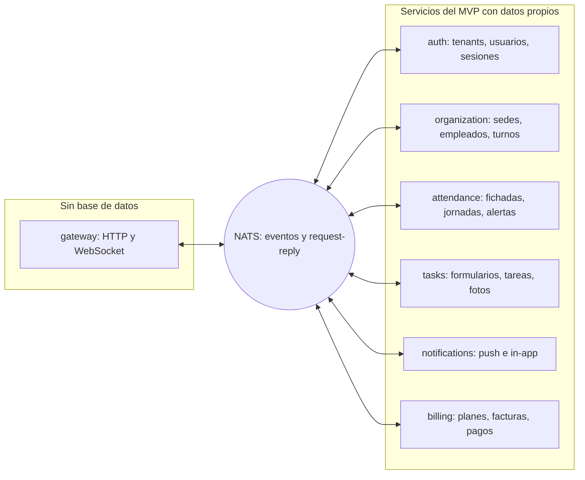
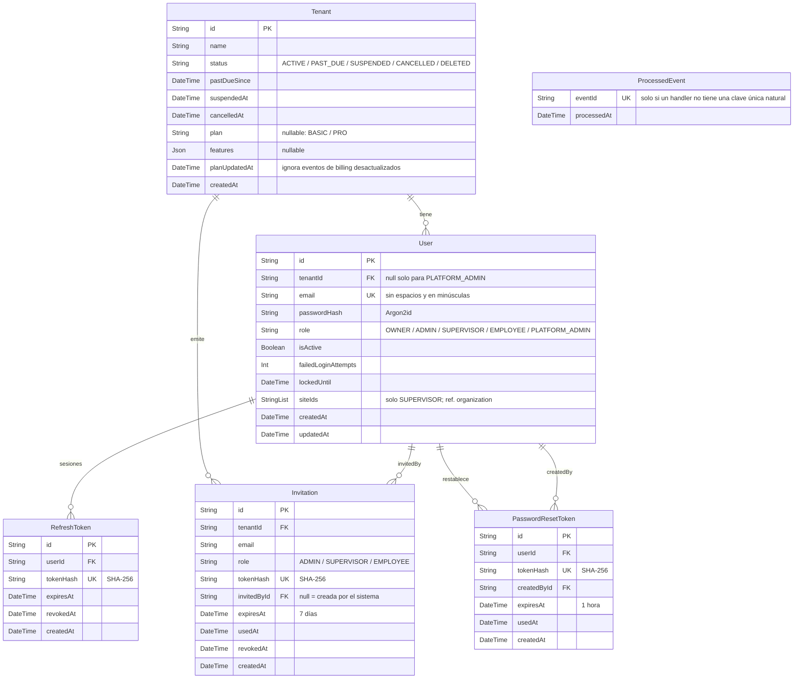
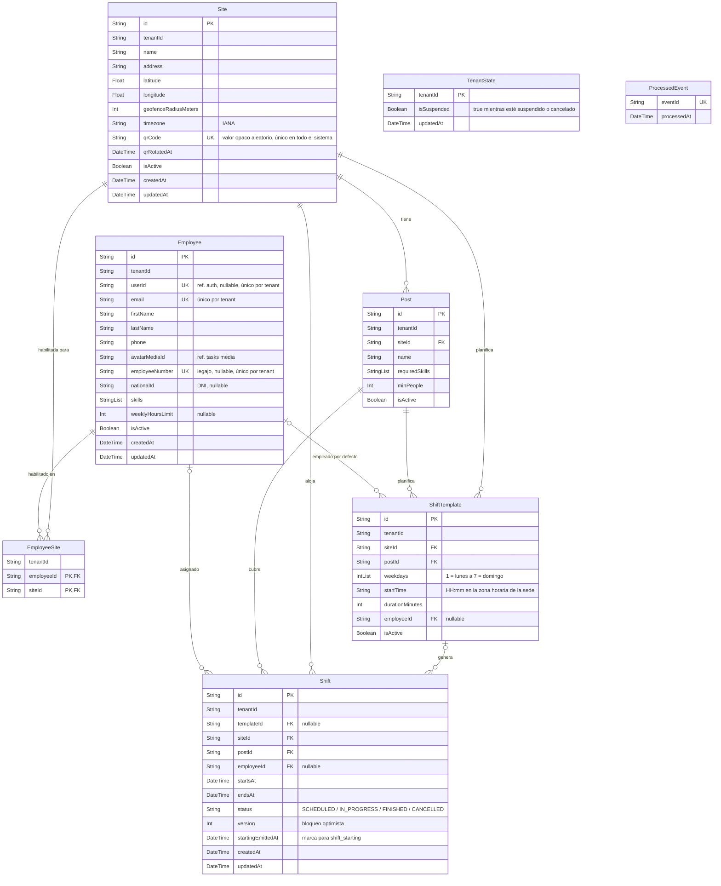
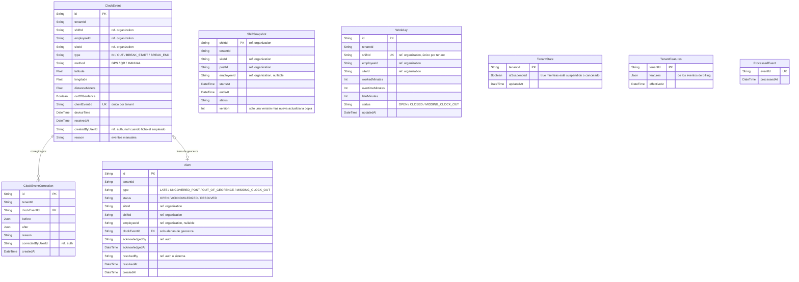
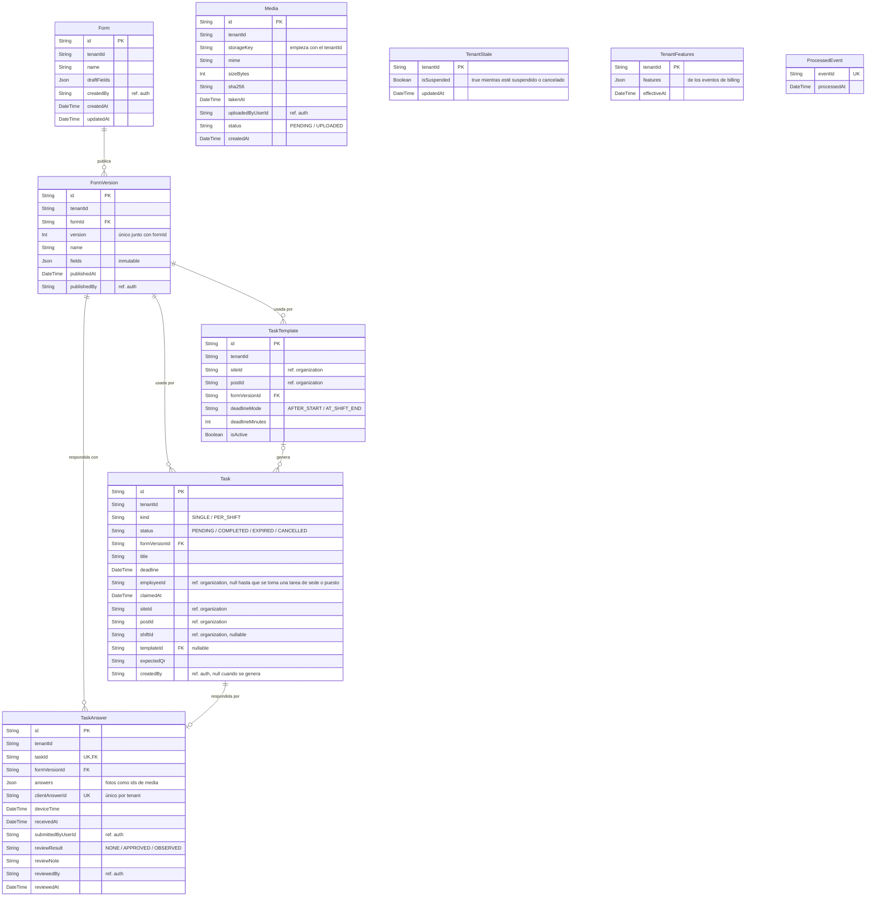
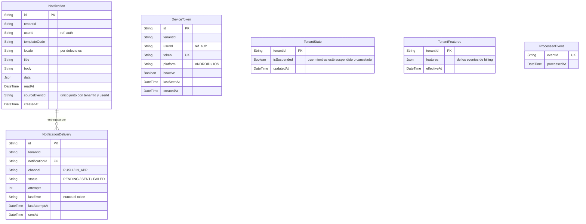
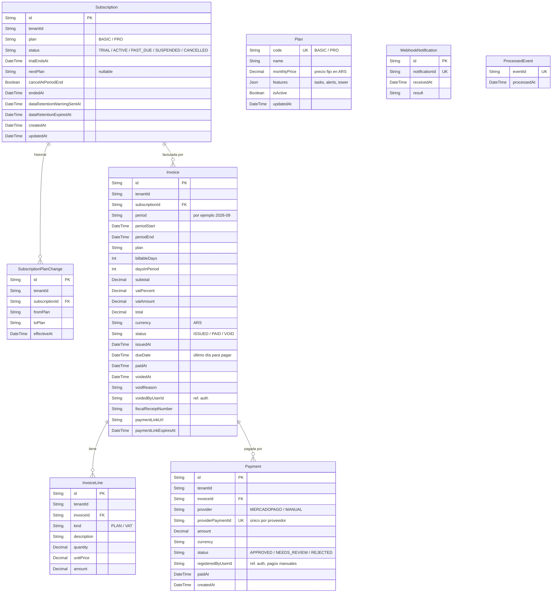

# Base de datos de TeamWorkFlow

Modelo de datos de los servicios del MVP. Cada sección muestra un diagrama entidad-relación (Mermaid, renderizado por GitHub) construido a partir de la sección `Data Model` del `AGENTS.md` de ese servicio, además de las reglas clave. El diseño previo al MVP (identificadores en español, SQL) se conserva al final solo como referencia.

> Estado: todavía no se creó ningún servicio con datos. Todo lo que sigue es el **modelo del MVP por crear** con Prisma. Hoy solo existen `backend/gateway`, `backend/auth` (esqueleto) y `frontend/`. Ver el [README](../README.md) y [AGENTS.md](../AGENTS.md).

> Fuente de verdad: `backend/<service>/AGENTS.md` (sección `Data Model`). Si este documento y un `AGENTS.md` no coinciden, prevalece el `AGENTS.md`.

## Contenido

- [Estructura y aislamiento por tenant](#estructura-y-aislamiento-por-tenant)
- [Resumen](#resumen)
- Servicios del MVP: [auth](#auth) · [organization](#organization) · [attendance](#attendance) · [tasks](#tasks) · [notifications](#notifications) · [billing](#billing)
- [Arquitectura objetivo (servicios futuros)](#arquitectura-objetivo-servicios-futuros)
- [Apéndice: SQL del diseño original (solo referencia)](#apéndice-sql-del-diseño-original-solo-referencia)

## Estructura y aislamiento por tenant

- **Cada servicio tiene su propio schema de Prisma** (`prisma/schema.prisma`) y su propio historial de migraciones. Si los servicios comparten una base de datos PostgreSQL (cada uno con su propio schema) o tienen bases separadas se decide por servicio, más adelante. Dos servicios nunca migran las mismas tablas.
- **Toda fila que pertenece a un tenant lleva `tenantId`**, y toda consulta filtra por él. El `tenantId` proviene del actor verificado o del evento consumido, nunca de lo que envía el cliente. Row Level Security no es obligatorio.
- **Sin claves foráneas entre servicios.** Un id que pertenece a otro servicio es una columna simple, marcada en los diagramas con un comentario como `"ref. organization"` y dibujada sin línea de relación. Los datos de otros servicios se solicitan por NATS o se guardan como una copia alimentada por eventos.
- `gateway` no tiene base de datos.

### Cómo leer los diagramas

- `PK` clave primaria, `FK` clave foránea (dentro del mismo servicio), `UK` valor único.
- Los modelos van en PascalCase y los campos en camelCase, como en Prisma; las tablas son snake_case en plural mediante `@map`. Los tipos son tokens únicos de Mermaid: `String`, `Int`, `Float`, `Boolean`, `DateTime`, `Decimal`, `Json`; `StringList` e `IntList` representan listas de Prisma (`String[]`, `Int[]`).
- Las enumeraciones se muestran como `String` con los valores permitidos en el comentario.
- "Unique per tenant" en un comentario significa un único compuesto con `tenantId`.
- Cada servicio también tiene una tabla `ProcessedEvent` (`eventId` único) para deduplicar los eventos consumidos. Los servicios que pausan el trabajo automático guardan una fila `TenantState` por cada tenant suspendido o cancelado (sin fila significa activo), y los servicios que restringen funcionalidades pro guardan una copia `TenantFeatures` (sin fila significa sin funcionalidades pro).

## Resumen



Todos los servicios se comunican entre sí solo por NATS; ninguno consulta el schema de otro. No existe un servicio `users`: el perfil de cada usuario vive en `organization` (módulo employees), que lo crea o vincula a partir del evento `t.<tenant>.auth.user_created`.

## auth

Identidad, sesiones y estado de acceso del tenant. Fuente de verdad: [`backend/auth/AGENTS.md`](../backend/auth/AGENTS.md).



Reglas clave:

- El correo es único en todo el sistema (un usuario, un tenant) y se guarda sin espacios y en minúsculas.
- `User.tenantId` admite null solo para `PLATFORM_ADMIN`; una restricción check garantiza que todos los demás roles tengan un tenant y que `PLATFORM_ADMIN` no tenga ninguno.
- Los roles son fijos: `OWNER`, `ADMIN`, `SUPERVISOR`, `EMPLOYEE` y el rol de plataforma `PLATFORM_ADMIN`. Los usuarios nunca se eliminan definitivamente mientras su tenant exista; se desactivan (`isActive = false`).
- Los tokens de refresco, de invitación y de restablecimiento de contraseña se guardan solo como hashes SHA-256.
- `User.siteIds` (columna `site_ids`, arreglo con valor por defecto vacío) guarda las sedes de un supervisor; los demás roles tienen `[]`. Cada `siteId` referencia una sede de `organization` sin clave foránea y no se valida aquí. Tiene un índice GIN para filtrar destinatarios por sede.
- `Tenant` conserva el `plan` y las `features` vigentes a partir de los eventos de `billing`, y `planUpdatedAt` evita que un evento desactualizado sobrescriba uno más nuevo.
- Purga: con `data_retention_expired` se eliminan los usuarios, tokens, invitaciones y eventos procesados del tenant, y la fila de `Tenant` permanece como registro residual (`id`, `name`, estado `DELETED`).
- `auth` no usa RLS en `tenants` ni en `users` porque resuelve el tenant durante el login; aun así, toda consulta filtra por `tenantId`.

## organization

Sedes, perfiles de empleados y turnos. Tres módulos internos (`sites`, `employees`, `shifts`) en un solo schema. Fuente de verdad: [`backend/organization/AGENTS.md`](../backend/organization/AGENTS.md).



Reglas clave:

- Todas las horas se guardan en UTC (`timestamptz`); los valores de hora local como `startTime` se interpretan en la zona horaria de la sede.
- `Site.qrCode` es único en todo el sistema y rotable; el valor anterior deja de ser válido de inmediato. Las sedes se desactivan, nunca se eliminan. La geocerca es un punto más un radio (sin polígonos).
- `Employee`: `userId`, `email` y `employeeNumber` son únicos por tenant (`employeeNumber` es null para owners, admins y supervisores). Los empleados nunca se eliminan definitivamente.
- `EmployeeSite` tiene clave primaria (`employeeId`, `siteId`).
- `Shift` tiene un único (`tenantId`, `templateId`, `startsAt`) para que el generador diario sea idempotente. La verificación de superposición (la única regla bloqueante) se ejecuta en la misma transacción que la escritura y está respaldada por una restricción de la base de datos o por una verificación serializable.
- Índices para las búsquedas reales: turnos por (`tenantId`, `employeeId`, `startsAt`), por (`tenantId`, `siteId`, `startsAt`) y por (`status`, `startsAt`) para el job de ciclo de vida.
- `TenantState` no tiene fila para un tenant activo. Purga: `data_retention_expired` elimina todas las filas del tenant (sedes, puestos, empleados, sedes habilitadas, plantillas, turnos, estado del tenant y eventos procesados).

## attendance

Fichadas, jornadas, alertas y resúmenes de la Torre de Control. Cuatro módulos internos (`clock-ins`, `workdays`, `alerts`, `tower`). Fuente de verdad: [`backend/attendance/AGENTS.md`](../backend/attendance/AGENTS.md).



Reglas clave:

- `ShiftSnapshot` es una copia local alimentada por los eventos de turnos de `organization`; se actualiza solo cuando la `version` entrante es más nueva. Las sedes no se copian (la geocerca y el QR provienen de `organization.site.get`).
- `ClockEvent`: `clientEventId` es único por tenant (deduplicación sin conexión). Los cálculos de tiempo usan `deviceTime`. La ubicación nunca rechaza un evento; solo establece `outOfGeofence`.
- Las correcciones nunca son destructivas: el evento se actualiza y una fila `ClockEventCorrection` conserva el `before` y el `after` completos, el motivo y el autor.
- `Workday`: una por turno (`shiftId` único por tenant), se recalcula con cada fichada, corrección y `shift_ended`.
- `Alert`: como máximo una por (`tenantId`, `shiftId`, `type`) para `LATE`, `UNCOVERED_POST` y `MISSING_CLOCK_OUT` (índice único parcial), y una por (`tenantId`, `clockEventId`) para las alertas de geocerca.
- `TenantFeatures`: sin fila significa sin funcionalidades pro (se omiten las alertas y la torre).
- Índices: fichadas por (`tenantId`, `shiftId`, `deviceTime`), turnos en curso por (`status`, `startsAt`), alertas por (`tenantId`, `siteId`, `status`).
- Purga: `data_retention_expired` elimina todas las filas del tenant en este servicio.

## tasks

Formularios, tareas, revisión del supervisor y metadatos de fotos. Tres módulos internos (`forms`, `tasks`, `media`). Fuente de verdad: [`backend/tasks/AGENTS.md`](../backend/tasks/AGENTS.md).



Reglas clave:

- `FormVersion` es inmutable y única por (`formId`, `version`); un `Form` conserva un borrador editable (`draftFields`). Las tareas y las respuestas referencian la versión que usaron.
- `Task`: único (`tenantId`, `shiftId`, `templateId`) para las tareas generadas, de modo que recibir `shift_started` dos veces crea una sola tarea. `employeeId` es null en las tareas de sede o puesto hasta que el primer empleado las toma (compare-and-set).
- `TaskAnswer`: una respuesta por tarea (`taskId` único) y `clientAnswerId` único por tenant (deduplicación sin conexión). La revisión nunca cambia el estado de la tarea.
- Las filas de `Media` guardan solo metadatos; el archivo vive en un almacenamiento compatible con S3 bajo una clave que empieza con `<tenantId>/`. Las respuestas referencian las fotos por id de media dentro del JSON `answers`, sin línea de relación.
- `TenantFeatures`: sin fila significa sin funcionalidades pro (la creación de tareas responde `feature_not_in_plan` y no se generan tareas por turno).
- Índices: tareas por (`tenantId`, `employeeId`, `status`), por (`tenantId`, `siteId`, `status`) y por (`status`, `deadline`) para el job de vencimiento.
- Purga: primero las fotos almacenadas (todos los objetos bajo el prefijo del tenant), luego las filas de la base de datos.

## notifications

Tokens de dispositivo, notificaciones in-app y registro de entregas. Tres módulos internos (`push-tokens`, `routing`, `delivery`). Fuente de verdad: [`backend/notifications/AGENTS.md`](../backend/notifications/AGENTS.md).



Reglas clave:

- `DeviceToken.token` es único; registrar un token existente lo reasigna al usuario actual y lo reactiva. Un usuario puede tener muchos tokens. Ningún endpoint devuelve los tokens.
- `Notification` es única por (`tenantId`, `userId`, `sourceEventId`), de modo que un evento reentregado no la duplica. La fila in-app se crea aun cuando el usuario no tiene token de push.
- `NotificationDelivery`: los push fallidos se reintentan hasta 3 intentos en total mediante un job cada minuto; una entrega in-app queda `SENT` apenas existe la fila.
- Las plantillas viven en el código (`src/templates`), identificadas por (`templateCode`, `locale`); no se guardan en la base de datos. `locale` se guarda en cada notificación para poder agregar más idiomas sin cambiar el modelo.
- Índices: notificaciones por (`tenantId`, `userId`, `createdAt`), no leídas por (`tenantId`, `userId`, `readAt`), entregas por (`status`, `attempts`) para el job de reintentos.
- Purga: `data_retention_expired` elimina los tokens de dispositivo, las notificaciones, las entregas, el estado del tenant, la copia de funcionalidades y los eventos procesados.

## billing

Planes, suscripciones, facturas y pagos. Cinco módulos internos (`plans`, `subscriptions`, `invoicing`, `payments`, `collections`). Fuente de verdad: [`backend/billing/AGENTS.md`](../backend/billing/AGENTS.md).



Reglas clave:

- El dinero es `Decimal` (`numeric(12,2)`), nunca punto flotante; cada línea se redondea half-up a 2 decimales y el total es la suma de las líneas redondeadas. Una sola moneda en el MVP: `ARS`.
- `Plan` es global (sin `tenantId`) y se carga por seed con `BASIC` y `PRO`. Solo un `platform_admin` cambia precios y funcionalidades.
- Un tenant tiene como máximo una `Subscription` no cancelada: un índice único parcial sobre `tenantId` donde el estado no es `CANCELLED` (SQL en la migración). Las canceladas quedan como historial, de modo que volver a suscribirse agrega una fila nueva.
- `Invoice`: único (`tenantId`, `period`) donde el estado no es `VOID` (índice único parcial, SQL en la migración), lo que vuelve idempotente el cierre mensual. Una factura emitida es inmutable; se corrige anulándola con un motivo. Cada factura copia los precios que usó.
- `Payment`: `providerPaymentId` es único por proveedor. Solo un pago aprobado, en `ARS`, igual al saldo de la factura la marca como pagada; cualquier discrepancia se guarda como `NEEDS_REVIEW`.
- `WebhookNotification` nunca guarda el cuerpo completo ni la firma.
- Índices: facturas por (`tenantId`, `status`, `dueDate`) y por (`tenantId`, `period`), suscripciones por (`status`, `trialEndsAt`), pagos por `invoiceId`.
- Purga: con `data_retention_expired`, billing elimina el historial de cambios de plan, los eventos procesados, las notificaciones de webhook y los enlaces de pago, pero conserva las facturas (con sus líneas) y los pagos, además de la referencia mínima de suscripción que necesitan (`id`, `tenantId`, `plan`, `status`, `endedAt`).

## Arquitectura objetivo (servicios futuros)

Estos servicios existen solo en la arquitectura objetivo de 16 servicios descrita en el [README](../README.md). Todavía no tienen modelo de datos; cuando se construyan, cada uno tendrá su propio schema de Prisma. Hasta entonces, los datos que les corresponderían viven en el servicio del MVP indicado a continuación, o no existen.

| Futuro dueño de datos | Sería dueño de | Hoy |
|---|---|---|
| `location` | Historial de puntos GPS (serie temporal, con retención según el plan) | No se guarda; `attendance` solo verifica la posición de cada fichada |
| `emergencies` | Búsquedas de turnos de emergencia y sus ofertas a empleados | No construido; los supervisores reasignan turnos manualmente en `organization` |
| `reports` | Tablas de lectura alimentadas por eventos (asistencia diaria, cobertura por sede, exportaciones) | No construido; use los endpoints de listado de cada servicio |
| `integrations` | Claves de API, webhooks salientes y su registro de entregas | No construido |
| `audit` | Registro inmutable, solo de inserción, de quién hizo qué y cuándo | Solo las filas de corrección de `attendance` |

También es futuro: dividir `organization` en `sites`, `employees` y `shifts`, y `tasks` en `forms`, `tasks` y `media`.

## Apéndice: SQL del diseño original (solo referencia)

> **Solo referencia.** El SQL siguiente es el **diseño previo al MVP**: sus identificadores están en español (`sedes`, `empleados`, `turnos`, ...) y supone la división en los 16 servicios objetivo, PostGIS y Row Level Security. **No** coincide con los modelos del MVP anteriores, que son la fuente de verdad. No lo copie a un schema de Prisma; el SQL de `auth` se eliminó porque el modelo del MVP lo reemplaza.

### Base común: extensiones, schemas, roles y función auxiliar de RLS

<details><summary>SQL</summary>

```sql
CREATE EXTENSION IF NOT EXISTS postgis;
CREATE EXTENSION IF NOT EXISTS citext;
CREATE EXTENSION IF NOT EXISTS btree_gist;
CREATE EXTENSION IF NOT EXISTS timescaledb; -- solo para ubicacion; se puede mover a otra instancia

-- Un schema y un rol por servicio (repetir para cada uno)
CREATE SCHEMA auth;
CREATE ROLE svc_auth LOGIN PASSWORD 'cambiar';
GRANT USAGE, CREATE ON SCHEMA auth TO svc_auth;
-- sedes, empleados, turnos, asistencia, ubicacion, formularios, tareas, media,
-- reglas, emergencias, notificaciones, reportes, billing, integraciones, auditoria

-- Cada servicio, al abrir una transacción, ejecuta:
--   SET LOCAL app.tenant_id = '<uuid del tenant>';
CREATE FUNCTION public.aplicar_rls(tabla regclass) RETURNS void AS $$
BEGIN
  EXECUTE format('ALTER TABLE %s ENABLE ROW LEVEL SECURITY', tabla);
  EXECUTE format('ALTER TABLE %s FORCE ROW LEVEL SECURITY', tabla);
  EXECUTE format(
    $p$CREATE POLICY aislamiento_tenant ON %s
       USING (tenant_id = current_setting('app.tenant_id')::uuid)
       WITH CHECK (tenant_id = current_setting('app.tenant_id')::uuid)$p$, tabla);
END $$ LANGUAGE plpgsql;
```

</details>

### sedes (sites)

<details><summary>SQL</summary>

```sql
CREATE TABLE sedes.sedes (
  id            uuid PRIMARY KEY DEFAULT gen_random_uuid(),
  tenant_id     uuid NOT NULL,
  nombre        text NOT NULL,
  direccion     text,
  cliente_final text,
  ubicacion     geography(Point, 4326) NOT NULL,
  geocerca      geography(Polygon, 4326),
  radio_m       integer,
  qr_codigo     text NOT NULL UNIQUE,
  zona_horaria  text,
  activa        boolean NOT NULL DEFAULT true,
  CHECK (geocerca IS NOT NULL OR radio_m IS NOT NULL)
);
CREATE INDEX ON sedes.sedes USING gist (geocerca);
CREATE INDEX ON sedes.sedes (tenant_id);

CREATE TABLE sedes.puestos (
  id                     uuid PRIMARY KEY DEFAULT gen_random_uuid(),
  tenant_id              uuid NOT NULL,
  sede_id                uuid NOT NULL REFERENCES sedes.sedes(id),
  nombre                 text NOT NULL,
  habilidades_requeridas text[] NOT NULL DEFAULT '{}',
  minimo_personas        smallint NOT NULL DEFAULT 1,
  activo                 boolean NOT NULL DEFAULT true
);
```

</details>

### empleados (employees)

<details><summary>SQL</summary>

```sql
CREATE TABLE empleados.empleados (
  id                uuid PRIMARY KEY DEFAULT gen_random_uuid(),
  tenant_id         uuid NOT NULL,
  usuario_id        uuid UNIQUE,     -- id en auth (null hasta que acepta la invitación)
  legajo            text,            -- solo empleados operativos
  nombre            text NOT NULL,
  apellido          text,
  dni               text,            -- solo empleados operativos
  telefono          text,
  email             citext,
  avatar_media_id   uuid,            -- id en media
  horas_max_semana  smallint NOT NULL DEFAULT 48,
  fecha_ingreso     date,
  activo            boolean NOT NULL DEFAULT true,
  UNIQUE (tenant_id, legajo),        -- varios NULL permitidos
  UNIQUE (tenant_id, dni),
  UNIQUE (tenant_id, email)
);

CREATE TABLE empleados.habilidades (
  tenant_id   uuid NOT NULL,
  empleado_id uuid NOT NULL REFERENCES empleados.empleados(id) ON DELETE CASCADE,
  habilidad   text NOT NULL,
  PRIMARY KEY (empleado_id, habilidad)
);

CREATE TABLE empleados.certificaciones (
  id          uuid PRIMARY KEY DEFAULT gen_random_uuid(),
  tenant_id   uuid NOT NULL,
  empleado_id uuid NOT NULL REFERENCES empleados.empleados(id) ON DELETE CASCADE,
  tipo        text NOT NULL,
  numero      text,
  vence_el    date,
  archivo_id  uuid                 -- id en media
);
CREATE INDEX ON empleados.certificaciones (vence_el);

CREATE TABLE empleados.empleado_sedes (
  tenant_id   uuid NOT NULL,
  empleado_id uuid NOT NULL REFERENCES empleados.empleados(id) ON DELETE CASCADE,
  sede_id     uuid NOT NULL,
  PRIMARY KEY (empleado_id, sede_id)
);

CREATE TABLE empleados.disponibilidad (
  id          uuid PRIMARY KEY DEFAULT gen_random_uuid(),
  tenant_id   uuid NOT NULL,
  empleado_id uuid NOT NULL REFERENCES empleados.empleados(id) ON DELETE CASCADE,
  dia_semana  smallint NOT NULL CHECK (dia_semana BETWEEN 0 AND 6),
  desde       time NOT NULL,
  hasta       time NOT NULL
);

CREATE TABLE empleados.ausencias (      -- licencias, vacaciones, enfermedad
  id          uuid PRIMARY KEY DEFAULT gen_random_uuid(),
  tenant_id   uuid NOT NULL,
  empleado_id uuid NOT NULL REFERENCES empleados.empleados(id) ON DELETE CASCADE,
  desde       timestamptz NOT NULL,
  hasta       timestamptz NOT NULL,
  motivo      text NOT NULL
);
```

</details>

### turnos (shifts)

<details><summary>SQL</summary>

```sql
CREATE TABLE turnos.plantillas (
  id          uuid PRIMARY KEY DEFAULT gen_random_uuid(),
  tenant_id   uuid NOT NULL,
  nombre      text NOT NULL,
  sede_id     uuid NOT NULL,
  puesto_id   uuid NOT NULL,
  empleado_id uuid,
  rrule       text NOT NULL,         -- ej. 'FREQ=WEEKLY;BYDAY=MO,TU,WE,TH,FR'
  hora_inicio time NOT NULL,
  duracion    interval NOT NULL,
  activa      boolean NOT NULL DEFAULT true
);

CREATE TABLE turnos.turnos (
  id           uuid PRIMARY KEY DEFAULT gen_random_uuid(),
  tenant_id    uuid NOT NULL,
  sede_id      uuid NOT NULL,
  puesto_id    uuid NOT NULL,
  empleado_id  uuid,
  inicio       timestamptz NOT NULL,
  fin          timestamptz NOT NULL CHECK (fin > inicio),
  estado       text NOT NULL DEFAULT 'programado'
               CHECK (estado IN ('programado','en_curso','finalizado','cancelado','descubierto')),
  origen       text NOT NULL DEFAULT 'manual'
               CHECK (origen IN ('manual','plantilla','emergencia','intercambio')),
  plantilla_id uuid REFERENCES turnos.plantillas(id),
  version      integer NOT NULL DEFAULT 1,   -- bloqueo optimista
  CONSTRAINT sin_superposicion EXCLUDE USING gist (
    empleado_id WITH =, tstzrange(inicio, fin) WITH &&
  ) WHERE (empleado_id IS NOT NULL AND estado <> 'cancelado')
);
CREATE INDEX ON turnos.turnos (tenant_id, sede_id, inicio);
CREATE INDEX ON turnos.turnos (empleado_id, inicio);

CREATE TABLE turnos.intercambios (
  id             uuid PRIMARY KEY DEFAULT gen_random_uuid(),
  tenant_id      uuid NOT NULL,
  turno_id       uuid NOT NULL REFERENCES turnos.turnos(id),
  solicitante_id uuid NOT NULL,
  receptor_id    uuid NOT NULL,
  estado         text NOT NULL DEFAULT 'pendiente'
                 CHECK (estado IN ('pendiente','aceptado','aprobado','rechazado')),
  aprobado_por   uuid,
  creado_en      timestamptz NOT NULL DEFAULT now()
);
```

</details>

### asistencia (attendance)

<details><summary>SQL</summary>

```sql
CREATE TABLE asistencia.fichadas (
  id              uuid PRIMARY KEY DEFAULT gen_random_uuid(),
  tenant_id       uuid NOT NULL,
  empleado_id     uuid NOT NULL,
  turno_id        uuid,
  sede_id         uuid NOT NULL,
  tipo            text NOT NULL CHECK (tipo IN ('entrada','salida','pausa_inicio','pausa_fin')),
  registrada_en   timestamptz NOT NULL,   -- hora del dispositivo
  recibida_en     timestamptz NOT NULL DEFAULT now(),
  posicion        geography(Point, 4326),
  precision_m     real,
  dentro_geocerca boolean,
  metodo          text NOT NULL CHECK (metodo IN ('gps','qr','selfie','manual')),
  selfie_media_id uuid,
  estado          text NOT NULL DEFAULT 'valida'
                  CHECK (estado IN ('valida','fuera_geocerca','manual','corregida','rechazada')),
  dispositivo_id  text,
  msg_id          text NOT NULL UNIQUE     -- deduplicación de reenvíos offline
);
CREATE INDEX ON asistencia.fichadas (tenant_id, empleado_id, registrada_en DESC);
CREATE INDEX ON asistencia.fichadas (turno_id);

CREATE TABLE asistencia.correcciones (
  id             uuid PRIMARY KEY DEFAULT gen_random_uuid(),
  tenant_id      uuid NOT NULL,
  fichada_id     uuid NOT NULL REFERENCES asistencia.fichadas(id),
  valor_anterior jsonb NOT NULL,
  valor_nuevo    jsonb NOT NULL,
  motivo         text NOT NULL,
  corregido_por  uuid NOT NULL,
  creado_en      timestamptz NOT NULL DEFAULT now()
);

CREATE TABLE asistencia.jornadas (
  id                uuid PRIMARY KEY DEFAULT gen_random_uuid(),
  tenant_id         uuid NOT NULL,
  empleado_id       uuid NOT NULL,
  turno_id          uuid NOT NULL UNIQUE,
  fecha             date NOT NULL,
  minutos_normales  integer NOT NULL DEFAULT 0,
  minutos_extra     integer NOT NULL DEFAULT 0,
  minutos_nocturnos integer NOT NULL DEFAULT 0,
  minutos_tardanza  integer NOT NULL DEFAULT 0,
  es_feriado        boolean NOT NULL DEFAULT false,
  cerrada           boolean NOT NULL DEFAULT false
);
CREATE INDEX ON asistencia.jornadas (tenant_id, empleado_id, fecha);
```

</details>

### ubicacion (location, TimescaleDB)

<details><summary>SQL</summary>

```sql
CREATE TABLE ubicacion.puntos (
  tenant_id     uuid NOT NULL,
  empleado_id   uuid NOT NULL,
  turno_id      uuid,
  registrado_en timestamptz NOT NULL,
  posicion      geography(Point, 4326) NOT NULL,
  precision_m   real,
  bateria       smallint
);
SELECT create_hypertable('ubicacion.puntos', 'registrado_en');
CREATE INDEX ON ubicacion.puntos (empleado_id, registrado_en DESC);
SELECT add_retention_policy('ubicacion.puntos', INTERVAL '90 days');
```

</details>

### formularios (forms)

<details><summary>SQL</summary>

```sql
CREATE TABLE formularios.formularios (
  id             uuid PRIMARY KEY DEFAULT gen_random_uuid(),
  tenant_id      uuid NOT NULL,
  nombre         text NOT NULL,
  descripcion    text,
  version_actual integer NOT NULL DEFAULT 0,
  activo         boolean NOT NULL DEFAULT true
);

CREATE TABLE formularios.versiones (
  id            uuid PRIMARY KEY DEFAULT gen_random_uuid(),
  tenant_id     uuid NOT NULL,
  formulario_id uuid NOT NULL REFERENCES formularios.formularios(id),
  version       integer NOT NULL,
  esquema       jsonb NOT NULL,          -- JSON Schema + tipos foto, qr, codigo_barras, checklist, firma
  publicado_por uuid NOT NULL,
  publicado_en  timestamptz NOT NULL DEFAULT now(),
  UNIQUE (formulario_id, version)
);
```

</details>

### tareas (tasks)

<details><summary>SQL</summary>

```sql
CREATE TABLE tareas.tareas (           -- definición
  id                    uuid PRIMARY KEY DEFAULT gen_random_uuid(),
  tenant_id             uuid NOT NULL,
  titulo                text NOT NULL,
  descripcion           text,
  sede_id               uuid NOT NULL,
  puesto_id             uuid,
  formulario_version_id uuid,
  rrule                 text,          -- null = tarea única
  duracion_limite       interval,
  qr_esperado           text,
  prioridad             smallint NOT NULL DEFAULT 2,
  activa                boolean NOT NULL DEFAULT true
);

CREATE TABLE tareas.instancias (       -- cada ejecución concreta
  id            uuid PRIMARY KEY DEFAULT gen_random_uuid(),
  tenant_id     uuid NOT NULL,
  tarea_id      uuid NOT NULL REFERENCES tareas.tareas(id),
  turno_id      uuid,
  empleado_id   uuid,
  vence_en      timestamptz NOT NULL,
  estado        text NOT NULL DEFAULT 'pendiente'
                CHECK (estado IN ('pendiente','en_curso','completada','vencida','rechazada')),
  iniciada_en   timestamptz,
  completada_en timestamptz
);
CREATE INDEX ON tareas.instancias (tenant_id, estado, vence_en);
CREATE INDEX ON tareas.instancias (empleado_id, estado);

CREATE TABLE tareas.respuestas (
  id                    uuid PRIMARY KEY DEFAULT gen_random_uuid(),
  tenant_id             uuid NOT NULL,
  instancia_id          uuid NOT NULL UNIQUE REFERENCES tareas.instancias(id),
  formulario_version_id uuid NOT NULL,
  datos                 jsonb NOT NULL,   -- las fotos van como ids de media
  posicion              geography(Point, 4326),
  enviada_en            timestamptz NOT NULL,
  revisada_por          uuid,
  estado_revision       text CHECK (estado_revision IN ('aprobada','observada'))
);
CREATE INDEX ON tareas.respuestas USING gin (datos);
```

</details>

### media

<details><summary>SQL</summary>

```sql
CREATE TABLE media.archivos (
  id              uuid PRIMARY KEY DEFAULT gen_random_uuid(),
  tenant_id       uuid NOT NULL,
  clave_s3        text NOT NULL UNIQUE,
  miniatura_clave text,
  tipo_mime       text NOT NULL,
  bytes           bigint,
  sha256          text,
  ancho           integer,
  alto            integer,
  capturada_en    timestamptz,
  posicion        geography(Point, 4326),
  subido_por      uuid NOT NULL,
  estado          text NOT NULL DEFAULT 'pendiente'
                  CHECK (estado IN ('pendiente','procesado','error')),
  expira_en       timestamptz,
  creado_en       timestamptz NOT NULL DEFAULT now()
);
CREATE INDEX ON media.archivos (expira_en) WHERE expira_en IS NOT NULL;
```

</details>

### reglas (rules)

<details><summary>SQL</summary>

```sql
CREATE TABLE reglas.reglas (
  id         uuid PRIMARY KEY DEFAULT gen_random_uuid(),
  tenant_id  uuid NOT NULL,
  tipo       text NOT NULL CHECK (tipo IN ('tardanza','puesto_descubierto','salida_anticipada',
                                          'fuera_geocerca','sin_senal','tarea_vencida','cobertura_minima')),
  nombre     text NOT NULL,
  sede_id    uuid,                     -- null = todas las sedes
  parametros jsonb NOT NULL,           -- ej. {"minutos": 15}
  severidad  text NOT NULL CHECK (severidad IN ('info','media','alta','critica')),
  activa     boolean NOT NULL DEFAULT true
);

CREATE TABLE reglas.alertas (
  id             uuid PRIMARY KEY DEFAULT gen_random_uuid(),
  tenant_id      uuid NOT NULL,
  regla_id       uuid REFERENCES reglas.reglas(id),
  tipo           text NOT NULL,
  severidad      text NOT NULL,
  sede_id        uuid NOT NULL,
  turno_id       uuid,
  empleado_id    uuid,
  estado         text NOT NULL DEFAULT 'abierta'
                 CHECK (estado IN ('abierta','reconocida','resuelta')),
  detalle        jsonb NOT NULL DEFAULT '{}',
  abierta_en     timestamptz NOT NULL DEFAULT now(),
  reconocida_por uuid,
  reconocida_en  timestamptz,
  resuelta_en    timestamptz,
  resolucion     text
);
CREATE INDEX ON reglas.alertas (tenant_id, sede_id, abierta_en DESC) WHERE estado <> 'resuelta';
```

</details>

### emergencias (emergencies)

<details><summary>SQL</summary>

```sql
CREATE TABLE emergencias.emergencias (
  id           uuid PRIMARY KEY DEFAULT gen_random_uuid(),
  tenant_id    uuid NOT NULL,
  turno_id     uuid NOT NULL,
  alerta_id    uuid,
  sede_id      uuid NOT NULL,
  estado       text NOT NULL DEFAULT 'buscando'
               CHECK (estado IN ('buscando','ofrecida','cubierta','escalada','cancelada')),
  ronda        smallint NOT NULL DEFAULT 1,
  cubierta_por uuid,
  iniciada_en  timestamptz NOT NULL DEFAULT now(),
  cerrada_en   timestamptz
);
CREATE UNIQUE INDEX ON emergencias.emergencias (turno_id)
  WHERE estado IN ('buscando','ofrecida');   -- una emergencia activa por turno

CREATE TABLE emergencias.ofertas (
  id             uuid PRIMARY KEY DEFAULT gen_random_uuid(),
  tenant_id      uuid NOT NULL,
  emergencia_id  uuid NOT NULL REFERENCES emergencias.emergencias(id),
  empleado_id    uuid NOT NULL,
  ronda          smallint NOT NULL,
  puntaje        numeric(6,2) NOT NULL,
  enviada_en     timestamptz NOT NULL DEFAULT now(),
  expira_en      timestamptz NOT NULL,
  respuesta      text NOT NULL DEFAULT 'pendiente'
                 CHECK (respuesta IN ('pendiente','aceptada','rechazada','expirada','llego_tarde')),
  respondida_en  timestamptz,
  UNIQUE (emergencia_id, empleado_id)
);
```

</details>

### notificaciones (notifications)

<details><summary>SQL</summary>

```sql
CREATE TABLE notificaciones.plantillas (
  id        uuid PRIMARY KEY DEFAULT gen_random_uuid(),
  tenant_id uuid,                      -- null = plantilla global de la plataforma
  codigo    text NOT NULL,             -- ej. 'emergencia_ofrecida'
  canal     text NOT NULL CHECK (canal IN ('push','sms','whatsapp','email')),
  idioma    text NOT NULL DEFAULT 'es',
  asunto    text,
  cuerpo    text NOT NULL,
  UNIQUE NULLS NOT DISTINCT (tenant_id, codigo, canal, idioma)
);

CREATE TABLE notificaciones.preferencias (
  tenant_id      uuid NOT NULL,
  usuario_id     uuid NOT NULL,
  canal          text NOT NULL,
  habilitado     boolean NOT NULL DEFAULT true,
  silencio_desde time,
  silencio_hasta time,
  PRIMARY KEY (usuario_id, canal)
);

CREATE TABLE notificaciones.envios (
  id               uuid PRIMARY KEY DEFAULT gen_random_uuid(),
  tenant_id        uuid NOT NULL,
  usuario_id       uuid,
  canal            text NOT NULL,
  plantilla_codigo text NOT NULL,
  destino          text NOT NULL,
  estado           text NOT NULL DEFAULT 'pendiente'
                   CHECK (estado IN ('pendiente','enviado','entregado','fallido')),
  intentos         smallint NOT NULL DEFAULT 0,
  error            text,
  proveedor_id     text,
  creado_en        timestamptz NOT NULL DEFAULT now(),
  enviado_en       timestamptz
);
CREATE INDEX ON notificaciones.envios (tenant_id, creado_en DESC);
```

</details>

### reportes (reports)

<details><summary>SQL</summary>

```sql
CREATE TABLE reportes.asistencia_diaria (
  tenant_id          uuid NOT NULL,
  fecha              date NOT NULL,
  sede_id            uuid NOT NULL,
  empleado_id        uuid NOT NULL,
  turnos             smallint NOT NULL DEFAULT 0,
  presentes          smallint NOT NULL DEFAULT 0,
  tardanzas          smallint NOT NULL DEFAULT 0,
  ausencias          smallint NOT NULL DEFAULT 0,
  minutos_trabajados integer NOT NULL DEFAULT 0,
  PRIMARY KEY (tenant_id, fecha, sede_id, empleado_id)
);

CREATE TABLE reportes.cobertura_sede_hora (
  tenant_id uuid NOT NULL,
  sede_id   uuid NOT NULL,
  hora      timestamptz NOT NULL,
  esperados smallint NOT NULL,
  presentes smallint NOT NULL,
  PRIMARY KEY (tenant_id, sede_id, hora)
);

CREATE TABLE reportes.exportaciones (
  id             uuid PRIMARY KEY DEFAULT gen_random_uuid(),
  tenant_id      uuid NOT NULL,
  tipo           text NOT NULL,
  parametros     jsonb NOT NULL,
  formato        text NOT NULL CHECK (formato IN ('xlsx','pdf','csv')),
  estado         text NOT NULL DEFAULT 'pendiente',
  archivo_id     uuid,
  solicitado_por uuid NOT NULL,
  creado_en      timestamptz NOT NULL DEFAULT now()
);
```

</details>

### billing (reemplazado: precio por empleado, USD, Stripe)

<details><summary>SQL</summary>

```sql
CREATE TABLE billing.planes (           -- global, sin RLS
  id                  uuid PRIMARY KEY DEFAULT gen_random_uuid(),
  codigo              text NOT NULL UNIQUE,   -- 'basico','pro','enterprise'
  nombre              text NOT NULL,
  precio_por_empleado numeric(10,2) NOT NULL,
  minimo_mensual      numeric(10,2) NOT NULL,
  moneda              text NOT NULL DEFAULT 'USD',
  features            jsonb NOT NULL      -- ej. {"emergencias": true, "retencion_fotos_dias": 365}
);

CREATE TABLE billing.suscripciones (
  id                       uuid PRIMARY KEY DEFAULT gen_random_uuid(),
  tenant_id                uuid NOT NULL,
  plan_id                  uuid NOT NULL REFERENCES billing.planes(id),
  estado                   text NOT NULL CHECK (estado IN ('prueba','activa','morosa','cancelada')),
  ciclo                    text NOT NULL CHECK (ciclo IN ('mensual','anual')),
  proveedor                text NOT NULL CHECK (proveedor IN ('stripe','mercadopago')),
  proveedor_suscripcion_id text,
  inicio                   date NOT NULL,
  proximo_cobro            date,
  cancelada_en             timestamptz
);

CREATE TABLE billing.uso_mensual (
  tenant_id         uuid NOT NULL,
  periodo           date NOT NULL,      -- primer día del mes
  empleados_activos integer NOT NULL DEFAULT 0,
  sms_enviados      integer NOT NULL DEFAULT 0,
  gb_media          numeric(10,2) NOT NULL DEFAULT 0,
  PRIMARY KEY (tenant_id, periodo)
);

CREATE TABLE billing.facturas (
  id                   uuid PRIMARY KEY DEFAULT gen_random_uuid(),
  tenant_id            uuid NOT NULL,
  periodo              date NOT NULL,
  subtotal             numeric(12,2) NOT NULL,
  impuestos            numeric(12,2) NOT NULL DEFAULT 0,
  total                numeric(12,2) NOT NULL,
  moneda               text NOT NULL,
  estado               text NOT NULL CHECK (estado IN ('borrador','emitida','pagada','vencida','anulada')),
  proveedor_factura_id text,
  emitida_en           timestamptz,
  pagada_en            timestamptz
);
```

</details>

### integraciones (integrations)

<details><summary>SQL</summary>

```sql
CREATE TABLE integraciones.api_keys (
  id          uuid PRIMARY KEY DEFAULT gen_random_uuid(),
  tenant_id   uuid NOT NULL,
  nombre      text NOT NULL,
  prefijo     text NOT NULL UNIQUE,     -- se muestra al usuario, ej. 'sk_live_ab12'
  hash        text NOT NULL,
  permisos    text[] NOT NULL DEFAULT '{}',
  creada_en   timestamptz NOT NULL DEFAULT now(),
  revocada_en timestamptz
);

CREATE TABLE integraciones.webhooks (
  id              uuid PRIMARY KEY DEFAULT gen_random_uuid(),
  tenant_id       uuid NOT NULL,
  url             text NOT NULL,
  secreto_cifrado text NOT NULL,        -- para la firma HMAC
  eventos         text[] NOT NULL,
  activo          boolean NOT NULL DEFAULT true
);

CREATE TABLE integraciones.entregas (
  id              uuid PRIMARY KEY DEFAULT gen_random_uuid(),
  tenant_id       uuid NOT NULL,
  webhook_id      uuid NOT NULL REFERENCES integraciones.webhooks(id),
  evento          text NOT NULL,
  payload         jsonb NOT NULL,
  estado          text NOT NULL DEFAULT 'pendiente'
                  CHECK (estado IN ('pendiente','entregada','fallida')),
  intentos        smallint NOT NULL DEFAULT 0,
  ultimo_codigo   smallint,
  proximo_intento timestamptz
);
CREATE INDEX ON integraciones.entregas (proximo_intento) WHERE estado = 'pendiente';
```

</details>

### auditoria (audit)

<details><summary>SQL</summary>

```sql
CREATE TABLE auditoria.eventos (
  id          bigint GENERATED ALWAYS AS IDENTITY,
  tenant_id   uuid NOT NULL,
  ocurrido_en timestamptz NOT NULL,
  actor_id    uuid,
  actor_tipo  text NOT NULL CHECK (actor_tipo IN ('usuario','sistema','api')),
  servicio    text NOT NULL,
  accion      text NOT NULL,             -- ej. 'fichada.corregida'
  entidad     text NOT NULL,
  entidad_id  uuid,
  antes       jsonb,
  despues     jsonb,
  ip          inet,
  msg_id      text NOT NULL,
  PRIMARY KEY (id, ocurrido_en),
  UNIQUE (msg_id, ocurrido_en)
) PARTITION BY RANGE (ocurrido_en);
-- crear una partición por mes (pg_partman lo automatiza)
CREATE TABLE auditoria.eventos_2026_10 PARTITION OF auditoria.eventos
  FOR VALUES FROM ('2026-10-01') TO ('2026-11-01');

REVOKE UPDATE, DELETE ON auditoria.eventos FROM svc_auditoria;  -- solo inserción
```

</details>

### Habilitar RLS en cada tabla de tenant

Solo aplica si varios servicios comparten una misma base de datos PostgreSQL. El MVP no lo usa.

<details><summary>SQL</summary>

```sql
DO $$
DECLARE r record;
BEGIN
  FOR r IN
    SELECT c.table_schema, c.table_name
    FROM information_schema.columns c
    JOIN information_schema.tables t
      ON t.table_schema = c.table_schema AND t.table_name = c.table_name
    WHERE c.column_name = 'tenant_id'
      AND t.table_type = 'BASE TABLE'
      AND c.table_schema NOT IN ('auth', 'public')
      AND (c.table_schema, c.table_name) <> ('notificaciones', 'plantillas')
      AND c.table_name NOT LIKE 'eventos\_20%'   -- las particiones heredan del padre
  LOOP
    PERFORM public.aplicar_rls(format('%I.%I', r.table_schema, r.table_name)::regclass);
  END LOOP;
END $$;

-- Plantillas: cada tenant ve las suyas y las globales
ALTER TABLE notificaciones.plantillas ENABLE ROW LEVEL SECURITY;
CREATE POLICY plantillas_visibles ON notificaciones.plantillas
  USING (tenant_id IS NULL OR tenant_id = current_setting('app.tenant_id')::uuid);
```

</details>
