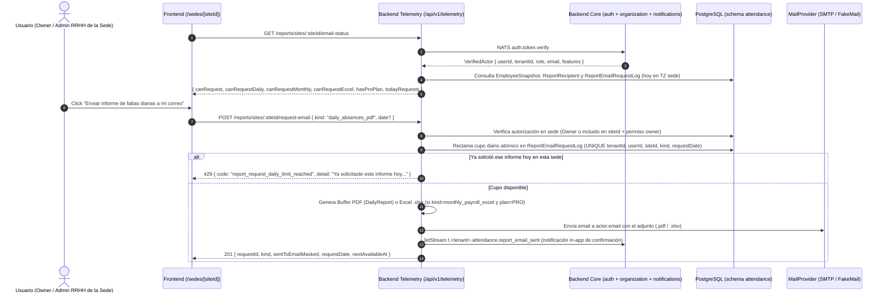

# Plan de Implementación — Solicitud y Envío por Correo de Informes por Sede (Diario de Faltas, Mensual y Excel PRO)

> **Ubicación:** `implementacion_pedido_informes.md` (raíz del repositorio, porque abarca cambios coordinados en `backend/core`, `backend/telemetry` y `frontend`).
>
> **Normativa aplicable:** Este plan respeta estrictamente [`AGENTS.md`](./AGENTS.md), [`docs/architecture.md`](./docs/architecture.md), [`docs/database.md`](./docs/database.md), [`backend/core/AGENTS.md`](./backend/core/AGENTS.md), [`backend/core/src/auth/AGENTS.md`](./backend/core/src/auth/AGENTS.md), [`backend/core/src/organization/AGENTS.md`](./backend/core/src/organization/AGENTS.md), [`backend/core/src/notifications/AGENTS.md`](./backend/core/src/notifications/AGENTS.md), [`backend/telemetry/AGENTS.md`](./backend/telemetry/AGENTS.md) y las skills `teamworkflow-nest`, `teamworkflow-prisma-migrations`, `teamworkflow-postgres`, `teamworkflow-frontend`, `teamworkflow-react`, `teamworkflow-tailwind` y `teamworkflow-typescript`.

---

## 1. Resumen Ejecutivo y Reglas de Negocio

Se integran en el **panel de control de cada sede** (dentro de la pestaña **Sedes y Geocercas**, ruta `/sedes/[siteId]`) botones de acción para que el usuario autorizado solicite el envío a **su propia dirección de correo electrónico** de:

1. **Informe de Faltas Diarias de la Sede (PDF):** trabajadores ausentes en la jornada y fichajes fuera de geocerca/fraudulentos de esa sede. Disponible en planes `basic` y `pro`.
2. **Informe Mensual de Asistencia de la Sede (PDF):** resumen mensual de asistencias, ausencias, tardanzas, horas regulares, horas extras y fichajes fuera de geocerca por trabajador de esa sede. Disponible en planes `basic` y `pro`.
3. **Informe Mensual con Liquidación en Excel (`.xlsx`) de la Sede (Exclusivo Plan `PRO`):** libro Excel de 3 hojas con el cálculo monetario (`Prisma.Decimal`) de paga base y horas extras por puesto. **Restringido exclusivamente a cuentas con el mejor plan del servicio (`PRO`, feature `payroll_reports === true`)**.

### Reglas de Negocio y Seguridad Innegociables

| Regla | Especificación Técnica |
|---|---|
| **1. Destino del correo (cero input del cliente)** | El correo se envía **exclusivamente al email del usuario que presionó el botón** (`actor.userId`). El backend **nunca** acepta un email por `body`, `query` ni `headers`; lo resuelve desde la identidad verificada (`auth.token.verify` / `EmployeeSnapshot`). |
| **2. Límite estricto de 1 pedido por día** | Cada usuario autorizado puede solicitar **como máximo 1 vez al día** (día calendario en la zona horaria IANA de la sede, p. ej. `America/Argentina/Buenos_Aires`) cada tipo de informe (`DAILY_ABSENCES_PDF`, `MONTHLY_ATTENDANCE_PDF`, `MONTHLY_PAYROLL_EXCEL`) por sede (`siteId`). Si intenta pedirlo nuevamente el mismo día, el backend responde **`429 report_request_daily_limit_reached`** con cuerpo `{ detail, code }` y la hora de habilitación del próximo pedido. |
| **3. Control de acceso por Sede y Rol/Permiso** | Solo pueden ver y accionar estos botones en una sede (`siteId`):<br>1. El **`owner`** del tenant (acceso total a todas las sedes).<br>2. Los usuarios del tenant que **estén incluidos/asignados a dicha sede** (`siteId` presente en sus sedes habilitadas `EmployeeSite` / `EmployeeSnapshot.siteIds`) **Y** a quienes el **`owner` les haya otorgado permiso de administrador / receptor de informes** (rol `admin` en esa sede o habilitados explícitamente por el `owner` en `ReportRecipient`, como los trabajadores de RRHH de la sede).<br>Cualquier otro usuario (`supervisor` o `employee` sin permiso de administrador de informes otorgado por el `owner`, o un usuario no incluido en esa sede) recibe **`403 forbidden`** (o `404 site_not_found` si la sede no está en su alcance). `platform_admin` siempre recibe `403 forbidden`. |
| **4. Plan Gating para el Excel Mensual (`PRO`)** | El pedido del Excel mensual (`MONTHLY_PAYROLL_EXCEL`) exige `features.payroll_reports === true` (`@RequireFeature('payroll_reports')`). Un tenant en plan `basic` puede pedir por mail el PDF de faltas diarias y el PDF mensual de asistencia, pero si solicita el Excel mensual recibe **`403 feature_not_in_plan`** (y en la UI de la sede la opción Excel muestra el badge `PRO` bloqueado). |
| **5. Ubicación en la Interfaz** | Dentro de la pestaña **Sedes y Geocercas** (`/sedes`), en el **panel de control de cada sede** (`/sedes/[siteId]` -> `SiteDetailView.tsx`), mediante el nuevo bloque `SiteReportEmailCard.tsx`. |
| **6. Aislamiento de Base de Datos y Schemas** | `telemetry` (`attendance_svc`) no lee tablas de `auth` ni de `organization`. Los datos necesarios (`email` del actor, `siteIds` del empleado) viajan por el contrato verificado de NATS / JetStream hacia `EmployeeSnapshot` y `VerifiedActor`. |

---

## 2. Arquitectura de la Solución



---

## 3. Diagnóstico del Estado Actual y Brechas a Cubrir

1. **Identidad y Email del Usuario que presiona el botón:**
   - Hoy `auth.token.verify` (`backend/core/src/auth/auth.service.ts`) selecciona `id, tenantId, role, isActive, siteIds, tenant` de la tabla `auth.users`, pero **no devuelve `email`** en `VerifiedActor`.
   - Agregando `email: true` en el `select` de `AuthService.verify()` y en la interfaz `VerifiedActor` (tanto en `core` como en `telemetry`), cada request autenticado en `telemetry` conoce de inmediato y de forma 100% confiable el `email` exacto del usuario que apretó el botón, sin consultas extra ni exponer datos en el JWT.
2. **Validación de Pertenencia a la Sede (`siteId`) y Permiso de Administrador/RRHH otorgado por el `owner`:**
   - En `backend/core/src/organization/`, cada empleado tiene `sites: EmployeeSite[]` (`siteIds` habilitados para trabajar o administrar en esa sede).
   - Sin embargo, `toTelemetryEmployeeCatalog` (`backend/core/src/organization/responders/telemetry-wire.ts`) y los eventos `employee_created` / `employee_updated` aún no incluyen `siteIds: string[]`, y `EmployeeSnapshot` en `backend/telemetry/src/prisma/schema.prisma` no tiene la columna `siteIds String[]`.
   - Asimismo, `ReportRecipient` en `telemetry` (`report_recipients`) permite al `owner` habilitar usuarios (`receiveDaily`, `receiveMonthly`, `receivePayrollExcel`). Agregando `siteIds String[] @default([]) @map("site_ids")` en `EmployeeSnapshot` (sincronizado desde `organization`) y opcionalmente `siteIds String[] @default([]) @map("site_ids")` en `ReportRecipient` (donde vacío `[]` significa todas las sedes donde el trabajador esté incluido, o una lista explícita de sedes administradas), podemos validar con precisión matemática que el solicitante:
     - O bien es el **`owner`** del tenant.
     - O bien es un usuario **incluido en dicha sede (`siteId`)** a quien el **`owner` le dio permiso de administrador / receptor de informes** (en `ReportRecipient` o con rol `admin` asignado a esa sede).
3. **Control de Rate Limit de 1 Pedido por Día (`ReportEmailRequestLog`):**
   - `@nestjs/throttler` usa memoria efímera que se pierde al reiniciar el proceso y no distingue por `(sede, tipo de informe, día calendario en timezone de la sede)`.
   - Se requiere un modelo persistente `ReportEmailRequestLog` en `backend/telemetry/src/prisma/schema.prisma` con restricción única `@@unique([tenantId, userId, siteId, reportKind, requestDate])`.
4. **Proveedor de Correo (`MailProvider`) en `telemetry`:**
   - Siguiendo las reglas del proyecto (`skills/teamworkflow-nest`: *"NEVER import a package that is not installed... ask the user before `pnpm add`"* y el patrón `FcmProvider` de `notifications` / `PaymentProvider` de `billing`), el envío de correo se abstrae detrás de `MailProvider`:
     - `FakeMailProviderService` (`MAIL_ENABLED=false`, por defecto en dev/test): no requiere dependencias externas, valida el adjunto PDF/Excel en memoria y registra el envío de forma determinística para tests unitarios y E2E.
     - `SmtpMailProviderService` (`MAIL_ENABLED=true`): envía el correo con el adjunto `.pdf` o `.xlsx` usando `nodemailer` (previa confirmación del usuario antes de ejecutar `pnpm add nodemailer` y `pnpm add -D @types/nodemailer` en `backend/telemetry/`) o `fetch` nativo de Node 24 contra una API HTTP transaccional (Resend/SendGrid) sin instalar paquetes adicionales.

---

## 4. Fases y Pasos Detallados de Implementación

### Reglas de Git y Commits (`teamworkflow-commits`)

> - **Rama de trabajo:** Crear o trabajar sobre una rama feature desde la rama de trabajo actual (p. ej. `feat/site-report-email-requests`), **NUNCA desde `main` o `master`**.
> - **Tamaño de commits:** Máximo **3 archivos por commit**; archivos grandes (>200 líneas modificadas o >300 líneas nuevas) en un commit individual.
> - **Formato:** Conventional Commits (`feat(telemetry): ...`, `feat(auth): ...`, `feat(organization): ...`, `feat(frontend): ...`, `test(telemetry): ...`, `docs(architecture): ...`).
> - **Seguridad:** Prohibido `git add .`, prohibido `Co-Authored-By` o menciones a IA, prohibido commitear `.env`.

---

### Fase 0 — Contratos, Excepciones y Variables de Entorno

Commits: `b8845e6`, `5dab627`, `338a93f`

- [x] **INF-0.1** Actualizar contratos de arquitectura y módulos:
  - En `backend/core/src/auth/AGENTS.md` y `backend/core/AGENTS.md`: documentar que `auth.token.verify` incluye `email` del usuario activo en su respuesta (`{ userId, tenantId, role, email, siteIds, tenantStatus, plan, features }`).
  - En `backend/core/src/organization/AGENTS.md`: documentar que `TelemetryEmployeeCatalogDto` y los eventos `employee_created` / `employee_updated` incluyen `siteIds: string[]` (sin incluir jamás PII sensible como `nationalId` o `phone`).
  - En `backend/telemetry/AGENTS.md`: documentar las nuevas rutas bajo `/api/v1/telemetry/reports/sites/:siteId/...`, el modelo `ReportEmailRequestLog`, el código de error `429 report_request_daily_limit_reached` y las variables `MAIL_*`.
  - **Check:** Los archivos `AGENTS.md` y `docs/architecture.md` reflejan el contrato actualizado sin contradicciones.

- [x] **INF-0.2** Agregar código de excepción de límite diario en `backend/telemetry/src/common/exceptions/app.exceptions.ts`:
  - Extender `AppErrorCode` con `'report_request_daily_limit_reached'` y `'mail_delivery_failed'`.
  - Crear `ReportRequestDailyLimitReachedException extends AppException`:
    ```typescript
    export class ReportRequestDailyLimitReachedException extends AppException {
      constructor(nextAvailableDate: string) {
        super(
          429,
          'report_request_daily_limit_reached',
          `Solo se puede solicitar este informe una vez al día por sede. Próximo pedido disponible el ${nextAvailableDate}.`,
        );
      }
    }
    ```
  - Crear `MailDeliveryFailedException extends AppException` (`502`, `'mail_delivery_failed'`, `'No se pudo enviar el informe por correo en este momento. Intentá nuevamente.'`).
  - **Check:** `pnpm test src/common/exceptions/app.exceptions.spec.ts` en `backend/telemetry/` pasa al 100%.

- [x] **INF-0.3** Validar variables de entorno de correo en `backend/telemetry/src/config/env.schema.ts`, `envs.ts` y `backend/telemetry/.env.example`:
  - `MAIL_ENABLED`: `joi.boolean().default(false)`
  - `MAIL_FROM`: `joi.string().email().default('no-reply@teamworkflow.local')`
  - `MAIL_PROVIDER`: `joi.string().valid('fake', 'smtp', 'resend').default('fake')`
  - `SMTP_HOST`: `joi.string().optional().allow('')`
  - `SMTP_PORT`: `joi.number().port().default(587)`
  - `SMTP_USER`: `joi.string().optional().allow('')`
  - `SMTP_PASS`: `joi.string().optional().allow('')`
  - `RESEND_API_KEY`: `joi.string().optional().allow('')`
  - Actualizar `backend/telemetry/.env.example` y `backend/.env.example` solo con placeholders (nunca secretos reales).
  - **Check:** `pnpm test src/config/envs.spec.ts` en `backend/telemetry/` pasa.

---

### Fase 1 — Backend `core`: Email en `VerifiedActor` y `siteIds` en `organization`

Commits: `af46f08`, `871a197`

- [x] **INF-1.1** Incluir `email` en `auth.token.verify` (`backend/core/src/auth/`):
  - En `backend/core/src/auth/verified-actor.ts`: agregar `email: string;` a `VerifiedActor`.
  - En `backend/core/src/auth/auth.service.ts` (método `verify`): agregar `email: true` en el `select` de `this.prisma.user.findUnique` y devolver `email: user.email` en el objeto `VerifiedActor`.
  - Actualizar `backend/core/src/auth/auth.service.verify.spec.ts` y `auth-token.responder.spec.ts`.
  - **Check:** `pnpm test src/auth/` en `backend/core/` pasa todas las suites sin errores.

- [x] **INF-1.2** Incluir `siteIds` del empleado en eventos y responder de `organization` (`backend/core/src/organization/`):
  - En `backend/core/src/organization/responders/telemetry-wire.ts`:
    - Agregar `siteIds: string[];` a `TelemetryEmployeeCatalogDto` y `TelemetryEmployeeDto`.
    - En `toTelemetryEmployeeCatalog(employee)` y `toTelemetryEmployee(employee, userId)`: mapear `siteIds: employee.siteIds ?? []`.
  - En `backend/core/src/organization/employees/employees.service.ts`:
    - Al emitir `ORGANIZATION_EVENTS.employeeCreated` y `ORGANIZATION_EVENTS.employeeUpdated`, incluir `siteIds: row.sites.map((s) => s.siteId)` en el payload del evento.
  - Actualizar `organization.responder.spec.ts` y `employees.service.spec.ts`.
  - **Check:** `pnpm test src/organization/` y `pnpm lint` en `backend/core/` pasan sin errores.

---

### Fase 2 — Backend `telemetry`: Modelo Prisma (`ReportEmailRequestLog` + `siteIds`) y Migración

Commits: `51e9d13`, `f62e9ab`, `5d705d0`

- [x] **INF-2.1** Actualizar `backend/telemetry/src/prisma/schema.prisma` (`teamworkflow-prisma-migrations` y `teamworkflow-postgres`):
  - En `EmployeeSnapshot`: agregar `siteIds String[] @default([]) @map("site_ids")`.
  - En `ReportRecipient`: agregar `siteIds String[] @default([]) @map("site_ids")` (lista opcional de sedes donde el `owner` le habilita permiso de administrador de informes; si está vacía `[]`, aplica a las sedes en las que el trabajador esté incluido en `EmployeeSnapshot.siteIds`).
  - Agregar enum `ReportEmailKind` y modelo `ReportEmailRequestLog`:
    ```prisma
    enum ReportEmailKind {
      DAILY_ABSENCES_PDF
      MONTHLY_ATTENDANCE_PDF
      MONTHLY_PAYROLL_EXCEL

      @@map("report_email_kind")
    }

    enum ReportEmailStatus {
      PENDING
      SENT
      FAILED

      @@map("report_email_status")
    }

    // Registro y control de límite diario (1 vez al día por usuario, sede y tipo de informe).
    model ReportEmailRequestLog {
      id             String            @id @default(uuid(7)) @db.Uuid
      tenantId       String            @map("tenant_id") @db.Uuid
      siteId         String            @map("site_id") @db.Uuid
      userId         String            @map("user_id") @db.Uuid
      recipientEmail String            @map("recipient_email")
      reportKind     ReportEmailKind   @map("report_kind")
      requestDate    String            @map("request_date") // YYYY-MM-DD en la timezone de la sede
      targetPeriod   String            @map("target_period") // YYYY-MM-DD para diario, YYYY-MM para mensual
      status         ReportEmailStatus @default(PENDING)
      requestedAt    DateTime          @default(now()) @map("requested_at") @db.Timestamptz(6)
      sentAt         DateTime?         @map("sent_at") @db.Timestamptz(6)

      // Garantiza como máximo 1 solicitud exitosa/en curso por día, sede, usuario y tipo de informe
      @@unique([tenantId, userId, siteId, reportKind, requestDate], map: "uq_report_email_req_daily_limit")
      @@index([tenantId, siteId, requestDate], map: "idx_report_email_req_tenant_site_date")
      @@map("report_email_request_logs")
    }
    ```
  - Generar y revisar la migración SQL en `backend/telemetry/src/prisma/migrations/<timestamp>_add_report_email_request_logs/migration.sql` y ejecutar `pnpm prisma:attendance:generate`.
  - Actualizar `BillingConsumer.handleDataRetentionExpired` (`backend/telemetry/src/consumers/handlers/billing.handler.ts`) para purgar `reportEmailRequestLog.deleteMany({ where: { tenantId } })`.
  - **Check:** `pnpm exec prisma validate --config prisma.attendance.config.ts` y `pnpm prisma:attendance:generate` pasan sin errores.

- [x] **INF-2.2** Sincronizar `siteIds` en `OrgSnapshotsService` y `OrganizationConsumer` (`backend/telemetry/`):
  - En `backend/telemetry/src/nats/dto/nats-contracts.ts`: agregar `email?: string;` a `VerifiedActor` y `siteIds?: string[];` a `EmployeeDto` y `EmployeeCatalogDto`.
  - En `backend/telemetry/src/snapshots/org-snapshots.service.ts` y `backend/telemetry/src/consumers/handlers/organization.handler.ts`: persistir `siteIds` al hacer upsert de `EmployeeSnapshot`.
  - **Check:** `pnpm test src/consumers/handlers/organization.handler.spec.ts` pasa.

---

### Fase 3 — Backend `telemetry`: Reglas de Autorización por Sede, Límite Diario y Envío de Email

Commits: `5d705d0`, `444aa72`, `7da069b`, `6693835`, `a85941b`

- [x] **INF-3.1** Ampliar `ReportRecipientsService` (`backend/telemetry/src/reports/report-recipients.service.ts`) para validar permisos por Sede (`siteId`):
  - Implementar método `authorizeSiteReportEmailRequest(actor: VerifiedActor, siteId: string, kind: 'daily' | 'monthly' | 'payroll_excel'): Promise<{ recipientEmail: string }>`:
    1. Si `actor.role === 'platform_admin' || !actor.tenantId` -> lanzar `ForbiddenException`.
    2. Verificar que la sede `siteId` exista en `SiteSnapshot` para `actor.tenantId` (previo `ensureTenantCatalogSynced`); si no existe -> lanzar `SiteNotFoundException` (`404 site_not_found`).
    3. Resolver el perfil del usuario en `EmployeeSnapshot` (`where: { tenantId: actor.tenantId, userId: actor.userId }`). Si existe y `!linkedEmployee.isActive` -> lanzar `ForbiddenException`.
    4. Resolver `recipientEmail = actor.email`: si no viene en `actor.email`, lanzar `ForbiddenException('No verified email address available for current user')`.
    5. **Si `actor.role === 'owner'`:** acceso permitido a cualquier sede del tenant. Devuelve `{ recipientEmail }`.
    6. **Si no es `owner` (usuarios incluidos en la sede con permiso de administrador dado por el `owner`, como RRHH de la sede):**
       - Buscar fila en `ReportRecipient` para `(actor.tenantId, actor.userId)`.
       - Verificar que el usuario esté **incluido en dicha sede `siteId`**:
         - `const inEmployeeSites = linkedEmployee?.siteIds.includes(siteId) ?? false;`
         - `const inRecipientSites = recipient?.siteIds.includes(siteId) ?? false;`
         - Debe cumplirse `inEmployeeSites || inRecipientSites`. Si no está incluido en la sede -> lanzar `ForbiddenException('User is not assigned to this site')`.
       - Verificar que el **`owner` le haya dado permiso de administrador/informes**:
         - Debe existir `recipient` asignado por el `owner` con el flag del informe activo (`kind === 'daily' ? recipient.receiveDaily : kind === 'monthly' ? recipient.receiveMonthly : recipient.receivePayrollExcel`).
         - *(Nota de diseño: si un usuario con rol `admin` está incluido en `linkedEmployee.siteIds` para esa sede y el `owner` lo habilitó en `ReportRecipient`, o si se habilita que todo `admin` incluido en `EmployeeSite` de esa sede tenga permiso de administrador de la sede, ambos quedan cubiertos de forma explícita y auditable).*
       - Si no tiene el permiso para ese `kind`, lanzar `ForbiddenException`.
  - Implementar método `getSiteEmailRequestCapabilities(actor: VerifiedActor, siteId: string)` que devuelve qué botones puede ver/usar el actor en esa sede sin lanzar error 403 cuando solo consulta el estado del panel.
  - **Check:** Tests unitarios en `report-recipients.service.spec.ts` prueban:
    - `owner` autorizado en todas las sedes.
    - Trabajador de RRHH / `admin` incluido en la sede A y habilitado por el `owner` -> autorizado en sede A, rechazado con `403` en sede B donde no está incluido.
    - Usuario incluido en la sede A pero sin permiso de administrador otorgado por el `owner` -> rechazado con `403`.
    - Usuario desactivado (`isActive: false`) -> rechazado con `403`.

- [x] **INF-3.2** Crear abstracción `MailProvider` en `backend/telemetry/src/reports/mail/`:
  - `mail-provider.interface.ts`:
    ```typescript
    export interface SendReportEmailInput {
      to: string;
      subject: string;
      text: string;
      html: string;
      attachment: {
        filename: string;
        content: Buffer;
        contentType: string;
      };
    }

    export interface MailProvider {
      sendReportEmail(input: SendReportEmailInput): Promise<{ messageId: string }>;
    }
    ```
  - `fake-mail-provider.service.ts`: implementación en memoria cuando `MAIL_ENABLED=false` o `MAIL_PROVIDER='fake'`, que guarda el último envío en una cola inspeccionable por tests (sin loguear nunca el email completo en consola para respetar la regla de no PII en logs).
  - `smtp-mail-provider.service.ts`: implementación real cuando `MAIL_ENABLED=true` (usando transporte SMTP o API HTTP según configuración; **recordatorio:** si se opta por `nodemailer`, pedir confirmación al usuario antes de ejecutar `pnpm add nodemailer`).
  - **Check:** `mail-provider.service.spec.ts` verifica envío con adjunto PDF y Excel `.xlsx` sin filtrar direcciones de correo en logs.

- [x] **INF-3.3** Implementar `SiteReportEmailService` (`backend/telemetry/src/reports/site-report-email.service.ts`):
  - **Método 1: `getSiteEmailRequestStatus(actor: VerifiedActor, siteId: string)`**
    - Verifica que la sede pertenezca al tenant (`404 site_not_found` si no).
    - Calcula `todayInSiteTz = formatDateInTz(now, site.timezone)` y `nextAvailableAt` (inicio del día siguiente `00:00:00` en `site.timezone`).
    -Evalúa permisos del actor para esa sede (`canRequestDaily`, `canRequestMonthly`, `canRequestExcel`) y si el tenant tiene plan `PRO` (`hasProPlan = actor.features?.payroll_reports === true || await this.tenantState.hasFeature(actor.tenantId, 'payroll_reports')`).
    - Consulta en `ReportEmailRequestLog` los pedidos con `status: 'SENT'` (o `'PENDING'`) de hoy (`requestDate === todayInSiteTz`) para `(actor.tenantId, actor.userId, siteId)`.
    - Devuelve:
      ```typescript
      export interface SiteReportEmailStatusResponse {
        siteId: string;
        siteName: string;
        timezone: string;
        currentDateInSiteTz: string;
        nextAvailableAt: string; // ISO-8601 UTC del próximo medianoche en la sede
        hasProPlan: boolean;
        permissions: {
          canAccessPanel: boolean;
          canRequestDaily: boolean;
          canRequestMonthly: boolean;
          canRequestPayrollExcel: boolean;
        };
        requestedToday: {
          dailyAbsencesPdf: { requested: boolean; sentAt: string | null };
          monthlyAttendancePdf: { requested: boolean; sentAt: string | null };
          monthlyPayrollExcel: { requested: boolean; sentAt: string | null };
        };
      }
      ```
  - **Método 2: `requestSiteReportEmail(actor: VerifiedActor, siteId: string, dto: RequestSiteReportEmailDto, now = new Date())`**
    - `dto.kind`: `'daily_absences_pdf' | 'monthly_attendance_pdf' | 'monthly_payroll_excel'`.
    - **Paso A (Plan gating para Excel):** Si `dto.kind === 'monthly_payroll_excel'`, verificar `actor.features?.payroll_reports === true` (o `tenantState.hasFeature(actor.tenantId, 'payroll_reports')`). Si es `false`, lanzar `FeatureNotInPlanException('payroll_reports')` (`403 feature_not_in_plan`).
    - **Paso B (Autorización por sede y rol/permiso):** Llamar a `authorizeSiteReportEmailRequest(actor, siteId, mappedKind)`. Obtiene `{ recipientEmail }`.
    - **Paso C (Fecha calendario en la timezone de la sede):**
      - Obtener `site = await this.prisma.siteSnapshot.findFirst({ where: { tenantId: actor.tenantId, siteId } })`.
      - `requestDate = formatDateInTz(now, site.timezone)` (`YYYY-MM-DD`).
    - **Paso D (Reserva atómica de límite 1 vez al día):**
      - Intentar crear registro en `ReportEmailRequestLog` con `{ tenantId: actor.tenantId, siteId, userId: actor.userId, recipientEmail, reportKind, requestDate, targetPeriod, status: 'PENDING' }`.
      - Si falla por violación de clave única (`P2002`) o ya existe una fila con `status: 'SENT' | 'PENDING'` para hoy -> lanzar `ReportRequestDailyLimitReachedException(nextAvailableDate)` (`429 report_request_daily_limit_reached`).
      - Si existía una fila previa de hoy con `status: 'FAILED'` (porque el servidor SMTP falló antes), permitir actualizarla a `'PENDING'` para reintentar.
    - **Paso E (Generación del archivo acotado a `siteId`):**
      - Si `kind === 'daily_absences_pdf'`: genera el PDF de faltas diarias y fichajes fuera de geocerca de `siteId` (`exportDailyPdf(actor, { date: dto.date ?? requestDate, siteId })`).
      - Si `kind === 'monthly_attendance_pdf'`: genera el PDF mensual de asistencia de `siteId` (`exportMonthlyPdf(actor, { period: dto.period ?? currentPeriod, siteId })`).
      - Si `kind === 'monthly_payroll_excel'`: genera el Excel `.xlsx` de liquidación mensual de `siteId` (`exportMonthlyPayrollExcel(actor, { period: dto.period ?? currentPeriod, siteId })`).
    - **Paso F (Envío del correo y confirmación):**
      - Llamar a `mailProvider.sendReportEmail({ to: recipientEmail, subject, text, html, attachment })`.
      - Si el envío tiene éxito: actualizar `ReportEmailRequestLog` a `status: 'SENT', sentAt: new Date()`, emitir evento opcional `t.<tenant>.attendance.report_email_sent` a `notifications` y devolver `{ requestId, kind: dto.kind, siteId, requestDate, sentAt, sentToEmailMasked: maskEmail(recipientEmail), nextAvailableAt }`.
      - Si el proveedor de correo lanza error: eliminar o marcar `FAILED` la fila de `ReportEmailRequestLog` y lanzar `MailDeliveryFailedException` (así el usuario no pierde su único intento diario por una caída temporal del servidor de correo).
  - **Check:** `site-report-email.service.spec.ts` cubre:
    1. Envío exitoso de informe diario de faltas al email del actor.
    2. Segundo intento el mismo día en la misma sede -> `429 report_request_daily_limit_reached`.
    3. Intento el mismo día pero para otro tipo de informe (ej. ya pidió el diario y ahora pide el mensual) -> permitido (1 vez al día por cada tipo de informe).
    4. Intento al día siguiente en la timezone de la sede -> permitido.
    5. Intento de pedir `monthly_payroll_excel` en un tenant `BASIC` -> `403 feature_not_in_plan`.
    6. Intento de pedir `monthly_payroll_excel` en un tenant `PRO` por `owner` o RRHH autorizado -> `201` con adjunto `.xlsx`.
    7. Intento por un usuario no incluido en la sede o sin permiso del `owner` -> `403 forbidden`.
    8. Si el envío SMTP falla, el cupo diario se libera para que pueda reintentar.

- [x] **INF-3.4** Exponer endpoints en `ReportsController` (`backend/telemetry/src/reports/reports.controller.ts`):
  - `GET /api/v1/telemetry/reports/sites/:siteId/email-status` -> estado de permisos, plan `PRO` y si ya pidió hoy cada informe en esa sede.
  - `POST /api/v1/telemetry/reports/sites/:siteId/request-email` -> solicita el envío por mail del informe (`daily_absences_pdf`, `monthly_attendance_pdf` o `monthly_payroll_excel`).
  - DTOs en `backend/telemetry/src/reports/dto/reports.dto.ts`:
    - `SiteIdParamDto`: `@IsUUID() siteId!: string;`
    - `RequestSiteReportEmailDto`:
      - `@IsIn(['daily_absences_pdf', 'monthly_attendance_pdf', 'monthly_payroll_excel']) kind!: ...;`
      - `@IsOptional() @Matches(/^\d{4}-\d{2}-\d{2}$/) date?: string;`
      - `@IsOptional() @Matches(/^\d{4}-\d{2}$/) period?: string;`
    -*(Ningún campo `email`, `userId` ni `tenantId` en el DTO: `forbidNonWhitelisted: true` rechaza con `422 validation_error` si un cliente intenta inyectar otra dirección de correo).*
  - **Check:** `reports.controller.spec.ts` verifica validación de DTOs (`422` si envían un campo `email` en el body), status `201`, `403` y `429`.

---

### Fase 4 — Frontend: Panel de Solicitud de Informes en cada Sede (`/sedes/[siteId]`)

Commits: `96349bf`, `ff35e7a`, `934f896`, `f676b0c`

- [x] **INF-4.1** Actualizar tipos, cliente HTTP y Mocks en `frontend/features/telemetry/`:
  - En `frontend/features/telemetry/types.ts`:
    - Agregar `SiteReportEmailKind = 'daily_absences_pdf' | 'monthly_attendance_pdf' | 'monthly_payroll_excel'`.
    - Agregar `SiteReportEmailStatusResponse` y `RequestSiteReportEmailResponse`.
    - En `ReportRecipientView` y `UpsertReportRecipientInput`: agregar `siteIds?: string[]` para que el `owner` pueda indicar en qué sede(s) tiene permiso de administrador de informes el trabajador designado (ej. RRHH de la sede).
  - En `frontend/features/telemetry/api.ts`, `http.ts` y `mock.ts`:
    - Agregar `getSiteReportEmailStatus(siteId: string): Promise<SiteReportEmailStatusResponse>`.
    - Agregar `requestSiteReportEmail(siteId: string, input: { kind: SiteReportEmailKind; date?: string; period?: string }): Promise<RequestSiteReportEmailResponse>`.
    - En `mock.ts`: simular en memoria el límite de 1 pedido por día por `(siteId, kind)` para que al hacer click en modo demo (`NEXT_PUBLIC_USE_MOCKS=true`) el botón pase inmediatamente a estado `"Enviado hoy a tu correo · Disponible mañana"`.
  - **Check:** `npx tsc --noEmit` en `frontend/` pasa con 0 errores.

- [x] **INF-4.2** Crear componente `SiteReportEmailCard.tsx` e integrarlo en el panel de control de cada sede (`frontend/features/organization/components/SiteDetailView.tsx`):
  - **Visibilidad del panel:**
    - Consume `useResource(telemetryApi.getSiteReportEmailStatus, siteId)`.
    - Si `status.data?.permissions.canAccessPanel` es `false` (por ejemplo, un supervisor o empleado al que el `owner` no le dio permiso de administrador de informes en esa sede), el panel **no se renderiza**.
    - Si es `true` (`owner` o usuario incluido en la sede con permiso de administrador/RRHH otorgado por el `owner`), se muestra en el panel de control de la sede (`/sedes/[siteId]`, debajo de los KPIs o en la columna lateral junto al QR y puestos de la sede).
  - **Controles dentro del panel de la sede:**
    1. **Bloque "Informe de Faltas Diarias":**
       - Selector opcional de fecha (por defecto hoy en la sede) y botón **"Enviar informe de faltas diarias a mi correo"**.
       - Si `requestedToday.dailyAbsencesPdf.requested === true`: el botón queda deshabilitado con badge `"Ya solicitado hoy"` e indica la hora del envío y que podrá volver a pedirse mañana (1 vez al día).
    2. **Bloque "Informe Mensual de la Sede":**
       - Selector de mes (`YYYY-MM`, por defecto el mes actual).
       - Botón 1: **"Enviar informe mensual (PDF) a mi correo"** (habilitado para planes `BASIC` y `PRO`, sujeto a 1 vez al día).
       - Botón 2: **"Enviar Excel de liquidación mensual (.xlsx) a mi correo"**:
         - Si el tenant tiene el **mejor plan del servicio (`PRO`, `hasProPlan === true`)** y el usuario tiene `canRequestPayrollExcel === true`: botón activo (sujeto a 1 vez al día).
         - Si el tenant está en plan **`BASIC` (`hasProPlan === false`)**: botón deshabilitado con badge **`Exclusivo Plan PRO`** y leyenda explicando que la exportación en Excel al pedir el informe mensual corresponde al plan PRO, con enlace a `/facturacion`.
    3. **Feedback al usuario:**
       - Al presionar cualquiera de los botones, muestra estado de carga (`"Enviando a tu correo..."`), deshabilita el botón al completarse y muestra confirmación con el correo enmascarado (`"Enviado a m***@empresa.com. Podrás volver a solicitarlo mañana."`).
       - Si el backend responde `429 report_request_daily_limit_reached` o `403`, muestra el mensaje en un `<p role="alert">`.
  - **Estética y Design System (`teamworkflow-frontend` / `teamworkflow-tailwind`):**
    - Usar exclusivamente `Card`, `SectionLabel`, `Button`, `Badge` y `TextField` de `@/shared/components/` y tokens semánticos de `app/globals.css` (cero colores hexadecimales hardcoded).
  - **Check:** `pnpm lint` y `npx tsc --noEmit` en `frontend/` pasan sin errores.

- [x] **INF-4.3** Actualizar panel de Destinatarios del `owner` (`frontend/features/telemetry/components/PayrollAndRecipientsPanel.tsx`):
  - En `ReportRecipientsTab` (exclusivo del `owner`), mostrar a qué sede(s) pertenece cada trabajador asignado (p. ej. RRHH de la sede) y permitir filtrar/confirmar las sedes en las que tiene permiso de administrador para pedir los informes diarios, mensuales y el Excel (en plan `PRO`).
  - **Check:** `pnpm build` en `frontend/` compila todas las rutas sin errores.

---

### Fase 5 — Verificación Integral, Tests y Calidad (QA)

- [x] **INF-5.1** Suite de pruebas unitarias e integración en `backend/core` y `backend/telemetry`:
  - `cd backend/core && pnpm lint && pnpm test && pnpm build`
  - `cd backend/telemetry && pnpm lint && pnpm test && pnpm build`
  - Verificar explícitamente con tests:
    - [x] El email se toma únicamente de `actor.email` verificado por `auth.token.verify` (intentar enviar `email` en el body devuelve `422 validation_error`).
    - [x] Límite de **1 vez al día**: primera petición del día devuelve `201`; segunda petición el mismo día para la misma sede, usuario y tipo de informe devuelve `429 report_request_daily_limit_reached`.
    - [x] Permisos por sede: `owner` puede en todas las sedes; usuario incluido en la sede con permiso de administrador dado por el `owner` (RRHH) puede en su sede pero recibe `403 forbidden` en otra sede donde no esté incluido; usuario sin permiso recibe `403 forbidden`.
    - [x] Plan Gating: el botón/endpoint de Excel mensual (`monthly_payroll_excel`) exige plan `PRO` (`403 feature_not_in_plan` en plan `BASIC`), mientras que los PDFs diario y mensual funcionan en `BASIC` y `PRO`.
    - [x] Aislamiento multi-tenant: pedir informe de un `siteId` de otro tenant devuelve `404 site_not_found`.
    - [x] Cero PII en logs: ninguna llamada a `Logger` imprime el email completo del destinatario ni tokens.

- [x] **INF-5.2** Verificación de Frontend:
  - `cd frontend && pnpm lint && npx tsc --noEmit && pnpm build`
  - Verificar en `/sedes/[siteId]` (tanto en modo mock como conectado al backend):
    - Visualización del panel de solicitud de informes por correo en el panel de control de cada sede.
    - Bloqueo instantáneo tras pedirlo 1 vez en el día.
    - Badge y restricción `PRO` en la opción de Excel del informe mensual cuando el plan es `BASIC`.
    - Ocultamiento del panel para roles sin permiso en esa sede.

---

## 5. Resumen de Archivos a Crear / Modificar

| Capa | Archivo | Acción |
|---|---|---|
| **Docs / Contratos** | `backend/core/AGENTS.md`, `backend/core/src/auth/AGENTS.md`, `backend/core/src/organization/AGENTS.md`, `backend/telemetry/AGENTS.md` | Documentar `actor.email`, `employee.siteIds`, rutas `/reports/sites/:siteId/request-email` y error `429` |
| **Backend Core (`auth`)** | `backend/core/src/auth/verified-actor.ts`, `backend/core/src/auth/auth.service.ts`, `auth.service.verify.spec.ts` | Devolver `email` del usuario activo en `auth.token.verify` |
| **Backend Core (`organization`)** | `backend/core/src/organization/responders/telemetry-wire.ts`, `backend/core/src/organization/employees/employees.service.ts` | Incluir `siteIds` en el catálogo y eventos de empleados hacia `telemetry` |
| **Backend Telemetry (Prisma)** | `backend/telemetry/src/prisma/schema.prisma`, nueva migración SQL, `billing.handler.ts` | Agregar `ReportEmailRequestLog` (unique diario), `siteIds` en `EmployeeSnapshot` y `ReportRecipient`, y purga en retención |
| **Backend Telemetry (Config/Errors)** | `backend/telemetry/src/config/env.schema.ts`, `envs.ts`, `.env.example`, `app.exceptions.ts` | Variables `MAIL_*` y excepción `ReportRequestDailyLimitReachedException` (`429`) |
| **Backend Telemetry (Reports)** | `backend/telemetry/src/reports/mail/*`, `site-report-email.service.ts`, `report-recipients.service.ts`, `reports.controller.ts`, `dto/reports.dto.ts` | Lógica de autorización por sede (`owner` + incluidos en la sede con permiso del `owner`), límite 1/día, plan gating `PRO` para Excel y envío al mail del actor |
| **Frontend (`telemetry` + `organization`)** | `frontend/features/telemetry/types.ts`, `api.ts`, `http.ts`, `mock.ts`, `frontend/features/organization/components/SiteReportEmailCard.tsx`, `SiteDetailView.tsx` | Integrar botones de pedido por correo en el panel de control de cada sede (`/sedes/[siteId]`) con estado diario y gating `PRO` para Excel |
