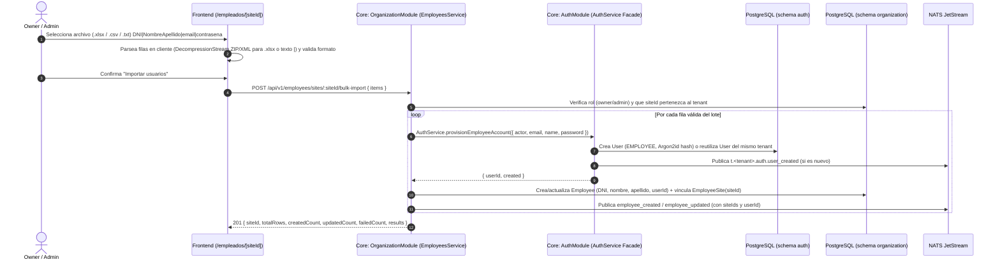

# Plan de Implementación — Rediseño de Pestaña de Empleados por Carpetas de Sedes y Carga Masiva (`rediseno_pestana_empleados.md`)

> **Ubicación:** `rediseno_pestana_empleados.md` (raíz del repositorio, porque coordina cambios en `backend/core` —módulos `auth` y `organization`— y en `frontend`).
>
> **Estado:** `last verified: EMP-5.1 · next: — · in progress: — · blocked: —`
>
> **Normativa aplicable:** Cumple estrictamente [`AGENTS.md`](./AGENTS.md), [`STEPS.rules.md`](./STEPS.rules.md), [`docs/architecture.md`](./docs/architecture.md), [`docs/database.md`](./docs/database.md), [`backend/core/AGENTS.md`](./backend/core/AGENTS.md), [`backend/core/src/auth/AGENTS.md`](./backend/core/src/auth/AGENTS.md), [`backend/core/src/organization/AGENTS.md`](./backend/core/src/organization/AGENTS.md) y las skills `teamworkflow-nest`, `teamworkflow-frontend`, `teamworkflow-nextjs`, `teamworkflow-react`, `teamworkflow-tailwind`, `teamworkflow-typescript` y `teamworkflow-commits`.

---

## 1. Resumen Ejecutivo y Reglas de Negocio

Se actualiza la pestaña **Empleados** (`/empleados`) para adoptar una navegación jerárquica de **carpetas** inspirada en la pestaña **Turnos** (`/turnos`), pero simplificada a **2 niveles exclusivos (`Sedes -> Trabajadores de la Sede`)** e incorporando alta individual contextualizada y carga masiva por archivo Excel/texto estructurado:

1. **Estructura de Carpetas de Sedes (2 niveles):**
   - **Nivel Raíz (`/empleados`):** Muestra **únicamente carpetas de Sedes (`Sites`)**. Cada carpeta exhibe el nombre de la sede, dirección, estado (`Activa`/`Inactiva`), cantidad de trabajadores habilitados en esa sede y cantidad de puestos operativos.
   - **Interior de Carpeta de Sede (`/empleados/[siteId]`):** Lista los **trabajadores asignados/habilitados en esa sede** junto con la **especificación de qué puestos (`Posts`) tiene cada trabajador a su cargo** dentro de dicha sede (derivados de las plantillas semanales activas `ShiftTemplate` y turnos programados/en curso `Shift` no cancelados de la sede), además de su DNI, legajo/correo, habilidades, estado y acción de edición.
2. **Buscador Superior Progresivo (estilo Sedes / Turnos):**
   - **En la página principal (`/empleados`):** Permite filtrar simultáneamente por **Sede** (nombre o dirección), **Nombre y Apellido** del trabajador y **DNI** (`nationalId`) del trabajador. Al escribir nombre o DNI, se filtran las carpetas de sedes que contienen trabajadores coincidentes y se destacan las coincidencias en cada tarjeta.
   - **Dentro de la carpeta de cada sede (`/empleados/[siteId]`):** Permite filtrar a los trabajadores de esa sede por **Nombre y Apellido** y por **DNI**, además de ordenar por **Nombre (`↑/↓`)** y **DNI (`↑/↓`)**.
3. **Acciones dentro de la Carpeta de cada Sede (`/empleados/[siteId]`):**
   - **Botón `"Nuevo empleado"`:** Abre el formulario de alta (`EmployeeFormModal`) con la sede actual (`siteId`) preseleccionada automáticamente.
   - **Botón `"Cargar Excel de usuarios"`:** Abre un asistente modal (`BulkImportEmployeesModal`) que recibe un archivo estructurado como:
     ```text
     DNI|NombreApellido|email|contrasena
     ```
     Soporta tanto libros Excel reales (`.xlsx`, ya sea con una columna separada por `|` o con 4 columnas `DNI | NombreApellido | email | contrasena`, con o sin fila de encabezado) como archivos `.csv` / `.txt` delimitados por `|`, previsualizando las filas (con la contraseña enmascarada) antes de confirmar la importación.
4. **Provisionamiento Integral (`auth` + `organization`) sin Romper Fronteras de Módulo:**
   - Al importar usuarios en una sede (`POST /api/v1/employees/sites/:siteId/bulk-import`, exclusivo para `owner` y `admin`), `organization` invoca únicamente la **fachada pública** `AuthService.provisionEmployeeAccount(...)` para crear (o vincular si ya existe en el mismo tenant) la cuenta `User` con rol `EMPLOYEE` y hash Argon2id de la contraseña, y registra/actualiza el perfil `Employee` en `organization` habilitado en `siteId` con su `nationalId`, `firstName`, `lastName` y `userId`, emitiendo los eventos de dominio correspondientes en NATS JetStream.

---

## 2. Arquitectura y Flujo de Importación Masiva



---

## 3. Reglas de Git y Calidad para este Proceso

- **Rama dedicada:** `feat/employees-site-folders-and-bulk-import` (creada desde la rama de trabajo actual, nunca desde `main`/`master`).
- **Commits recurrentes y atómicos (`teamworkflow-commits`):**
  - Máximo **3 archivos modificados por commit**.
  - Cualquier archivo grande (>200 líneas modificadas o >300 líneas nuevas) se commitea en solitario.
  - Formato Conventional Commits (`feat(auth): ...`, `feat(organization): ...`, `feat(frontend): ...`, `test(...): ...`, `docs(...): ...`), sin `Co-Authored-By` ni menciones a IA, y usando siempre `git add <archivo>` explícito.
- **Seguridad y Privacidad:**
  - Las contraseñas (`contrasena`) se validan (`8..128` caracteres), se hashean con Argon2id fuera de transacciones DB y **jamás** se registran en logs, eventos NATS ni respuestas HTTP.
  - `nationalId` (DNI) respeta la política existente (`canSeeNationalId`: visible para `owner`/`admin` y el propio empleado; oculto para `supervisor`).
- **Frontend (`teamworkflow-frontend` + `teamworkflow-react`):**
  - Cero paquetes externos nuevos sin permiso: el lector `.xlsx` utiliza `DecompressionStream('deflate-raw')` nativo del navegador sobre el contenedor ZIP/XML de OpenXML.
  - Prohibido usar `useMemo`, `useCallback` o `React.memo` (React 19 Compiler activo).
  - Uso exclusivo de tokens semánticos de `app/globals.css` y componentes de `@/shared/components`.

---

## 4. Fases y Pasos Detallados

### Fase 1 — Backend `auth`: Fachada de Provisionamiento de Cuentas de Empleados (`e8eead4`)

- [x] **EMP-1.1** Agregar método interno de fachada `provisionEmployeeAccount` en `AuthService` (`backend/core/src/auth/auth.service.ts`) y documentarlo en `backend/core/src/auth/AGENTS.md`:
  - Recibe `{ actor, email, name, password }`.
  - Valida que `actor.tenantId` exista y `actor.role === 'owner' || actor.role === 'admin'` (de lo contrario lanza `ForbiddenException`).
  - Normaliza `email` (`normalizeEmail`), verifica si ya existe un `User` con ese correo:
    - Si pertenece a **otro tenant** (`existing.tenantId !== actor.tenantId`) -> lanza `EmailTakenException` (`409 email_taken`).
    - Si ya pertenece al **mismo tenant** -> verifica que el tenant no esté eliminado y devuelve `{ userId: existing.id, created: false }` para que `organization` pueda vincular/habilitar al trabajador en la nueva sede sin fallar.
  - Si no existe: calcula `hashPassword(password)` con Argon2id antes de abrir transacción, revoca invitaciones pendientes para `(tenantId, email)`, crea el `User` con `role: 'EMPLOYEE'` e `isActive: true`, y tras confirmar la transacción publica `AUTH_EVENTS.userCreated` (sin incluir jamás contraseña ni hash).
  - **Check:** `cd backend/core && pnpm test src/auth/auth.service.provision.spec.ts && pnpm lint` pasan sin errores.

---

### Fase 2 — Backend `organization`: Endpoint y Servicio de Carga Masiva por Sede (`f420ec4`, `aeaa058`, `97e02b0`, `1024b8a`, `c12ed0c`)

- [x] **EMP-2.1** Definir DTOs de importación masiva en `backend/core/src/organization/employees/dto/employee.dto.ts` y conectar `AuthModule` en `OrganizationModule`:
  - `EmployeeSiteParamDto`: `@IsUUID() siteId!: string`.
  - `BulkImportEmployeeItemDto`:
    - `nationalId`: `@Transform(trim) @IsString() @IsNotEmpty() @MaxLength(40)`
    - `fullName`: `@Transform(trim) @IsString() @IsNotEmpty() @MaxLength(200)`
    - `email`: `@Transform(normalize) @IsEmail() @MaxLength(254)`
    - `password`: `@IsString() @MinLength(8) @MaxLength(128)`
  - `BulkImportEmployeesBodyDto`: `@IsArray() @ArrayMinSize(1) @ArrayMaxSize(200) @ValidateNested({ each: true }) @Type(() => BulkImportEmployeeItemDto) items!: BulkImportEmployeeItemDto[]`.
  - Importar `AuthModule` en `backend/core/src/organization/organization.module.ts` (inyectando únicamente la fachada `AuthService`).
  - **Check:** `cd backend/core && pnpm lint` pasa sin dependencias circulares.

- [x] **EMP-2.2** Implementar `EmployeesService.bulkImportForSite`, exponerlo en `OrganizationService` y en `EmployeesController` (`POST /api/v1/employees/sites/:siteId/bulk-import`), y documentar la ruta en `backend/core/AGENTS.md` y `backend/core/src/organization/AGENTS.md`:
  - Verifica `requireEmployeeManager(actor)` (`owner` / `admin`) y que `siteId` exista en el tenant (`requireTenantSites(manager.tenantId, [siteId])`).
  - Separa `NombreApellido` de forma inteligente (`splitFullName`):
    - Si tiene espacios (`"Juan Carlos Perez"` -> `firstName: "Juan"`, `lastName: "Carlos Perez"`).
    - Si viene en `PascalCase` sin espacios como en el ejemplo `NombreApellido` (`"JuanPerez"` -> `firstName: "Juan"`, `lastName: "Perez"`).
    - Si es una sola palabra (`"Juan"` -> `firstName: "Juan"`, `lastName: "-"`).
  - Por cada fila:
    - Invoca `authService.provisionEmployeeAccount(...)`.
    - Crea el `Employee` habilitado en `siteId` (o, si el empleado ya existía en el tenant por email, actualiza `userId`/`nationalId` si faltaban y asegura el vínculo `EmployeeSite` con `siteId` sin borrar sus otras sedes).
    - Publica `employee_created` (si fue alta nueva) y `employee_updated` (con `userId` y `siteIds`) tras confirmar en BD.
    - Captura errores por fila (`EmailTakenException`, DNI/email duplicado en otro registro, etc.) devolviendo `{ status: 'failed', code, detail }` en `results[]` para no abortar las demás filas válidas del archivo.
  - **Check:** `cd backend/core && pnpm test src/organization/employees/ && pnpm lint && pnpm build` pasan al 100%.

---

### Fase 3 — Frontend: Contrato HTTP, Mocks y Parser Cliente de Archivos Excel / Pipe (`b75e682`, `a4224ab`, `e833fbd`)

- [x] **EMP-3.1** Extender `types.ts`, `api.ts`, `http.ts` y `mock.ts` en `frontend/features/organization/`:
  - Agregar tipos `BulkImportEmployeeItem`, `BulkImportEmployeesInput`, `BulkImportEmployeeRowResult` y `BulkImportEmployeesResponse`.
  - Implementar `bulkImportEmployees(siteId, input)` en `organizationHttpApi` (`POST /employees/sites/${siteId}/bulk-import`) y en `organizationMockApi` (además de habilitar `createEmployee` y `updateEmployee` en memoria en `mock.ts` para soporte completo en modo demo).
  - **Check:** `cd frontend && pnpm exec tsc --noEmit` pasa sin errores.

- [x] **EMP-3.2** Crear parser `frontend/features/organization/employees-import-parser.ts` (con utilidades de filtrado de empleados por Sede, Nombre/Apellido y DNI):
  - Soporta archivos **`.xlsx`** (extrayendo `xl/sharedStrings.xml` y `xl/worksheets/sheet1.xml` mediante `DecompressionStream('deflate-raw')` nativo sin librerías externas) y archivos de texto **`.csv` / `.txt`**.
  - Acepta tanto filas con una celda pipe-delimited (`DNI|NombreApellido|email|contrasena`) como hojas Excel de 4 columnas (`DNI`, `NombreApellido`, `email`, `contrasena`), ignorando filas vacías y encabezados opcionales (`DNI|NombreApellido|email|contrasena`).
  - Valida cada fila en cliente (DNI presente, nombre presente, formato de email válido, contraseña de 8 a 128 caracteres, detección de emails duplicados dentro del mismo archivo) antes de enviarla al backend.
  - **Check:** `cd frontend && pnpm exec tsc --noEmit && pnpm lint` pasan sin errores.

---

### Fase 4 — Frontend: Carpetas de Sedes en `/empleados`, Vista Interior `/empleados/[siteId]` y Modales (`4b13b61`, `4adf2e3`, `198985d`, `10b3674`)

- [x] **EMP-4.1** Actualizar `EmployeeFormModal.tsx` y crear `BulkImportEmployeesModal.tsx`:
  - `EmployeeFormModal`: acepta `defaultSiteId?: string` para que al abrir `"Nuevo empleado"` dentro de `/empleados/[siteId]` esa sede aparezca marcada por defecto.
  - `BulkImportEmployeesModal`: modal para `"Cargar Excel de usuarios"` en la sede actual; muestra instrucciones claras del formato `DNI|NombreApellido|email|contrasena`, botón de descarga de plantilla de ejemplo, previsualización de filas detectadas (contraseña enmascarada `••••••••`), errores de validación por fila y resumen final tras importar (`creados`, `actualizados`, `fallidos`).
  - **Check:** `cd frontend && pnpm exec tsc --noEmit && pnpm lint` pasan sin errores.

- [x] **EMP-4.2** Crear buscador progresivo y migas de pan de empleados (`EmployeeSearchBar.tsx` y `EmployeeFolderBreadcrumbs.tsx`) + vista raíz de carpetas de sedes (`EmployeesRootView.tsx`):
  - En `/empleados`:
    - Buscador superior con los **3 filtros requeridos**: **Sede**, **Nombre y apellido** y **DNI**.
    - Grilla exclusiva de **Carpetas de Sedes** (sin subcarpetas de puestos), mostrando cantidad de trabajadores en la sede, cantidad de puestos activos, coincidencias rápidas al buscar por trabajador/DNI y botón `"Abrir carpeta"` hacia `/empleados/[siteId]`.
  - **Check:** `cd frontend && pnpm exec tsc --noEmit && pnpm lint` pasan sin errores.

- [x] **EMP-4.3** Crear vista interior de carpeta de sede (`SiteEmployeesFolderView.tsx`) y conectar rutas App Router (`/empleados/page.tsx`, `/empleados/[siteId]/page.tsx` e `index.ts`):
  - En `/empleados/[siteId]`:
    - Migas de pan `Empleados (Sedes) / <Nombre de la Sede>` y botón de retorno a `/empleados`.
    - Botones de acción en cabecera (protegidos con `<Can capability="employees.manage">`): **`Cargar Excel de usuarios`** y **`Nuevo empleado`**.
    - Buscador superior acotado a la sede (**Nombre y apellido** y **DNI**) + ordenamiento por **Trabajador (`↑/↓`)** y **DNI (`↑/↓`)**.
    - Tabla de trabajadores de la sede con la columna **"Puestos a su cargo"**, que cruza `ShiftTemplate` activas y `Shift` vigentes de esa sede con el catálogo de `Post`s de la sede para listar mediante `Badge`s todos los puestos que cada trabajador tiene asignados (o `"Sin puestos asignados"`).
  - **Check:** `cd frontend && pnpm exec tsc --noEmit && pnpm lint && pnpm build` pasan sin errores.

---

### Fase 5 — Verificación Integral y Cierre Documental

- [x] **EMP-5.1** Ejecutar validaciones completas en `backend/core` y `frontend`, verificar historial de commits (`≤ 3` archivos por commit, sin archivos sin trackear ni `Co-Authored-By`) y marcar todos los pasos verificados en `rediseno_pestana_empleados.md`:
  - `cd backend/core && pnpm lint && pnpm test && pnpm build`
  - `cd frontend && pnpm exec tsc --noEmit && pnpm lint && pnpm build`
  - **Check:** Todos los comandos finalizan con código `0` y `git status --short` queda limpio.

---

## 5. Mapa de Archivos del Cambio

| Capa | Archivo | Propósito |
|---|---|---|
| **Documentación** | `rediseno_pestana_empleados.md`, `backend/core/AGENTS.md`, `backend/core/src/auth/AGENTS.md`, `backend/core/src/organization/AGENTS.md` | Plan paso a paso y actualización de contratos y mapa de rutas |
| **Backend (`auth`)** | `backend/core/src/auth/auth.service.ts`, `backend/core/src/auth/auth.service.provision.spec.ts` | Fachada `provisionEmployeeAccount` con Argon2id y emisión de `user_created` |
| **Backend (`organization`)** | `backend/core/src/organization/organization.module.ts`, `organization.service.ts`, `employees/dto/employee.dto.ts`, `employees/employees.service.ts`, `employees/employees.controller.ts`, `employees/employees.service.spec.ts` | Endpoint `POST /api/v1/employees/sites/:siteId/bulk-import`, partición de `NombreApellido`, vinculación a sede y tests |
| **Frontend (Datos & Parser)** | `frontend/features/organization/types.ts`, `api.ts`, `http.ts`, `mock.ts`, `employees-import-parser.ts` | Cliente HTTP/Mock de carga masiva y lector `.xlsx`/`.csv`/`.txt` para `DNI\|NombreApellido\|email\|contrasena` |
| **Frontend (UI & Rutas)** | `frontend/features/organization/components/EmployeeSearchBar.tsx`, `EmployeeFolderBreadcrumbs.tsx`, `EmployeesRootView.tsx`, `SiteEmployeesFolderView.tsx`, `BulkImportEmployeesModal.tsx`, `EmployeeFormModal.tsx`, `frontend/app/(dashboard)/empleados/page.tsx`, `frontend/app/(dashboard)/empleados/[siteId]/page.tsx` | Carpetas por sede, detalle de trabajadores con puestos a su cargo, buscador por sede/nombre/DNI y carga de Excel |
